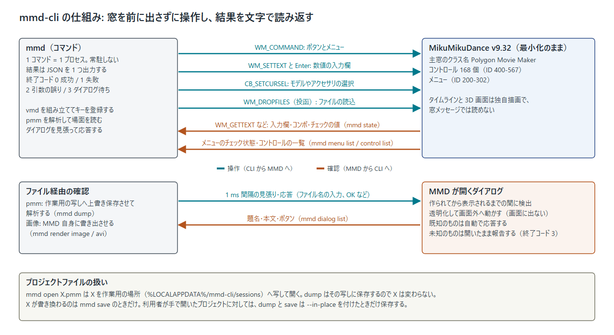
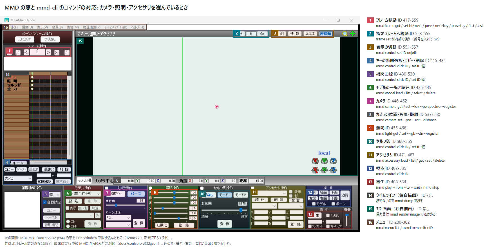
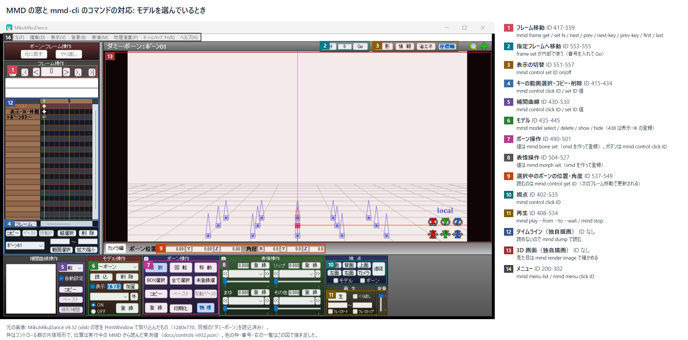

# mmd-cli

MikuMikuDance（MMD）を、窓を前に出さずにコマンドラインから操作する道具。
同じ PC で人が別の作業をしている間に、エージェント（Claude など）やスクリプトが裏で MMD を動かすために作った。

- MMD は最小化のまま動かす。前面に出さず、入力の焦点も奪わない。
- 操作の途中で MMD が開くダイアログは、画面に出る前に隠して自動で応答する。
- 結果は JSON で返る。画面の取り込み（スクリーンショット）を見なくても、何が起きたかを確かめられる。
- 見た目を確かめたいときは、MMD 自身に画像ファイルを書き出させる。

対象は MikuMikuDance v9.32（x64、日本語表示）と Windows。Python 3.9 以上、標準ライブラリのみ。
MMD 本体・モデル・モーションはこのリポジトリに含まれない。



## 導入

```
git clone https://github.com/kakuteki/mmd-cli.git
cd mmd-cli
python -m pip install --user -e .
mmd --version          # 入らない場合は python -m mmd_cli --version
```

MMD 本体は配布元（VPVP）から入手して、任意の場所に展開しておく。

## 使い方

```
mmd launch --exe C:/tools/MikuMikuDance_v932x64/MikuMikuDance.exe   # 最小化で起動。2 回目以降は --exe を省ける
mmd model load C:/models/miku/miku.pmx
mmd bone set 右腕 --rot 0 0 35 --frame 30      # フレーム 30 に右腕のキーを登録
mmd morph set まばたき 1.0                     # 現在のフレームに表情のキーを登録
mmd camera set --pos 0 12 0 --rot 5 20 0 --distance 28 --register
mmd render image C:/work/shot.png --size 640 360
mmd save C:/work/scene.pmm
mmd quit
```

それぞれのコマンドは JSON を 1 つ出す。上の `bone set` の結果（`--out` で書いたファイルの中身）:

```json
{"ok": true, "bone": "右腕", "frame": 30, "pos": [0.0, 0.0, 0.0], "rot": [0.0, 0.0, 35.0]}
```

`mmd model load` の結果には、MMD が出した「モデル情報」ダイアログの本文（モデルのコメント）と、
自動で応答したダイアログの記録が入る。

```json
{"ok": true, "name": "初音ミク", "index": 0,
 "comment": "PolyMo用モデルデータ：初音ミク ver.1.3\n(物理演算対応モデル)\n...",
 "answered_dialogs": [{"kind": "model_info", "title": "モデル情報", "buttons": ["OK", "キャンセル"], "action": "ok"}]}
```

## ヘッドレスで使う

画面に何も出さずに使うには、`--headless` で起動する。主窓は非表示（タスクバーにも出ない）のまま動き、
ダイアログは従来どおり画面に出ない。`mmd window show` で最小化状態に戻せる。
MMD は AVI の書き出しを始めるときに自分で主窓を表示するが、mmd-cli は各コマンドの間、非表示の主窓を画面外に
置いておき、表示されても画面には出さず、終わったら隠し直す（結果の `answered_dialogs` に `hidden again` と残る）。

```
mmd launch --headless --exe C:/tools/MikuMikuDance_v932x64/MikuMikuDance.exe
mmd model load C:/models/miku/miku.pmx
mmd render image C:/work/shot.png
mmd quit
```

SSH 越し・CI・サービスのように **利用者のデスクトップの外** から呼ばれたときは、`mmd` は自分をタスクスケジューラの
一回限りのタスクとして、ログオン中の利用者のデスクトップセッションの中で走らせ、その結果を返す（結果の JSON に
`"relayed": true` が付く）。窓メッセージはデスクトップセッションを越えて届かず、MMD 自体もデスクトップの無い
セッションでは起動が終わらないためである（v9.32 で実測）。

- 利用者がそのマシンにログオンしていることが必要。モニタは要らない（仮想ディスプレイでも、切断された
  セッションでもよい）。誰もログオンしていなければ、その旨のエラーになる。
- タスクは `pythonw.exe` で走るので、デスクトップにコンソール窓は出ない。タスクは終わると消す。
  電源条件の無い XML 定義で作るので、ノート PC がバッテリー駆動でも始まる（`schtasks /Create` の既定は AC 電源のときだけ）。
- `--no-relay` で止められる。デスクトップの中にいても `--in-user-session` で強制できる。
- 待っている側で Ctrl-C しても、デスクトップ側の子は止めない（書き込みやダイアログの途中で止めると半端な状態が残る）。
  子はそのまま終わり、結果は捨てられる。
- `mmd file info` のようにファイルだけを扱うコマンドは、どこでもそのまま走る。
- 確認済み: 別の機から SSH で入ったセッション 0 から、起動（非表示）・読込・キー登録・書き出し・終了まで
  中継で通り、その間デスクトップの前面の窓は変わらず、MMD の窓は一度も表示されなかった。

## 台本をまとめて流す（batch）

1 コマンド 1 プロセスだと、起動・接続・（中継なら）タスクの登録で 1 回あたり 1〜3 秒かかる。
何十手もある台本は `mmd batch` で 1 プロセスにまとめる。

```
mmd batch script.txt            # 1 行 1 コマンド。'-' なら標準入力
mmd batch script.txt --keep-going   # 失敗した行で止めず最後まで
```

```
# script.txt   コメントと空行は飛ばす。mmd の後ろに書く形で 1 行ずつ
new
model load "C:\models\miku\miku.pmx"
frame set 30
["bone", "set", "右腕", "--rot", "0", "0", "35"]
{"id": "wink", "args": ["morph", "set", "ウィンク", "1.0"]}
render image C:\work\shot.png --size 640 360
```

行はそのまま空白で区切り、二重引用符で囲めば 1 語になる。バックスラッシュはそのまま。引用の心配をしたくなければ
JSON の配列か `{"id": ..., "args": [...]}` で書く。`--pid` などの共通オプションは `mmd batch` 側に付ける。

結果は `{"ok", "ran", "failed", "exit_code", "results": [...]}` で、`results` の各要素が行ごとの結果（行番号・引数・
その行の JSON、応答したダイアログ）。既定では失敗した行で止まり、終了コードはその行のもの（1 失敗 / 2 引数の誤り /
3 ダイアログ待ち）。`launch` を台本に入れれば、起動したインスタンスを続く行がそのまま使う。

## 状態の確かめ方

| 知りたいこと | コマンド | 仕組み |
| --- | --- | --- |
| 今の様子（モデル一覧・選択・フレーム・再生中か・保留ダイアログ） | `mmd state` | 入力欄やコンボボックスの値を読む |
| 場面の全体（キーフレーム、現在のポーズ、カメラ、照明、アクセサリ、音） | `mmd dump`、キーの一覧まで欲しいときは `mmd dump --keys` | 作業用の pmm に上書き保存させて解析する |
| 1 つのボーン・表情の現在値 | `mmd bone get 名前` / `mmd morph get 名前` | 同上 |
| カメラ・照明の値 | `mmd camera get` / `mmd light get` | 入力欄の値を読む |
| 見た目 | `mmd render image out.png` | MMD の「画像ファイルに出力」 |
| モデルの骨の親子・種類（IK、回転/移動、表示、付与、物理後）と表情の区分（眉・目・口・その他） | `mmd model info [名前]` | MMD は骨の名前しか見せないので、モデルファイル（pmx / pmd）を読む |
| vmd / vpd / pmm / pmx / pmd ファイルの中身 | `mmd file info ファイル` | MMD を使わずに解析する |
| vmd の中のキー（区間を絞って、表示値で） | `mmd motion keys F.vmd [--camera \| --bone 名前 \| --morph 名前 \| --light] [--from A --to B]` | 同上。「モーションファイルの編集」を参照 |

角度は MMD の窓に表示される値と同じ（度）。ボーンの回転は四元数（`--quat X Y Z W`）でも指定できる。

`mmd dump` の例（モデル 1 体、フレーム 30 に右腕と まばたき のキーがある場面）:

```json
{"ok": true, "frame": 30, "last_frame": 30, "view_size": [640, 360], "mode": "model", "selected_model": 0,
 "models": [{"index": 0, "name": "初音ミク", "path": "C:\\tools\\MikuMikuDance_v932x64\\UserFile\\Model\\初音ミク.pmd",
   "visible": true, "bone_count": 122, "morph_count": 16, "last_frame": 30,
   "key_counts": {"bones": 1, "morphs": 1},
   "current": {"bones": {"右腕": {"pos": [0.0, 0.0, 0.0], "rot": [0.0, 0.0, 35.0]}}, "morphs": {"まばたき": 1.0}}}],
 "camera": {"current_is": "editing view",
   "keys": [{"frame": 0, "pos": [0.0, 10.0, 0.0], "rot": [0.0, 0.0, 0.0], "distance": 45.0, "fov": 30, "perspective": true},
            {"frame": 30, "pos": [0.0, 12.0, 0.0], "rot": [5.0, 20.0, 0.0], "distance": 28.0, "fov": 30, "perspective": true}]},
 "light": {"current": {"rgb": [154, 154, 154], "dir": [-0.5, -1.0, 0.5]}},
 "accessories": [], "wave": {"enabled": false, "path": ""}}
```

（一部の項目を省いてある。モデルを選択している間、`camera.current` は MMD の編集用の視点になる。
場面のカメラは `camera.keys` か `mmd camera get` で見る。）

### モデルの骨と表情

`mmd model info` は、読み込み中のモデル（名前・番号、省略なら選択中）のファイルを `dump` の結果から探して読む。
ファイルのパス（.pmx / .pmd）を渡せば、MMD が無くてもそのファイルを読む（`file info` と同じで、中継もしない）。
ファイルのパスを渡せばそのファイルを読む（MMD が動いていなくてよいのは `mmd file info ファイル`。`--brief` で件数と名前だけ）。
pmx 2.0 / 2.1 と pmd 1.0 に対応し、どちらも同じ形で返す。pmd の骨の種別（回転・IK・IK影響下・非表示 など）は pmx の旗に写してある。

```
mmd model info 初音ミク
mmd file info C:/models/初音ミク.pmd --brief
```

```json
{"ok": true, "path": "C:\\tools\\MikuMikuDance_v932x64\\UserFile\\Model\\初音ミク.pmd", "format": "pmd", "version": 1.0,
 "name": "初音ミク", "name_en": "Miku Hatsune", "comment": "PolyMo用モデルデータ：初音ミク ver.1.3\n...", "comment_en": "...",
 "counts": {"vertices": 9036, "faces": 14997, "textures": 1, "materials": 17, "bones": 122, "morphs": 15, "display_frames": 8,
            "rigid_bodies": 45, "joints": 27},
 "bones": [{"index": 0, "name": "センター", "name_en": "center", "parent": null, "layer": 0,
            "flags": {"rotate": true, "translate": true, "visible": true, "enabled": true, "ik": false, "append_rotate": false,
                      "append_translate": false, "fixed_axis": false, "local_axis": false, "physics_after": false, "external_parent": false},
            "append": null, "ik": null},
           {"index": 4, "name": "左目", "name_en": "eye_L", "parent": 3, "layer": 0, "flags": {"rotate": true, "visible": true, "enabled": true, "append_rotate": true, "...": false},
            "append": {"parent": 71, "ratio": 1.0}, "ik": null},
           {"index": 83, "name": "左足ＩＫ", "name_en": "leg IK_L", "parent": null, "layer": 0, "flags": {"rotate": true, "translate": true, "visible": true, "enabled": true, "ik": true, "...": false},
            "append": null, "ik": {"target": 40, "loops": 40, "angle": 0.5, "links": [39, 38]}}],
 "morphs": [{"index": 5, "name": "まばたき", "name_en": "blink", "panel": "eye", "kind": "vertex", "offsets": 147},
            {"index": 9, "name": "あ", "name_en": "a", "panel": "mouth", "kind": "vertex", "offsets": 88}],
 "display_frames": [{"name": "表情", "name_en": null, "special": true, "items": [{"kind": "morph", "index": 9}, {"kind": "morph", "index": 10}]},
                    {"name": "ＩＫ", "name_en": "IK", "special": false, "items": [{"kind": "bone", "index": 80}, {"kind": "bone", "index": 81}]}]}
```

（骨 122 本・表情 15 個・表示枠 8 個のうち数個だけ示した。`index` はファイルの中の番号で、`parent`・`append.parent`・`ik.target`・
`ik.links`・表示枠の `items` はこの番号で指す。pmd では表情の番号が MMD の内部番号と同じになるよう、ファイルの skin 番号をそのまま使う
（0 番の base は一覧に出さない）。`panel` は眉 `eyebrow` / 目 `eye` / 口 `mouth` / その他 `other`。`kind` は pmx の種類
（`group` `vertex` `bone` `uv` `uv1`〜`uv4` `material` `flip` `impulse`）で、pmd は常に `vertex`。IK の `angle` は pmx が
ラジアン、pmd はファイルの値のまま（pmx の 1/4）。`display_frames` は MMD の左の枠一覧で、`special` は Root と 表情。）

## モーションファイルの編集（MMD なし）

配布されたカメラモーションの一部の区間だけ寄せたい、というような直しは、MMD を動かさずに vmd を直接編集する。
`motion keys` で区間のキーを見て、`motion edit` で別名に書き出す。どちらも MMD に接続せず、中継もしない。
数値は MMD の窓に表示される値（距離は正、角度は度）で見せ、受け取る。

```
mmd motion keys camera.vmd                                      # 種類ごとの件数と、最初と最後のフレーム
mmd motion keys camera.vmd --camera --from 0 --to 300           # 区間のカメラのキー（距離・位置・角度・視野角）
mmd motion edit camera.vmd near.vmd --camera --from 0 --to 247 --distance-scale 0.6     # 距離を 0.6 倍にして near.vmd へ
mmd motion edit camera.vmd near.vmd --camera --from 0 --to 247 --distance-clamp 0 60    # または距離を 60 以下に抑える
```

```json
{"ok": true, "path": "C:\\work\\camera.vmd", "range": [0, 300], "model_name": "カメラ・照明", "kind": "camera",
 "target": {"kind": "camera"}, "count": 4,
 "keys": [{"frame": 0, "distance": 500.0, "pos": [0.0, 60.0, 0.0], "rot": [-6.0, 0.0, 0.0], "fov": 30, "perspective": true}, "..."]}
```

`motion edit` の結果には、対象ごとに触ったキーの数と、書いた OUT を読み戻した件数が入る。

```json
{"ok": true, "in": "C:\\work\\camera.vmd", "out": "C:\\work\\near.vmd", "range": [0, 247],
 "order": ["shift", "copy", "values", "interp"], "targets": [{"kind": "camera", "selected": 3, "changed": 3, "touched": 3}],
 "counts": {"bones": 0, "morphs": 0, "cameras": 260, "lights": 0, "shadows": 0, "show_ik": 0}}
```

対象は `--camera` / `--light` / `--bone 名前`（複数可）/ `--all-bones` / `--morph 名前`（複数可）/ `--all-morphs`。`motion keys` は 1 つだけ。
区間 `--from A --to B` は両端を含み、省略すると全体（片方だけはエラー）。ボーンと表情は名前の完全一致で選ぶので、
同じフレームにある別のボーンのキーには触れない。無い名前はエラーにし、近い名前を添える。

| 操作 | 対象 | 内容 |
| --- | --- | --- |
| `--shift N` | 全部 | フレームを N ずらす（負も可。0 未満になるキーがあれば何も変えずにエラー） |
| `--delete` | 全部 | 消す。他の操作とは組み合わせられない |
| `--copy-to F` | 全部 | 区間の先頭が F に来るように複製を足す |
| `--replace` | | `--shift` / `--copy-to` の行き先に既にあるキーを置き換える（付けなければエラー） |
| `--distance-scale K` / `--distance-add D` / `--distance-clamp MIN MAX` | カメラ | 距離を K 倍（K > 0）/ D 足す / MIN〜MAX に収める。表示値の意味で、ファイルが負で持つ符号はそのまま |
| `--pos-add X Y Z` | カメラ・ボーン | 位置に足す |
| `--fov-set F` / `--fov-add F` | カメラ | 視野角（度） |
| `--rot-add X Y Z` | ボーン | 表示値の度。キーの回転の後にボーン自身の軸で回す（単一軸のキーなら角度の足し算と同じ） |
| `--weight-set W` / `--weight-scale K` | 表情 | 重み |
| `--interp X1 Y1 X2 Y2` | カメラ・ボーン | 補間曲線を全チャンネル同じ値に置き換える |

1 回の呼び出しに複数の操作を書ける。適用の順番は固定で、ずらす → 複製 → 値の変更（倍率・設定 → 加算 → 上下限）→ 補間曲線。
値の変更と補間曲線は、区間のキーとその呼び出しで作った複製の両方に効く。IN は変えずに OUT に書く。OUT に既にあるファイル
（IN と同じパスを指定した場合も）は、書き終えるまで `名前.mmdcli-old` に退避する（他の書き出しと同じ規則）。キーの順番は
ファイルのまま（並べ替えない）。

補間曲線は MMD の補間パネルの 2 つの制御点 (X1, Y1)・(X2, Y2) で、各 0〜127。線形は `20 20 107 107`、`64 0 64 127` は
ゆっくり始まってゆっくり止まる S 字。`bone set --interp` と `camera set --register --interp` で登録するキーにも同じ形で指定できる
（省略すれば今までどおり線形）。カメラの登録ボタンには曲線を渡せないので、`camera set --interp` は欄の表示値から 1 キーの
カメラモーションを組んで読ませる方法で登録する。

### ダンスからカメラモーションを作る（`tools/make_camera.py`、MMD なし）

配布のカメラが会場前提で人物が小さいとき、ダンスの vmd から「人物を程よい大きさで捉え、1 ショットに 1 回だけゆっくり動く」
カメラの vmd を作る。音源は使わず、ボーンキーから出した動きの強さ（骨ごとの回転の角度差と位置の移動量を 30 フレーム窓で合計）の
山と谷でショットを切る（1 ショット 6〜16 秒。`--min-shot` / `--max-shot` はフレーム数で、後者は前者の 2 倍以上）。
ショットの型は 正面の寄り（距離 38→32）・引き（32→42）・回り込み（Y ±15 度）・上から（X +10 度、頭の高さから見下ろす。カメラは腰より下に置かない）の 4 つで、
強い区間は少し引き、静かな区間は寄りを多めにし、同じ型は続けず、直前の終点と絵がほとんど変わらない型も選ばない。注視点は
センターの位置を 3 秒の平均で追う（ショット内に 90 フレーム以下の間隔でキー）。距離と角度は 1 ショットで 1 本の S 字、先頭キーは段差の曲線。
全ショットで画面が膝下から頭上までを覆う（報告の `picture`）。視野 30。同じ入力と `--seed` なら同じ出力。

```
python tools/make_camera.py dance.vmd camera.vmd --report shots.json --analysis strength.json [--seed 0]
```

標準出力はショット数・キー数・型の内訳などの 1 行 JSON。`--report` はショットの一覧（開始・終了フレーム、型、距離・高さ・角度の
始点と終点、注視点、強さ）、`--analysis` はフレームごとの強さと閾値・山と谷の区間。出来た vmd は `motion keys --camera` で見られ、
`motion edit` で直せる。

`--handheld S`（既定 0 = 無し）で、人が持つカメラのようなごくゆっくりした揺れを足す: 強さ 1 で表示角 X・Y が最大 0.3 度、
注視点が 0.03、距離が 0.1 だけ、0.13・0.31・0.57 Hz の正弦の和で漂う（揺れではなく漂い。`--seed` で決まる）。
このときカメラは毎フレームにキーを持つ（カットの先頭は段差の曲線のまま）。

### ダンスを滑らかにする（`tools/smooth_motion.py`・`tools/motion_jerk.py`、MMD なし）

トレースしたダンスは直線補間のまばらなキーでできていて、MMD はキーの間を直線で動かし、キーの所で速さが跳ぶ。
`smooth_motion` はキーを全部通る単調な C1 の曲線（Hermite）に描き直して全フレームにキーを焼く。キーの値、止まり（同じ値の
キーが続く所）、作者が曲線を付けた区間はそのままで、キーの値を越えて行き過ぎない。`motion_jerk` は骨ごとの加速度
（フレームごとの 2 階差分）の平均・99 パーセンタイル・最大を出す。

```
python tools/smooth_motion.py dance.vmd smooth.vmd --report r.json        # 曲線に描き直して焼く
python tools/smooth_motion.py dance.vmd smooth.vmd --denoise              # 密なキーの手ぶれも取る（7.5 Hz）
python tools/smooth_motion.py dance.vmd smooth.vmd --denoise --denoise-cap 6 0.05 --straight   # 直線の経路を均す（速さの谷を作らない）
python tools/motion_jerk.py smooth.vmd --bones センター 上半身 右腕 左腕 右ひじ 頭
```

`--denoise [HZ]` は、キーが 1〜2 フレーム間隔で続く所（密なキー）の手ぶれを取る。トレースのキーは MMD の角度欄の 6 度刻みと
位置の 0.3 刻みに乗っていて（0 でない体の角度の 78%、0 も含めると 89%。0 でない位置の 96.5%。指の角度は 3% で乗っていない）、
速い所では 1 フレームごとの速さが 6 度刻みで跳ぶ。焼いた曲線のうち密なキーの前後 2 フレームだけを、躍度（3 階差分）の
罰則つき最小二乗で均す。HZ は半分になる周波数で（0 位相の低域通過）、既定の 7.5 Hz では 1 フレームごとに交互の揺れが 1/9 に、
2 フレーム間隔の交互の揺れが 1/2 になり、4 Hz の拍の動きは 96% 残る。直す所のひとつながりごとに補正の平均と傾きは 0
（まとめてずらさない）。4 フレームに満たないひとつながりは直さない（3 フレームでは平均 0・傾き 0 の補正が (1, −2, 1) の
ジグザグしか無く、なめらかな減速を段にする）。どのフレームも元の曲線から 3 度・位置は各成分 0.05 まで
（`--denoise-cap 度 単位` で変える）、高さは元の最低より下げない。上限を越えるフレームを止めると自由なフレームが 4 に
満たなくなるときは、補正全体を同じ倍率で縮めて収める（1 フレームだけ動く突起を作らない）。止まりとその直前直後のフレーム
（止まりに接する 1 歩は平滑だけと同じ。2〜4 歩離れた所は上限の範囲で変わる）、作者の曲線の区間、密でないキー、床に着いた
（最低の高さの）キーは動かさない。指（名前に「指」）は既定で外す（`--denoise-fingers` で入れる）。
キーを正確には通らない: 動いたフレームはトレースのキーの値を上限の分まで越えうる（既定で回転 200 フレーム・最大 2.99 度、
位置 542 フレーム・最大 0.05。平滑だけは 0）。

ヒビカセ（`dance_arms_open6.vmd`）では加速度の 99 パーセンタイルが 右腕 −23.5%・左腕 −20.6%・右ひじ −16.9%・頭 −16.3%・
上半身 −8.3%・センター −7.3% 下がり（`--denoise-cap 6 0.05` なら 右腕 −28.4%・右ひじ −25.7%。位置の上限は 0.05 のままなので
センターと足の位置は同じ）、
体の速さの揺り返しは平滑だけより少ない（5,480 → 5,403）。取り除いた分のエネルギーは回転で 84%、位置で 81% が 6 Hz より上
（1〜4 Hz は 6% と 7%）。実行は 4〜8 秒。残る大きな値は、1 フレームで 100 度を超える回り（上限の 3 度では取れない）と、
密でない所（センター・上半身・頭）にある。自分の出力（全フレームにキー）にかけると全部を密とみなして疎なキーまで動かすので、
トレースのキーにかける（キーの間隔の 9 割以上が 1 フレームの軌跡があれば結果の JSON の `warnings` に出る）。
実測と判断は `docs/reviews/2026-10-06-batch-h-denoise.md`。

`--straight`（`--denoise` と一緒に使う。既定は切）は、キーを通る曲線を使わず、MMD の直線の経路そのものを全部のキーで
同じ低域通過にかける。曲線は、保持の端と 90 度以上の向きの変化で速さを 0 にし、遅い方の区間の速さに合わせるので、
動きが続いているキーで速さが落ちる（分析 a02: 腕・ひじ・頭・上半身のキーの 59〜72% で前後の平均の半分未満）。直線の経路には
この落ち込みが無く、キーの所の速さの段だけを低域通過がならす。ただし止まり（同じ値のキーの区間）と最初・最後のキーに接する
区間だけは、直線のままだと 1 フレームで止まる・動き出す（平滑化の前のカクカク）ので、止まりに接する 4 フレーム
（`EASE_SPAN`）で直線の速さから 0 へ曲線で下ろす（出るときは 0 から上げる。止まり同士の間が 8 フレーム以下なら区間全体で）。止まり（と直前直後の 1 フレーム）、作者の曲線の区間、最初と最後のキー、最低の高さのキー
（1 つだけの着地も）、最低の高さのキー同士の区間（床に着いた足はトレースどおりにだけ滑る）は動かさない。最低の高さかどうかは
値の完全一致で見る（ヒビカセの床は 0.0 ちょうど。床の高さがわずかにばらつくトレースでは床の区間と見なされず、固定されない）。
どのフレームも焼いた経路から上限（`--denoise-cap`）まで。下ろす所は MMD の直線の経路から、さらにその部分の弧の 4/27 まで
時刻がずれる。手ぶれ除去をかける骨では `--tension` は効かない（指は `--denoise-fingers` が無ければ曲線のままで、そこには効く）。

ヒビカセ（`dance_arms_open6.vmd`、`--denoise --denoise-cap 6 0.05 --straight` → `fix_twist`）で、平滑化の前 / 今の手順
（`--denoise --denoise-cap 6 0.05`）/ `--straight`:

| 指標（a02・a08・査読の定義） | 右手首 | 左手首 | 頭 | センター |
| --- | --- | --- | --- | --- |
| 動いている最中の深い谷（回/秒） | 0.63 / 1.04 / 0.70 | 0.58 / 1.07 / 0.70 | 0.57 / 1.53 / 0.79 | - |
| 3〜6 Hz の割合（%） | 13.1 / 14.8 / 13.8 | 13.9 / 16.3 / 14.8 | 12.1 / 12.0 / 12.7 | - |
| 止まりのうち 1 フレーム以内で止まる割合（%） | 40 / 7 / 6 | 42 / 8 / 9 | 68 / 9 / 9 | 77 / 5 / 8 |
| 止まり（80→20%）の中央値（ms） | 52 / 60 / 59 | 48 / 53 / 53 | 22 / 51 / 45 | 20 / 49 / 46 |
| 1 フレームで止まる / 動き出す（回/分） | 24.3・27.5 / 7.8・10.9 / 6.6・10.4 | 19.9・24.5 / 8.0・10.7 / 5.8・9.5 | 32.8・31.3 / 17.7・20.9 / 20.9・20.7 | 49.3・47.4 / 21.9・28.2 / 27.0・30.6 |

止まりの 2 行は、a08 の出来事を今の手順と比べる相手の版の速さの平均で拾い、同じ出来事を両方で測った値（平滑化の前の列は
平滑化の前と今の手順の組、`--straight` の列は今の手順と `--straight` の組。今の手順の値は組で 1 ポイント・数 ms 違う）。

止まりに接する区間を直線のまま焼いた最初の版（6f21d86）は、深い谷が 0.65・0.61・0.63 まで減ったが、1 フレーム以内で止まる割合が
頭 9 → 28%・センター 5 → 40% に戻っていた（査読 `_spike/out/stage2/review_smooth/REVIEW.md` の指摘 1）。いまの版はその割合を
今の手順並みに戻し（センターの 1 フレームで止まる・動き出す回数は今の手順より 2〜5 回/分多い）、代わりに深い谷が少し増える。
区間全体で下ろすと 1 フレームの止まりはもう少し減る（頭 15.8・17.3、センター 20.2・23.6 回/分）が、深い谷が 0.75・0.79・0.89 に増える。キーの 65% が最大 6 度・0.05 動く（今の手順は 22%）。
実測と判断は `_spike/out/stage2/smooth/NOTES.md`。

### 動画に文字を重ねる（`tools/mv_text.py`、MMD なし）

MMD が書き出した動画に、題名・クレジット・歌詞・サビ頭のカードを重ねる。文字は Pillow で合図（cue）ごとの RGBA の連番 PNG に
描き（合図の箱の大きさだけで、全画面ではない）、ffmpeg の `overlay` で重ねる。ffmpeg の drawtext では作れない字間の開閉・
ワイプ・ずらした写し・やわらかい影が使える。Pillow と ffmpeg / ffprobe が要る（`mmd` 本体の依存は増えない）。

```
python tools/mv_text.py render IN.avi cues.json OUT.mp4 [--work DIR] [--size WxH] [--fps N]
python tools/mv_text.py preview cues.json OUT.png --at 秒 [--over FRAME.png] [--size WxH]
python tools/mv_text.py frames cues.json WORK [--size WxH] [--fps N]
```

- `render`: 動画の大きさと fps を ffprobe で読み（`--size` と `--fps` を両方与えれば読まない）、連番を `WORK`（既定は `OUT.work`）に
  描いて重ね、libx264（crf 18）で書く。音声があれば copy。ffmpeg は OUT の隣に書いて成功したら置き換えるので、失敗しても元の OUT は残る。
- `preview`: その時刻に出ている合図を 1 枚に描く（`--over` で動画の静止画の上に。無ければ palette の舞台色の上に）。設計の確認と報告用。
- `frames`: 連番だけ描いて計画（合図ごとの置き場所・開始フレーム・枚数・連番の経路）を出す。`tools/mv_look.py` のような別の道具は
  同じ計画を関数 `render_sequences(cues, work_dir, size=None, fps=None)` で受け取る（何も印字せず、ffmpeg も走らせない）。

合図ファイル（JSON、時刻は秒）:

```
{"fps": 30, "size": [1280, 720], "palette": "dark",
 "cues": [
  {"id": "title", "start": 1.0, "end": 6.0, "x": "left", "y": "top", "anim": "tracking-in", "layer": "back",
   "lines": [{"text": "HIBIKASE", "style": "logo"}, {"text": "ヒビカセ", "style": "title_jp"},
             {"text": "feat. KAGAMINE RIN", "style": "sub"}]},
  {"id": "credit1", "start": 2.0, "end": 7.0, "x": "left", "y": "bottom", "anim": "rise",
   "text": "Motion えぬた / Model Sour / Music ギガ", "style": "credit"},
  {"id": "hook1", "start": 44.5, "end": 45.3, "x": "center", "y": "middle", "anim": "flash", "text": "HIBIKASE", "style": "hook"},
  {"id": "lyric1", "start": 60.0, "end": 64.0, "x": "left-third", "y": "lower", "anim": "rise", "text": "歌詞の 1 行", "style": "lyric"}
 ]}
```

- 合図ファイルは UTF-8（BOM つきでも読める）。合図は `lines`（行ごとに text と style）か、`text` と `style`（1 行。改行は
  CR・LF・CRLF のどれでも行の区切り）を持つ。`id` は連番のフォルダ名になる（英数字と `_` `-`、64 文字まで）。大文字と小文字だけが
  違う id は、Windows ではフォルダが同じになるので重複として拒む。
- `x`: left / center / right / left-third / right-third（幅の 1/4・3/4 に箱の中心。中央に立つ人物の脇）。`y`: top / middle /
  lower（下 1/3 の中央）/ bottom。余白は左右 64 px・上下 48 px。px はすべて高さ 720 のときの値で、画面の高さに比例する。
- 置き場所が決めるのは「行の箱」の位置。行の箱は文面でなく様式で決まる（logo・sub・hook は欧文の大文字の高さ、title_jp・lyric・
  caption は漢字の高さ、credit はその両方）。だから同じ様式・同じ置き場所なら、文面が違っても基線は同じ行に来る
  （題名を 1 文字ずつ別の合図で出し、ほかの字を全角空白にしておけば、重ねると 1 語と同じ絵になる）。濁点・アクセント・下に出る字の
  墨は箱からはみ出して余白に掛かる。はみ出しが画面の外に出るときだけ、内側へ寄せる。
- `style`: logo（Y1RevForge 150）/ title_jp（Noto Sans JP 900・44）/ sub（Y1Vectura 30・字間 0.25 em・大文字・差し色）/
  credit（Vectura 22 と Noto 400 の 24・dark では文字色の 70 %、light では (120,120,130)）/ lyric（Noto 700・46・差し色の下線・
  やわらかい影）/ hook（Y1Cybanin3000 Glitch 180・差し色・左に 3 px ずらした墨の写し）/ caption（Noto 400・28）。
  行に `size` を書くと大きさを変えられる。
- `anim`: fade / rise（24 px 下から上がって出て、12 px 上へ抜ける）/ tracking-in（字間 0.6 em から詰まる）/ wipe（左から現れる）/
  flash（1・0・1・0.35・1 と点滅して保持、最後は切る。点滅の 1 段は曲のコマ（1/30 秒）で、60 fps の動画では各段を 2 枚続ける）/
  roll（画面の下から上へ通り抜ける）。入りは `enter`（既定 0.6 秒、3 次の
  ease-out）、抜けは `exit`（0.4 秒、ease-in）で、合図ごとに変えられる。enter と exit の合計より短い合図は、両方を同じ比で縮めて
  （どこかのフレームで全部見えるようにして）`warnings` に出す。
- 時刻は最寄りのフレームに合わせる（フレームのちょうど中間は偶数のフレームへ。30 fps の 0.25 秒は 8、0.75 秒は 22）。合図は
  start のフレームから end の 1 つ前のフレームまで。start のフレーム（連番の 0 枚目）は入りの始まりなので、flash 以外では
  まだ何も見えない。start のフレームから見せたいときは `"enter": 0` にする。
- 空白類の文字（TAB・EM SPACE など）は描かず、その書体のふつうの空白の幅だけ送る。全角空白（U+3000）だけは自分の幅（1 em）を保つ。
- `palette`: dark（黒い舞台用。白文字＋琥珀。既定）/ light（白い舞台用。墨の文字）。
- `layer`: front（既定）/ back。この道具は一覧の順に重ねるだけで、人物を別の層として持つ mv_look が back を人物の後ろに置く。
- 欧文は利用者フォルダの Y1 シリーズ（`%LOCALAPPDATA%/Microsoft/Windows/Fonts`）で描く。かな・漢字を持たないので日本語は
  Noto Sans JP（可変。太さは軸で指定）で描き、1 行の中でも字種ごとに書体を切り替える。Y1 が入っていない PC では Noto で代替し、
  Y1 に無い記号（書体によって `/` `!` `?` `(` など）も Noto で描く。どちらも結果の `warnings` に出る。
- 余白の内側に入らない行は入る大きさまで縮めて `warnings` に出す（見出しの書体は幅が広く、8 文字を 150 px で組むと 1228 px になる）。
- 以前の `tools/overlay_text.py` の合図（text / start / end / style / anim / x / y / fontsize の平らな一覧）もそのまま読める
  （title→logo、caption→sub、slide-up・slide-left→rise）。

標準出力は 1 行の ASCII の JSON（`ok`・`out`・`cues`・`frames`・`size`・`fps`・`work`・`warnings`・`ffmpeg`）。終了コードは 0 成功 /
1 ffmpeg の失敗 / 2 引数や合図ファイルの誤り。ただし引数の書式の誤り（必要な引数が無い・知らないオプション・知らないコマンド）は
`mmd` 本体と同じく argparse が扱い、usage を標準エラーに出して終了コード 2 で終わる（標準出力は空）。

### 人物に舞台・光・グローを付ける（`tools/mv_look.py`、MMD なし）

MMD は背景黒化（メニュー 282、`mmd menu set 282 on`）を入れると、`render image` の PNG と `render avi --codec 未圧縮` の AVI を
alpha つき（BGRA。何も描かれていない所は alpha 0）で書く。これを使って、人物の後ろに舞台と光を置き、人物にグローを付ける。
層は Pillow と numpy で作り、合成は ffmpeg の 1 本のグラフで行う（後ろから: 舞台の板 → 光条と玉ボケ → 後ろの文字 → 人物 →
人物だけから作るグロー → フレアの時刻のカメラのパンチと色ずれ → 周辺減光と粒子 → 前の文字 → フレア）。
人物を高い fps で描けば、出力の 1 コマに入る複数の姿勢を平均して本物の動きのぼかし（モーションブラー）にもできる。

```
python tools/mv_look.py render DANCER.avi look.json OUT.mp4 [--cues cues.json] [--work DIR | --prepared DIR] [--from 秒] [--to 秒]
                          [--offset 秒] [--subframes N --shutter S [--physics-align]] [--encoder x264|nvenc]
python tools/mv_look.py layers look.json WORK --size WxH --fps N [--encoder nvenc]
python tools/mv_look.py prepare look.json WORK --size WxH --fps N [--cues cues.json] [--encoder nvenc]
python tools/mv_look.py phase DANCER.avi --subframes N [--shutter S] [--offset 秒] [--from 秒] [--to 秒]
```

- `look.json` は既定（`DEFAULT_LOOK`）との差分だけを書く。知らない名前は誤りにする。空の `{}` で既定のまま。
  `plate`（舞台の色・地平の位置・周辺の暗さ）/ `beams`（光条の本数・広がり・揺れ・ループ秒数）/ `bokeh`（玉ボケ）/
  `glow`（しきい値・半径・強さ）/ `flares`（フレアを出す時刻の一覧、秒）/ `flare` / `camera`（パンチの量と長さ・色ずれ）/
  `lens`（周辺減光・粒子）。長さは高さ 720 のときの画素で、画面の高さに比例する。
  コマ数で書く値（`flare.frames` 既定 12・`camera.punch_frames` 既定 10）は曲のコマ（MMD のコマ、1/30 秒）で数える。60 fps の
  動画ではフレアの絵は 2 倍の枚数になり、パンチと色ずれは同じ秒だけ続く（60 fps の 2n 枚目が 30 fps の n 枚目と同じ絵）。
  `beams` や `bokeh` も、書いた項目だけが変わる（例: `{"beams": {"loop_seconds": 27.428571, "cycles": [2, 3]}}`）。
- 光（光条と玉ボケ）は `beams.loop_seconds` のループで、全曲でくり返す。ループの絵はループごとにまったく同じになる。
  各動きはループあたり整数回の正弦なので、ループの継ぎ目で跳ばない: 光条は 1 本おきに `beams.cycles` の 2 つの回数だけ揺れ、
  玉ボケは `bokeh.cycles` の 1 つめの回数だけ回り、2 つめの回数だけ瞬く（どちらも既定 [1, 2]、1 以上の整数）。
  既定の 12 秒は 140 BPM の 7 小節で、曲の句（8 小節）と合わない。ヒビカセ（140 BPM）では 16 小節（27.428571 秒 = 823 コマ、
  1 回あたり 0.14 コマ長く全曲で約 1.3 コマ）にし、`cycles` を [2, 3] にした（揺れの周期 13.7 秒 = 8 小節と 9.1 秒。既定の 12・6 秒
  に近い速さのまま、絵のくり返しは 21.5 回から 9.4 回へ）。ループの枚数だけ光の連番を書くので、長いループほど層づくりが遅い
  （640x360 で 1 枚約 0.1 秒、この PC）。ループの枚数は曲のコマ（30 fps）の整数で、60 fps ではその 2 倍（823 なら 1,646 枚）。
- `--cues` は `tools/mv_text.py` の合図。`layer` が back の合図は人物の後ろ、front は前に載る。
- `--from` / `--to` は曲の中の秒で抜粋を作る（合図とフレアの時刻もずれる）。`--offset` は人物のファイルの先頭が曲の何秒か
  （途中のフレームから描いた区間を、曲の時計のまま合成するため。全曲を区間に分けて描いて `ffmpeg -f concat` で繋ぐときに使う）。
  `--from` が曲の頭より後なら、光のループはその時刻の位相から続き（ループの頭を落とす）、それより前に始まったフレアの
  パンチと色ずれは、絵が終わっていても途中から入る。パンチは絵の中心に寄せる。作業フォルダの光とフレアの連番は書く前に
  消す（前の look の長いループやフレアが残って混ざらないように）。
- `--subframes N --shutter S`: 人物を出力の N 倍の fps で描いたとき、各出力コマを先頭 round(S×N) 枚の平均にする
  （シャッターが S だけ開いている映画のカメラと同じぼけ方。S=0.5 が標準）。MMD v9.32 は 120・240 fps でも中間の姿勢を全部
  別に描く（物理だけは 60 Hz で更新）。120 fps の 2 枚平均は速い手が二重に写るので、30 fps 出力なら 240 fps で描いて
  `--subframes 8 --shutter 0.5`（4 枚平均）にする。alpha の平均は乗算済みにしてから取る。
- `--physics-align`（`--subframes` と一緒に）: 平均する窓を、物理の 1 歩の中に収まるようにずらす。MMD は高い fps でも、体の姿勢は
  毎枚変えるが、物理（髪・スカート・リボン）は 1 秒に 60 回（240 fps なら 4 枚に 1 回、480 fps なら 8 枚に 1 回）しか進めず、
  カメラは曲のコマの頭の 1 枚でしか動かさない（2026-10-13 実測。表示の fps 制限を変えても同じ）。物理がどの枚で進むか（位相）は
  MMD を起こすたびに変わる。窓（先頭 4 枚）に物理の境目が入ると、スカートや髪が 2 枚重ねに写る（ボタンが 2 つ見える）。
  このオプションは畳む前に人物のファイルを読み直し（畳みと同じ `-ss`・`-t`・`-r` で、幅 320 に縮めて）、t で変わり t−1 と t+1 では
  変わらない画素（物理の歩みでだけ変わる所）を数えて位相を決め、各コマの窓をその歩みの中に置く（窓の頭を 0〜3 枚、480 fps なら
  0〜7 枚後ろへ。体の時刻も同じだけ後ろへずれる）。物理は 1 状態のくっきりした絵になり、体は今までどおりぼける。位相は 4 曲コマ
  ごとに読み、途中で変われば窓もそこから変える。物理の動かない区間（読めない）は前の窓のまま。ずらしが 0 なら ffmpeg の引数は
  付けないときと同じ。答えの JSON の `physics` に、1 歩の枚数（`period`）・位相（`residue`）・区切り（`segments`: 出力の先頭の
  コマ・位相・ずらし）を書く。`phase` は同じ読み取りだけをして答える（何も描かない）。人物の fps は 120 の倍数（1 歩が 2 枚以上）で、
  出力の 1 コマが歩みの整数個になる折り方だけ（30・60 fps の出力なら 120・240・480 fps の人物）。カメラの動きが布も動かして
  歩みの画素が 2 枚続けて変わる所は、片側だけ静かな画素でも数え直す（答えの `told_by_half_lone` が数え直して決まった窓の数）。
- 出力は無音（libx264、crf 16）。全曲 7,743 枚・1280x720 で約 70 秒（hinata 実測）。粒子を入れると大きさは約 2 倍になる。
  240 fps・1280x720 の alpha つき AVI はモーション 1 フレームあたり約 29.5 MB（全曲なら 228 GB）なので、区間に分けて描く。
- MMD の AVI は 30 fps を 10000000/333333 で書くので、人物は `-r` で層と同じ時計に載せている（載せないと最後の 1 枚が落ちる）。
- `render` は呼ぶたびに層（板・光のループ・フレア）と合図の連番を全部描き直す（区間に依らず同じもの。60 fps のヒビカセで
  約 100 秒、光のループ 1,646 枚が約 56 秒）。`prepare` はそれを一度だけ描き、作り元の印 `prepared.json`（look の値・合図の
  ファイルの中身・大きさ・fps・mv_look と mv_text のコード）を残す。`render --prepared WORK` は印と連番の枚数（抜けも余りも
  無いこと）を確かめてから使い、WORK には何も書かない。合わなければ「prepare をやり直す」と言って止まる。ffmpeg の引数は
  `--work WORK` のときと同じなので、同じ AVI からは同じ mp4 になる。フォント（mv_text が探す）は印に入らない。
  `render --work` と `layers` は、同じフォルダに描く前に印を消す（別の look で描き直した層を前の印が保証しないように）。
- `--encoder nvenc` は NVIDIA の GPU の h264_nvenc で符号化する（既定は libx264 crf 16。公開する版はこれ）。`-c:v` から画素形式の
  前までだけが変わる。`layers`・`prepare` に付けると数枚を h264_nvenc で試し、使えない機械では誤りにする。

床は `tools/make_stage.py` で作る（座標軸の格子は軸線ごと消すしかないため）:

```
python tools/make_stage.py stage_floor.x [--half 60] [--step 5] [--line 0.06] [--accent-every 4] [--height 0]
mmd menu set 215 off        # 座標軸と標準の格子
mmd menu set 221 off        # 地面影（暗い舞台では明るいしみに見える）
mmd menu set 282 on         # 背景黒化 = alpha つきで書き出す
mmd accessory load stage_floor.x
```

MMD はアクセサリをファイルの数値の 10 倍で表示するので、ファイルには MMD 単位の 1/10 を書く。色は自己発光だけに入れる
（拡散色にも入れると照明分が足されて飽和し、色相が転ぶ）。

`--height` は床全体（線と面）を上げる（MMD 単位）。振付の元の床では、Sour 式リンの靴底は y 0 より 0.111（約 0.9 cm）上に立つ
（2026-10-14、足の層の測り）。`--height 0.111` でその高さの床になる（hinata の `stage6/feet/stage/stage_floor_y0111.x` とバイト単位で同じ）。
既定の 0 は前の `stage_floor.x` と同じ。

#### 舞台を世界に置く（look の `stage`、`tools/mv_world.py`）

既定の舞台（板・光条・玉ボケ）は画面に貼った絵なので、カメラが回り込んでも動かない（2026-10-07 の分析 a16: 44 度の回り込みで 0 px。
遠景なら約 1,300 px）。床も MMD が描く黒い面で、足元に影が無い。look の `stage.world` を 1 にすると、舞台をカメラの VMD から毎コマ描く:

- **ホリゾント幕**: 舞台の中心のまわりの円筒（`stage.radius`、既定 120 = 約 9.6 m。0 で無限遠）に板の絵を貼る。もやの帯と光だまりは、
  基準のカメラ（舞台の中心の 38 前・高さ 13・水平・画角 30。make_camera の典型）が前の板と同じに見る所に置く。板の周辺の暗さ
  （`plate.vignette`）も幕の絵にする（画面に付けると、カメラについて回って背景の動きを打ち消す。画面の周辺減光は `lens.vignette`）。
- **光条**: 舞台の奥 `stage.truss`（既定 60 = 床の奥の端の上）のトラスから床まで。高さは基準のカメラが前の扇の根元（画面の上 35 %）に見る所。
  各本は円錐で、前の画面の下向きの薄れを、基準のカメラで見た高さで付ける。
- **玉ボケ**: 幕の少し手前（半径の 85〜100 %）、幕の周り `stage.specks` 度（既定 160）に、前の画面と同じ密度で。漂いと瞬きは前と同じ。
- **床**（`stage.floor` 1、既定）: `make_stage.py` の床（同じ寸法・線）を、v7 が見せた色で描く。**MMD には床のアクセサリを読ませない**
  （計画の `accessories` を空に）。読ませたままだと、人物のファイルの絵に床の alpha（226〜252）が写り、5 % を超えると止まる
  （最初の絵から終わり近くまでの 8 枚を見る。寄りで始まる区間は最初の絵に床が映らないため）。
  `stage.floor` 0 なら床は MMD が描き、幕と光だけを世界に置く。床の高さは `stage.floor_y`（既定 0。`make_stage.py --height` と
  同じ数を書く。靴底の高さの床なら 0.111）で、線・縁・光だまり・影はこの高さの面に描く。
- **光だまりと影**（`stage.pool`・`stage.shadow`、0〜1、既定 0）: 人物のまわりの床を照らし（センターを 90 コマで均した所、`pool_radius`・
  `pool_colour`）、足の裏の下に接地の影（足首の少し後ろからつま先まで、足が上がるほど淡く広く）と体のまわりの淡い暗がりを落とす。
  足の位置は足ＩＫ・つま先ＩＫを順運動学（`mmd_cli/fk.py`）で読むので、`--model` と `--motion`（MMD が読む順）が要る。

カメラの写像は MMD の床の描画と 0.15 px 以内で合う（2 コマ 12 点、`tests/test_mv_world.py`。査読で視野角 5〜30・20 コマに広げて 0.02 px 以内）。
MMD は 1 コマ離れたカメラのキーの間を補間しない（240 fps の 8 枚が全部そのコマのカメラ。査読の R1・R1b で測った）ので、コマごとにキーのある
カメラ（MV のカメラは全部そう）では、舞台はそのコマのカメラで 1 回描く。キーが 2 コマ以上離れたカメラで、シャッターが開いている間
（`--subframes 8 --shutter 0.5` なら 3/8 コマ）に床が 1 px 以上動くコマだけ、その瞬間の平均でぼかす。カメラが視線の周りに回る（窓の Z 角）
もの（MMD の回し方を測っていない）、真上を越えて見る（窓の X が 90 度以上）もの、正射影（パースの切）のキーがあるものは、カメラを読む
ときに全部のキーを見て断る（舞台を 1 枚も描く前に止まる）。

```
python tools/mv_look.py render DANCER.avi look.json OUT.mp4 --camera camera.vmd [--model rin.pmx --motion dance.vmd ...] ...
python tools/mv_look.py prepare look.json WORK --size 1280x720 --fps 30 --camera camera.vmd [...] [--subframes 8 --shutter 0.5]
                        [--from 秒 --to 秒] [--span 秒 秒 ...]
python tools/mv_world.py frame camera.vmd look.json out.png --frame 3085 [--model ... --motion ...]    # 1 コマだけ見る
```

- 画面に固定した look（`stage.world` 0、既定）は `--camera` などを読まず、ffmpeg の引数も前とバイト単位で同じ。
- 世界の look では、舞台のコマ（`WORK/stage/stage_NNNNN.png`、曲の頭からの動画のコマ番号）を描いて読む。`render` は抜粋の分だけ、
  `prepare` は曲全体（カメラの最後のキーまで）か、`--from`〜`--to` と `--span 秒 秒`（いくつでも）の分だけを描き（間のコマは描かない。
  重なる・接する区間は 1 回）、印にカメラ・人物のファイル・シャッターと描いた区間も入れる（`render --prepared` は同じものでないと止まり、
  抜粋が描いた区間の 1 つに収まらなくても止まる）。
- 描く速さは hinata で 1 コマ約 0.4〜0.9 秒（1280x720）。前の板と光のループ（全曲で使い回す 823 枚）と違い、コマごとに描く。
  `--jobs N`（render・prepare）で N 個の処理に分けて描く（各コマは独りで描くので、絵は N に依らずバイト単位で同じ。印にも入らない）。
  査読の hinata の測り（2026-10-14、240 コマ）: 1 処理 1 コアで 1 コマ 0.33 秒（コマごとにキーのあるカメラ）、`--jobs 4` で 4 コア・
  2 GB 未満・1 コマ 0.12 秒。全曲 7,743 コマは 1 処理で約 41 分、`--jobs 4` で 12〜15 分。
  舞台のコマは 1 枚約 380 KB（1280x720 の PNG）で、全曲を prepare すると 30 fps で約 2.9 GB、60 fps で約 5.8 GB。

### 全曲を区間に分けて描いて繋ぐ（`tools/mv_chunks.py`）

240 fps の alpha つき AVI は全曲だと 228 GB（4 分 18 秒・1280x720）になるので、カメラのカットごとの区間に分けて描き、
区間ごとに `mv_look.py` でぼかしと見た目を付けて 30 fps（`--out-fps 60` なら 60 fps）にしてから繋ぐ。境目はカットに隠れる。MMD の物理は描き始めのフレームで
休み姿勢から始まるので、各区間はカットの `--lead` フレーム手前から描き（髪やスカートがカットまでに落ち着く）、その助走は捨てる。
光のループとフレアのパンチは、区間の頭でも曲の時刻のまま続く（mv_look が `--from` から位相を取り、区間より前に
始まったパンチは途中から入る）。

```
python tools/mv_chunks.py plan.json OUTDIR --shots camera_report.json [--lead 120] [--fps 240] [--shutter 0.5] [--out-fps 30]
                          [--tag final]
python tools/mv_chunks.py plan.json OUTDIR --cuts 2577 5064 --last 7742 --fps 60      # カメラの報告が無いとき
python tools/mv_chunks.py plan.json OUTDIR --shots camera_report.json --out-fps 60     # 手元で見る 60 fps 版
python tools/mv_chunks.py plan.json OUTDIR --shots camera_report.json --workers 2      # 2 区間ずつ同時に描く
python tools/mv_chunks.py plan.json OUTDIR --shots camera_report.json --out-fps 60 --workers 3 --encoder nvenc
python tools/mv_chunks.py plan.json OUTDIR --shots camera_report.json --align-physics  # 物理の 2 枚重ねを出さない
python tools/mv_chunks.py plan.json OUTDIR --shots camera_report.json --fps 480 --align-physics --workers 2
powershell -NoProfile -ExecutionPolicy Bypass -File render_final.ps1 [-Resume]         # 描画機で
```

- `--out-fps` は繋いだ動画の fps で、30（既定。公開する版。配布モーションの規約が 30 fps）か 60（手元で見る版。公開しない）。
  60 でも MMD は同じ AVI を `--fps` で描き、区間・カット・`--lead` は曲のコマ（30 fps）のまま。曲のコマ 1 つが動画の 2 枚になり、
  各 1 枚は fps / 60 枚（240 fps なら 4 枚）のうち round(シャッター × 4) 枚の平均（`--shutter` は出力の 1 コマのうち開いている
  割合で、30 と同じ意味）。look のフレア・パンチと合図の点滅は同じ秒だけ続き、60 fps の 2n 枚目が 30 fps の n 枚目と同じ時刻の
  絵になる。曲全体（0〜7,742 コマ）なら 15,486 枚。
- 60 のファイル名には tag の後に `_60fps` が付く（`render_final_60fps.ps1`・`final_60fps_00.mp4`・`<name>_final_60fps.mp4`・
  作業フォルダ `look_work_final_60fps`）。30 fps の描画と同じ `--tag` で流しても、その区間・繋いだ動画・駆動台本を消さない。
  60 の連結の一覧には区間ごとの長さ（`duration`）を書く。mp4 の edit list の長さはミリ秒で書かれ、区間によっては 1 ms 短くなる
  （起きたのはどれも曲のコマ数を 3 で割って 1 余る区間で、起きるかどうかは絵による）。長さを書かない一覧では、その区間の後ろが
  5 tick（0.33 ms）早く繋がる。30 の一覧と台本は前のまま（公開する版のバイト列を変えないため）なので、30 fps ではこのずれが残る
  （v7 の本番では区間 04 の edit list が 13533 ms で、曲 1740 から後ろが 0.33 ms 早い。2026-10-13 の査読）。
- 60 では区間ごとの畳み（層・合図の連番・符号化）が約 2 倍かかる（hinata で 1 区間 51〜52 秒が 100〜102 秒、2026-10-13）。
  MMD の描画は同じ。

- `plan.json` は描画機の上のファイルの場所（絶対パス。`C:/...` か `//host/...`）。必須は `mmd` `model` `motions`（モデルに読む
  モーションの一覧）`camera` `look` `out`（AVI と mp4 の置き場）`scripts`（OUTDIR の中身を写す先）`mmd_cli`（このリポジトリの
  置き場）。任意は `accessories` `cues` `menu`（既定の 215 off・221 off・282 on に重ねる。282 の背景黒化は alpha のために外せない）
  `size` `codec` `avi_bytes_per_pixel`（未圧縮なら 4。ほかのコーデックでは 1 本の AVI で測った値が要る）`mmd_cli_home` `python`
  `name`（繋いだ動画は `out/<name>_<tag>.mp4`）。`size` は縦横とも偶数（動画は yuv420p）。知らない項目は誤りにする
  （綴りの誤りが黙って無視されないように）。
  `world`（true か false、既定 false）: look の舞台が世界にある（`stage.world` 1）とき true にする。畳みと look の確かめ（`layers`・
  `prepare`）に計画の `camera`・`model`・`motions` を `--camera`・`--model`・`--motion` で渡し、--workers の `prepare` には区間ごとの
  `--span`（区間の頭のカットから終わりまで。離れた区間の間は描かない）とシャッター（`--subframes`・`--shutter`）も渡す。床を舞台が
  描くなら `accessories` から床を外す。false の計画の台本は前と同じ。
  `stage_jobs`（world のとき既定 4、world でないときは 1 だけ）: 舞台のコマを描く処理の数（mv_look の `--jobs`）。4 で 4 コア・2 GB 未満
  （上の測り）。hinata が空いていれば 8 も使える。
  `out` と `scripts` は、`-Resume` が見るフォルダ（下）の外に置く（中にあると、書くたびに入力が変わったことになる）。
- `--shots` は `tools/make_camera.py --report` の報告で、描くカメラと同じショットのもの（`--handheld` はショットを変えない）。
  ショットに抜けや重なりがあれば誤り。区間は 3 枚以上（1〜2 枚の区間は `-c copy` の連結で時刻が乱れる）。`--fps` は MMD が書く
  30・60・120・240・480 のどれかで `--out-fps` 以上、`--shutter` は mv_look と同じく 1 枚以上のサブフレームを取る値だけを通す。
- OUTDIR に区間ごとの `mmd batch` の台本、ffmpeg の連結の一覧、駆動台本（Windows PowerShell 5.1 用、BOM つき）を書く。中身は
  まとめて写す（駆動台本はバッチの SHA-256 を持っていて、描く直前に違うバッチと分かれば止まる）。
- 駆動台本は最初に `mv_look.py layers` で look を確かめる（誤りなら MMD が描く前に止まる）。そのあと区間ごとに、前の試みの AVI
  （と `.mmdcli-failed*`）を消す → 空き容量（GetDiskFreeSpaceEx。UNC も可）を AVI の見積もり＋2 GiB と比べる → 台本を流す →
  `mv_look.py render`（答えは `<mp4>.look.json`）→ mp4 の枚数を数える → 作り方の印（`<mp4>.recipe`）を書く → AVI を消す。
  どこかで失敗すると止まり（終了コード 1、容量不足と空きを測れないときは 3。走らなかったコマンドは「did not run」と言う）、AVI は残す。消せない残り（ほかのプログラムが
  開いている等）や、AVI の名前のフォルダがあっても止まる。バッチ・mv_look・連結のコマンドは毎回、終了コードを空にしてから呼ぶ（見つからない
  コマンドで前の 0 が残らないように）。繋いだ動画の枚数も数える。
- `-Resume` は、枚数が合い、作り方の印が同じ区間だけを飛ばす。印はバッチの本文・look のパス・畳みの引数の SHA-256 と、見ているファイルの
  大きさと更新時刻: モーション・カメラ・look・cues・MMD 本体、モデルとアクセサリのフォルダの中身全部（テクスチャ・トゥーン・
  スフィア）、描画機の `mmd_cli/` と `tools/`（隠しファイルも。Python が書く `__pycache__` は除く）。フォント（mv_text が描画機で
  探す）・MMD の設定・Python とその部品・ffmpeg・見ているフォルダの外のファイル（モデルが別の場所から読むテクスチャ）や中の
  ジャンクションの先は見ないので、それらを変えたら `-Resume` なしで流す。時刻を保たない写し方で入力を写し直すと、中身が同じでも
  描き直しになる（安全側）。
- ヒビカセ（7,743 枚・21 区間・240 fps）で 1 区間の AVI は最大 17 GB、全体で約 30 分（hinata 実測）。v7 の場面（モーション 4 本、
  look v3 の 823 枚の光のループ）では 30 fps で 77 分、60 fps で約 100 分かかった（2026-10-13）。

速くする（`--workers N`・`--encoder nvenc`。どちらも付けなければ台本・連結の一覧・要約は前とバイト単位で同じ）:

- 1 区間の時間（hinata、v7 の区間 04 = 曲 526 コマを 240 fps で描き 406 コマを残す、60 fps、2026-10-13）: MMD の起動と読み込み
  約 40 秒（1 本の糸で詰まる）、AVI 157 秒（1 枚 37 ms。CPU は 0.3 コア、書き込みは約 100 MB/s で、ディスクでも CPU でもない。
  画素を 1/4 にすると 2.8 倍速いので、GPU で描いて読み戻す往復が、学習と時分割で分け合う GPU に待たされていると見ている）、
  mv_look の層と合図 91 秒（区間に依らず毎回同じものを作り直していた）、ffmpeg 17 秒。
  AVI の 1 枚の時間は GPU の混み具合で大きく変わる: 同じ日の 20 時過ぎ、別案件の GPU の仕事が 4 本増えた（GPU のメモリ 13 → 31 GB）
  後は 1 枚 130〜141 ms だった（査読の実測）。下の分数は 37 ms のときの値。
- `--workers N`（1〜8、既定 1）: N 本の作業者が区間を取り合って同時に描き、畳み、最後に駆動台本が繋ぐ。作業者は同じ駆動台本を
  `-Worker k` で起こしたもので、区間ごとの手順は 1 本ずつのときと同じ。区間は `out/run_<tag>/claim_<区間>` を作成専用で作れた
  作業者が取る。層と合図は最初に 1 回だけ `mv_look.py prepare` で作り（look と合図の誤りもここで止まる）、どの区間も
  `--prepared` で畳む（同じ AVI からは 1 本ずつのときとバイト単位で同じ mp4。区間 04 の 30・60 fps で SHA-256 一致）。
  1 区間でも失敗すると止めの印を置き、どの作業者も次の区間を取らない。描いている区間は終えてから、駆動台本が繋がずに
  失敗の終了コード（1、容量は 3）で終わる。`-Resume` は作業者にも渡り、終わった区間は飛ばす。空き容量は、描いている
  最中の AVI がまだ書く分を差し引いて比べ、足りなければ空くまで待つ（1 本だけでも足りなければ 3 で止まる）。同じ駆動台本を
  2 本同時に流すと 2 本目は止まる。作業者の出力は同じ画面（ログ）に混ざって出る。
- MMD を同時に描いても、窓・ダイアログ・中継・`MMD_CLI_HOME` の状態はぶつからない（16 本の答えで、答えたダイアログは 1 本ずつの
  ときと同じ種類と回数）。2 本同時は AVI の速さが 1 本のときと同じで起動が 22 % 遅いだけ、3 本同時は AVI が約 25 %・起動が
  44 % 遅い。MMD 1 本あたり GPU のメモリ約 330 MiB・私用メモリ約 1 GB。
- **MMD の物理は描くたびに少し違う**: 同じ台本を 1 本ずつ 2 回描いても AVI は同じにならない。MMD の物理は 60 Hz で進み、240 fps の
  AVI では 4 コマに 1 度だけ動くが、4 コマのどこで進むか（位相）が描くたびに変わる（査読の 4 回で 0・3・2・0）。最初のコマから
  少し違い、あとは物理で動く所（リボン・髪・スカート）だけが少しずつ離れる（16/255 より違う画素は曲 85〜90 秒の AVI で平均 0.6〜
  0.7 %）。同時に描いても違いの大きさは 1 本ずつ描き直したときと同じで、位相が同じなら同時と 1 本ずつの組がいちばん近い。
  同時に描いた動画は 1 本ずつ描いた動画とバイト単位では同じにならないが、1 本ずつ描き直しても同じにはならない。
  位相によっては、30 fps の畳み（8 枚のうち先頭 4 枚の平均）に物理の 1 歩の境目が入り、スカートや髪が 2 枚重ねに写る（区間ごとに
  運で決まる。`--workers` の前からある性質）。`--align-physics` で直る（下の節）。
- `--encoder nvenc`: 畳みの符号化を h264_nvenc（p7・hq・vbr・cq 19・AQ・先読み 32・B フレーム 3）にする。ファイル名に `_nvenc` が
  付き、libx264 の版（公開する版）を消さない。look の確かめで h264_nvenc を試し、使えない機械では MMD が描く前に止まる。
  区間 04（60 fps）で畳み 20.3 → 13.5 秒、大きさは libx264 の 2.2 倍。同じグラフの可逆の基準（FFV1）と同じ番号のコマどうしで比べると、
  曲 84.9〜90.0 秒の区間（60 fps 248 枚）で Y の PSNR 43.3 dB・SSIM 0.969・VMAF 97.2（libx264 crf 16 は 42.5・0.965・96.8、大きさ
  2.6 倍）。基準を Matroska（時刻が 1 ms 刻み）に書いて ffmpeg の psnr などに時刻で組ませると、3 枚に 1 枚が 1 つ前の基準のコマと
  比べられて PSNR が 34〜35 dB に下がるので、`setpts=N/(60*TB)` で両方の番号を揃えて比べる。符号化の間 GPU のメモリを約 0.4 GB
  使う。公開する 30 fps の版は既定（libx264）のまま作る。
- 実測（hinata、v7 の場面の 3 区間・各 60 コマ・60 fps）: `--workers 1` 528 秒、`--workers 2` 228 秒、`--workers 3` 176 秒
  （層と合図の準備 85 秒を含む）。全曲（v7 の 21 区間）の見込みは、30 fps でいま 84 分（実際の v7 は 77 分）→ 2 本 37 分・3 本 31 分、
  60 fps でいま 103 分 → 2 本 39 分・3 本 33 分（NVENC で 1 分ほど短い）。縮む分の半分近くは層と合図を 1 回にする分（約 30 分）。
  GPU が混んでいた時間の査読の実測（30 fps、曲 0〜89 コマを 3 区間）: `--workers 1` 481 秒、`--workers 2` 253 秒（1.9 倍）。
  hinata は共有機。作業者 1 本は MMD の間に私用メモリ約 1 GB、畳みの間に約 2.8 GB（mv_look 0.8 GB・ffmpeg 1.4〜2.0 GB）、MMD は
  GPU のメモリを 1 本約 0.33 GB 使う。学習で GPU のメモリの空きが 3 GB を、物理メモリの空きが 8 GB を切っているときは 1 本、
  ふだんは 2 本。3 本は両方に余裕があるときだけ。

物理の 2 枚重ねと手の写し（`--align-physics`・`--fps 480`。付けなければ台本・連結の一覧・要約は前とバイト単位で同じ）:

- `--align-physics`: どの区間も `mv_look.py render --physics-align` で畳む（窓を物理の 1 歩の中に置く。mv_look の節）。作り方の印に
  入るので、付けた区間と付けない区間は `-Resume` で取り違えない。区間ごとの位相とずらしは `<mp4>.look.json` の `physics` に残る。
  要約の行には `"align_physics": true` が増える。ファイル名は変えないので、付けない版と並べて見るときは `--tag` を分ける。
  `--fps` は 120・240・480 だけ（30・60 では物理を揃えられないので、MMD が描く前に断る）。
  揃えると窓が後ろへずれるので、絵は音より先に出る量が増える（240 fps で 6.2 → 最大 18.8 ms、480 fps で最大 21.9 ms。口の開ききりは
  声よりさらに最大 12.5〜14.6 ms 先になる。人が音の遅れに気付く量（約 125 ms）よりずっと小さい。2026-10-14 の査読）。
- 物理の位相（hinata、v7 の場面、2026-10-13〜14）: MMD を起こすたびに変わり、1 本の MMD が描く区間の中では変わらない（最長の
  区間 4,624 枚・480 fps で 9,248 枚でも、4 曲コマごとの余りは全部同じ）。240 fps で MMD を起こした 15 回（査読の 4 回を含む）の
  余り（4 で割って）は 0 が 7 回・1 が 3 回・2 が 1 回・3 が 4 回で、今の畳み（余り 0 だけが 1 枚）では 15 区間のうち 8 区間で
  スカートや髪が 2 枚重ねに写っていた（重みは 1:3・2:2・3:1）。480 fps の 9 回（8 で割って 0・2・2・2・4・4・6・6・7）では、
  16 枚中の先頭 8 枚の窓が 1 枚になるのは 1 回だけ。
- `--fps 480`: 曲の 1 コマを 16 枚描き、30 fps の 1 コマは 16 枚中 8 枚の平均（シャッター 0.5）。手の写しの間隔は半分になる
  （違和感の分析 a17 の物差しで、間隔 6 px を超えるコマ 11.50 → 0.95 %、10 px 超 2.34 → 0.04 %。v7 の骨の投影から）。
  物理は 480 fps でも 1/60 秒（8 枚）ごとなので、`--align-physics` と一緒に使う。絵で測った間隔（63.23 秒の右手、a17 の自己相関）は
  240 fps 12.1 px・480 fps 6.3 px（骨の投影からの見込み 13.7・6.8 px）。
  AVI は 2 倍（区間ごとに 7.5〜17.0 GB → 15.1〜34.1 GB。MMD は 34 GB の AVI も書けた）。MMD が書く時間は 1 枚あたりほぼ同じ
  （80〜94 ms）なので曲の 1 コマあたり約 2 倍（0.65 → 1.3〜1.5 秒）。揃えた畳みは 1 区間 6〜16 秒 → 10〜31 秒（読み直し込み）。
  本物の駆動台本で冒頭 30 秒（3 区間）を `--align-physics --workers 2` で描くと 240 fps 631 秒・480 fps 1,022 秒（2026-10-14 の
  GPU が空いていた時間、1 枚 67〜83 ms）、同時に置かれた AVI は最大 15.6 GB と 31.2 GB。全曲（21 区間・助走込みで曲の 10,143 コマ）を
  2 本で描くなら、480 fps の AVI は一度に 2 区間ぶん（隣り合う区間 13・14 で約 67 GB）と余り 2 GiB ずつが要る。
  `render avi` の既定の待ち時間は、480 fps では AVI の 1 枚あたり 0.25 秒（曲の 1 コマ 4 秒）にした（2 秒では GPU が混むと足りない）。

### 目を自分から動かす（`tools/eye_gaze.py`、MMD なし）

ダンスとカメラから、両目 だけの VMD を作る。ダンスの後に読む（ダンスの 1 個の 両目 のキーを置き換える）。

```
python tools/eye_gaze.py dance.vmd camera.vmd model.pmx eyes.vmd [--report r.json] [--seed 0]
                         [--cues cues_mv.json] [--chorus 60.02 128.59 198.87]
                         [--max-yaw 18] [--max-up 6] [--max-down 10] [--max-pitch P] [--min-fixation 10]
                         [--debug d.json] [--probe p.vmd]
```

狙い（2026-10 の作り直し。前の版は目がカメラを追うだけで、分析では「中に人がいない」感じのいちばん大きな原因と見込まれた）:
- 目は「顔がこれから向く方」を見る。速い頭の回転（横 150 度/秒超）の前に、回転の向きへ先に跳ぶ（lead）。回り始めの
  2〜4 コマ前に着地する。目がすでに回転の向きへ先回りの上限（13 度）より外にいるときは、その角度を保つ（第 6 段: 上限まで
  2 度ほど戻る跳びと、続く速い相が往復になっていた、査読 gaze-v8）。
- カメラ目線は、先のコマまで見て、カメラが 1.6 秒以上届く所にだけ置く。1〜1.6 秒の所は、歌詞の行の終わり・フック
  （`--cues`）・サビ頭（`--chorus`、秒）の近くだけ。カットの直前と直後には置かない。目線の外では視線をカメラから 5 度離す。
- 可動域は横 18・上 6・下 10 度。`--max-pitch P` は上と下を同じ P 度にする（`--max-up`・`--max-down` とは一緒に使えない）。
- seed が同じなら同じ出力。全曲（7,743 コマ）で約 3 秒。

滑らかさ（第 5 段、2026-10-13「光と黒目の移動は滑らかにして」）。前の作りは注視ごとに世界の一点を保ったので、ダンスの頭に
押されて目が範囲の端へ行っては 1 コマで跳んで戻った（v2 の曲で 2.98 回/秒、うち 1 コマの跳びが 487 回、注視の中央値 0.20 秒）:
- サッカードは 1 コマにしない。15 度未満は 2 コマ、35 度以下は 3 コマ、それより上は 4 コマ。形は最小躍度。
- 跳びの間は、視線を世界の一点に留める。目は頭の動きを横も縦も全部打ち消す（人の前庭動眼反射の利得は 0.5〜5 Hz で
  上下とも約 1。人は止まった物の間で目だけをゆっくり動かせない）。目が自由な範囲の外へ出ると柔らかい壁（限界の 85 %）に
  押し当て、端に張り付かせない。壁に着いた後の残りは、頭が視線を運ぶ。
- 跳ぶ（戻す）のは、目と顔の向かう先（頭の正面の、そのコマと先 12 コマの計 13 コマの平均）の差が 2 コマ先から 7 コマ
  続けて 8 度を超えるとき（頭が本当に移ったとき）だけ。拍の頷きのように戻ってくる動きでは跳ばない。
- 打ち消しを止めるのは跳びの間だけ（第 6 段）。先回りは回り始めまで頭の中の角度を保ち（頭はまだほぼ止まっている）、
  回り始めからは速い回転も打ち消す（目が壁に着いたら速い相、下の節）。第 5 段は速い回転（横 150 度/秒超で 20 度以上
  進むもの）の中で打ち消しを弱め、頭が視線を行き先まで運んでいた。v7 の測り直しで、頭に運ばれる大きな視線の移動（a07）が
  第 5 段の前の 1〜2 % から 57 % に、頭 60〜120 度/秒の歩みで視線が世界に留まる割合（W2）が 89 % から 54 % になったので
  やめた。20 度に届かない揺れには先回りを出さない。
- サッカードの外では、目が頭の中で 1 コマに動く角度を 8 度までにする（目線の間も、固視微動を足した後も）。
- `--min-fixation N`: 注視の下限（コマ、既定 10）。注視ごとに 0〜5 コマを seed で足す（1 つの値だと、そこにちょうど
  終わる注視の山ができた）。戻し・ちらっと見る（45〜120 コマごと）は、着地からこの長さが経つまで待つ。
- カメラを避ける点が 1 コマで反対側へ移る（カメラが視線の上を通り過ぎる）とき、また避けると 1 コマ 8 度を超えるときは、
  跳び（理由 away）に置き換える。
- 跳びの直後にまた跳ばない: 回り始めが重なる先回りは 1 つにし、目線が 12 コマ以内に始まるときは他の跳びを出さず、
  カメラに着いたら目線まで待つ。
- 第 5 段の最初の作り（2642bbe）は、小さな戻しの代わりに注視の点を顔の向かう先へ滑らせ（1 コマに差の 8 %）、縦は半分だけ
  打ち消し、速い頭では回転か揺れかを問わず打ち消しを弱めていた。査読で、跳びの間も視線が頭と一緒に流れる人形の目に
  近いと分かった（v2 の曲で、頭がほぼ止まっていても歩みの 73 % で視線が 0.1 度/コマを超えて動いた）ので、直した。

手を見る（第 6 段、2026-10-13「近くを見ると、両目が寄る。こういうのだけは改善して欲しい」。52 秒の顔の前の指でも目が
平行だった）。前の作りは手を的に選ばず、`tools/eye_optics.py` の寄り（視線から 12 度以内の手）は視線が偶然手を通る所だけで
起きた。今は視線の道具が手を見る区間を決め、目を手へ向ける。eye_optics はこの道具の報告（`--report`）の区間を読み、そこでだけ
両目を寄せる（`--gaze-report`。eye_optics の節）:
- 区間を選ぶ手の点は手首と中指の先の中点（開いた手でも握った手でも手の真ん中）。手を見るのは、その点が目から 18〜60 cm、
  頭の中で自由な範囲（横 12・上 4・下 7 度）から 4 度以内（顔が手の方を向いている）、カメラの線から 10 度以上、手のひらが
  カメラから 45 度以上外を向き、目から見た世界の角速度が 300 度/秒未満のコマが 9 コマ（0.3 秒）以上続き、そのうち 1 コマは
  100 度/秒未満（手が顔の前で止まる）の区間。2 コマ以下の切れ目はつなぐ。両手が同時なら長い方。目線（カメラを見る区間）と
  先回りが勝つ。
- 18 cm より近い手（目や顔を覆う振り。このダンスの顔の前の手でいちばん多い）、カメラの線の上へ差し出した手、手のひらを
  カメラへ向けた手（どちらも見る人に手を見せる形。手のひらの向きは手首・中指・人差し指・小指の先から）は見ない。0.3 秒に
  満たない区間も見ない（人が身振りに目をやる 1 回は平均 0.46 秒、Gullberg & Holmqvist 2006。第 6 段の最初の作りでは 6〜8 コマの
  区間で目が手に乗るのは 2〜4 コマだけで、大きな跳びで出入りするだけに見えた、査読 gaze-v8）。人は自分の手をめったに見ない
  （話し手が自分の身振りを見るのは身振りの 4 %、iconic の間の視線の 10 %、1 回約 1 秒、Gullberg & Holmqvist 1999・
  Huang & Mutlu 2013・Gullberg & Kita 2009。日常の手の作業では手そのものをほぼ見ない）。インド古典舞踊やバレエの一部の形では
  目が手を追う。v6d で 3 区間（52 秒・163.8 秒・182.8 秒、41 コマ）。
- 目が狙うのは、手首から一番遠い指の先（立てた指の先。開いた手なら一番長い指の先）。区間を選ぶ手の真ん中を狙うと、52 秒の
  立てた人差し指では袖口を見下ろす伏し目になった（指の先から 24 度下、目は縦 −6〜−9 度、査読 gaze-v8）。52 秒の指の先は目の
  上の範囲（6 度）の外なので、目は届く所まで上がり、視線は立てた指に沿う。
- 目は区間の最初のコマまでに、手が止まる所（区間で初めて 100 度/秒を下回るコマの手）へ跳ぶ（理由 hand）。自分で動かす手には
  目が先回りする（指より約 20 ms 先、Chen 2016。目は手の行き先へ手より 0.4〜0.9 秒先に着く、Johansson 2001・Lavoie 2024）。
  止まった後は手を 1 コマ先回りして、世界の中で最大 100 度/秒で追う（自分で動かす手の追従は利得約 0.9、最大の速さは目だけの
  2 倍、Chen 2016・Gauthier 1988）。3 度より遅れると追いつきの跳び（着地から 4 コマ以上後）。区間が終わると顔の向く先へ跳ぶ
  （理由 hand_away）。目線か先回りが来るなら、手からそこへ直接跳ぶ。手を見る区間の前 12 コマは戻し・ちらっと見る・そらすを
  出さない。
- 模型に手の骨（手首・中指３先）が無いときは、手を見ない。

速い相と壁からの跳び（第 6 段）。打ち消しを続けると、頭が回り続ける間に目は数コマで範囲の奥の壁に着く（範囲は横 18・
上 6・下 10 度。人は横 45〜55・上 28〜43・下 47 度あり、一点を見ながら頭を動かしても速い相は出ない、Barnes 1979）。範囲の
狭い動物（ネコ、左右 25 度）は大きな視線の移動を速い目の動きの列で行い、頭が速いほど間隔が詰まる（Guitton 1984）。速い相は
回る向きへ目を送り、始まりは眼窩の中の目の位置で決まる（Chun & Robinson 1978、Lau & Honrubia 1987）。縦は第 5 段で
全部打ち消すようにして、黒目が縦の壁（限界の 84 % 以上）にいるコマが 3.3 → 12.8 % に増えた（戻しの基準 8 度が壁までの
範囲、上 5.1・下 8.5 度と同じ大きさで、縦だけのずれではほとんど戻さなかった。2955〜2967 コマで黒目が目の下寄りに 0.4 秒
留まった）。そこで、着地から 5〜8 コマ経ったら（注視ごとに seed で引く。人の視運動性眼振の遅い相 1 回は 0.26 秒、Jell 1984。
速い相の引き金は回ごとにばらつく、Waddington & Harris 2012。7 コマに固定すると 56 % がちょうどそこで出た）:
- 速い回転の中（回り始めから、最も進んだ所か速い区間の終わりまで）で、打ち消しが目を自由な範囲（横 12 度）の奥へ運んだか、
  壁に押し当てられたまま（次）なら、速い相（理由 quick）で回転の向きへ跳ぶ。行き先は 3 コマ先の頭の向き（先回りと同じく
  限界の 13/18 まで、今より 6 度以上先）。
- それ以外で、目が自由な範囲（横 12・上 4・下 7 度）の外へ押し当てられ、顔の向く先がその軸で 3 度以上内側にある状態が、
  そのコマから 6 コマ続くなら、壁から跳ぶ（理由 wall）。行き先は顔の向く先。拍の頷きのように早く戻る押し当てでは跳ばない。
- v6d・seed 0（第 5 段の v7 → 第 6 段、査読の直しの後）: 頭に運ばれる a07 58 → 22 %（ボーンから作った跳びの一覧で分けると
  57 → 24 %）、頭 60〜120 度/秒の歩みで視線が 10 度/秒未満（W2、測り直しと同じ数え方）54 → 65 %、縦の壁 12.8 → 10.2 %
  （10 コマ以上続く所 199 → 57 コマ）。
  サッカードは 1.40 → 1.86 回/秒に増えた（速い相 80 回 = 0.31 回/秒。壁からの跳び 120 回が入り、戻しは 226 → 139 回に
  減った）。注視（着地から次の跳び始めまで）の中央値は 0.50 → 0.40 秒、跳び始めから次の跳び始めまでの間隔の中央値は
  0.53 → 0.43 秒（0.5 秒以下 46 → 70 %）、0.3 秒未満の注視は 10 → 127 回（速い相 59・壁からの跳び 52 ほか）。目の範囲が狭いので、
  頭が動く間に視線を世界に留めるには跳びを増やすしかなく、壁からの跳びを遅らせると a07 と W2 が先に崩れた。注視の中央値の
  条件は 0.4 秒から 0.33 秒以上に改めた（協調役、2026-10-14: 人が情景を自由に見るときの注視は平均 330 ms、Rayner 1998 の表 1。
  先回りが回転と逆へ戻らない直しで、査読の測りでは 0.367 秒になった）。

報告（`--report`、短くは標準出力）の読み方:
- `shares`: 目の状態の割合。contact（カメラ目線）・free（注視）・lead（回転の前に先回りして待つ）・
  in_saccade（跳んでいる途中）・hand（手を見る）。足して 1。
- `saccades`: 数・1 秒あたり・理由（contact・look_away・lead・recentre・glance・away・hand・hand_away・quick・wall）・コマ数の内訳
  （`by_frames`）・`list`（frame・frames・reason・amplitude。分析の台本がそのまま読める形）。
- `contacts`: カメラ目線の区間（first・last・seconds・anchor = 近くの曲の目印のフレーム、無ければ null）。
- `hands`: 手を見る区間（first・last・seconds・hand = 右 か 左・metres = 手の距離の中央値・settle = 手が止まるコマ・
  aim = 目が狙う世界の点を区間の毎コマ 1 つ。手が止まるまでは止まる所、その後は 1 コマ先の、手首から一番遠い指の先）。
  `hand_rules` は上の規則の数（距離・範囲・カメラから離す角・速さ・最短のコマ数・追従の速さ・追いつきの遅れ）。
  eye_optics はこの区間で、aim までの距離に両目を寄せる。
- `out_md5`・`in_md5`: 書いた VMD と読んだ踊りの md5（報告のファイルだけにある）。eye_optics は読んだ視線の VMD・踊りと合わない
  報告を止める（作り直した視線と古い報告の取り違え、別の踊りで作った視線。aim はその踊りの手の点）。eye_optics は区間へ入る跳び・
  離れる跳びの始まりと大きさを `saccades.list` から読み、寄りの時間をそれに合わせる。
- `zones`・`motion`: 範囲の中の区域（自由・壁・目線）と、上の滑らかさの定数（`vor_gain`・`gate_turn`・速い相の
  `quick_after`・`quick_spread`・`quick_sustain`・`quick_ahead`・壁の `wall_gap` ほか）。
- `measures`: 分析（`_spike/out/uncanny/` の a07・a13・a20）と同じ定義で、計画の上で測った値。
  - `edge_share`・`edge_longest_s`: 目が範囲の 90 % 以上にいるコマの割合と、居続けた最長の秒。
  - `eccentric_15_share`: 目が顔の中で正面から 15 度以上のコマの割合。
  - `contact`: 視線がカメラから 4 度以内（2 コマ以下の切れはつなぐ）の割合・回数・1 回の中央値と最長の秒。
  - `lead`: 速い頭の回転（200 度/秒超が 3 コマ以上）のうち、回り始めの前 6 コマで目が回転の向きへ 3 度より多く動いた数と割合。
  - `head_carried`: 視線が 0.5 秒で 20 度より大きく動いた回のうち、頭に運ばれた回の数と割合。`share` は道具のサッカードの
    一覧で分ける（a07）、`by_eye_motion.share` は一覧を使わず目が頭の中で動いた分で分ける（a13 の v_sac）。
  - `eye_steps`: 目の向きが頭の中で 1 コマに変わる角度の最大と 99 % 点（全部と、サッカードの外）。
  - `fixation_median_s`: 注視（着地から次の跳びの始まりまで。目線の間も 1 回に数える）の中央値の秒。
  - `reversals_per_second`: 3 度より大きい跳びが、着地から 10 コマ以内に逆向きの 3 度より大きい跳びで返された回の
    1 秒あたり（跳びの往復、せわしなさ。頷きを打ち消す目の往復は数えない）。
  - `world_gaze`: 跳びの外で視線が世界に留まるか（固視微動を除いた角度で測る）。頭が 15〜120 度/秒の歩みで、打ち消しの
    利得（横 `gain_yaw`・縦 `gain_pitch`。1 で視線が留まり、0 は頭と一緒に動く人形の目）と、視線が 10 度/秒未満の歩みの
    割合（`steady_share`）と、それを頭の速さ 15〜60・60〜120 度/秒に分けた割合（`steady_by_head`、測り直しの W2 の分け方）。
    頭が 20 度/秒未満の歩み（目線の間は除く）で、視線が 0.1 度/コマを超えて動く割合（`flow_share`）。
  - `wall_share`: 目が限界の 84 % 以上にいるコマの割合（横・縦）。
- ヒビカセ MV の現行のダンス（v2）とカメラでの値（出力の VMD から測り直した値。第 1 段の前 → 第 1 段 → 第 5 段）:
  - 目が先に動く 4 % → 77 % → 65 %、端 59 % → 7 % → 0.5 %、端の最長 4.0 → 0.3 → 0.13 秒、15 度以上 42 % → 3 % → 5 %。
  - 目線 1 回の中央値 0.30 → 1.60 → 1.60 秒（13 回）、目線の合計 40 % → 10 % → 10 %。
  - サッカード 0.33 → 3.0 → 1.43 回/秒。
  - 第 1 段 → 第 5 段: 1 コマの跳び 487 → 0 回（2 コマ 297・3 コマ 73）、注視の中央値 0.20 → 0.47 秒、目の 1 コマの変化の
    最大 31 → 18 度（サッカードの外 31 → 8 度、99 % 点 10.4 → 6.2 度）、跳びの往復 0.76 → 0.05 回/秒。
  - 跳びの外の世界の視線（第 1 段 → 第 5 段）: 頭が 15〜120 度/秒の歩みで視線が 10 度/秒未満 88 % → 66 %（打ち消しの利得
    横 0.92 → 0.85、縦 0.87 → 0.63）、頭が 20 度/秒未満の歩みで視線が 0.1 度/コマを超えて動く 1.4 % → 13 %。第 5 段は
    跳びを減らしたので、目が壁に着いた後の頭の動きは視線に乗る（縦は目の範囲が上 6・下 10 度と狭く、頷きの残りが乗る）。
  - 頭に運ばれる（a07 の分け方 / v_sac）: 93 % / 97 % → 3 % / 37 % → 62 % / 82 %。第 5 段の守る数には入れていない。
  - 第 6 段（手を見る・速い相・壁からの跳び、査読の直しの後）: 頭に運ばれる 32 % / 70 %、頭 60〜120 度/秒の歩みで視線が
    10 度/秒未満 63 %（15〜120 度/秒で 72 %、利得 横 0.87・縦 0.69）、頭が 20 度/秒未満で流れる 9.4 %。サッカード 1.80 回/秒
    （速い相 0.33 回/秒を除くと 1.47）、注視の中央値 0.40 秒、跳びの往復 0.17 回/秒、目が先に動く 54 %、縦の壁 10.6 %、
    手を見る 2 区間。

### 袖口のつぶれを直す（`tools/fix_twist.py`、MMD なし）

別モデル向けのダンスは手捩（前腕の捩り）を 180 度まで回すことがある。段階的な捩りボーンを持たないモデルでは前腕のブレンドが
幅を失い、袖口が絞られる。手の向きは「手捩 × 手首」の積で決まるので、手捩を T^k に、手首を T^(1-k) × W にすれば手は同じ向きの
まま前腕の捩りだけ減る。

```
python tools/fix_twist.py dance.vmd dance_fixed.vmd [--share 0.5] [--report r.json]
```

- 前腕に残す量は 90 度まで `--share` 倍、そこから 180 度で 0 に戻す（既定 0.5 で最大 45 度）。180 度は右回りと左回りが出会う
  点なので、そこで前腕が休んでいないと通過時に跳ぶ。
- 手捩と手首はキーのフレームも補間も別々なので、対の全フレームに MMD が見せていた回転を焼き、直線補間にする。
- 他のボーンと表情はそのまま。入力と同じファイルへは書かない。

### 呼吸と動いている止めを足す（`tools/breath_layer.py`、MMD なし）

トレースしたダンスは、止めの姿勢で速さがちょうど 0 になり、呼吸も無い（キーが 6 度刻みで、呼吸の大きさを書けない）。
毎フレームに焼いたダンスに、振付の形を変えない小さな回転の層を足す。センター・足ＩＫ・つま先ＩＫ・下半身・頭ほか、
層を足さないボーンと表情は入力のバイトのまま書くので、足の位置は変わらない。

```
python tools/breath_layer.py dance.vmd model.pmx dance_breath.vmd --cues cues_mv.json --report r.json [--seed 0] [--strength 1]
```

- 足すボーンは 上半身・上半身2・首・左肩・右肩・左腕・右腕 の 7 本で、どれも毎フレームにキーを持つ（線形の補間）。モデルには
  センター・上半身・上半身2・頭 が要る。
- 呼吸: 胸（上半身2）を 1.2 度開き、肩を 3 度上げる（腕の関節で約 3 mm）。腕は肩の回転を打ち消すので、呼吸では手は肩と
  一緒に数 mm 上がるだけで振られない。ただし手は下の揺れで胸ごと動く。ヒビカセでは指先の世界での動きが中央値 3 mm、
  p95 約 9 mm、腕を伸ばした所で最大約 2 cm。胸に対する腕の向きは変わらない。静かな呼吸は 3.3〜5 秒の周期（踊った後は速く、
  止めでは少し深く）。
- 歌の前の吸気: `--cues` の style が lyric の合図ごとに、start を頂点に 0.6 秒で吸い、行の間ゆっくり吐く。合図の時刻が動けば
  吸気も同じだけ動く。
- 曲頭: 頭が最初に動き出す所の手前で吸い、動きの直前に上半身を少し沈める（予備動作）。
- 動いている止め: 胸を左右の傾きとねじりで小さな楕円に回す（約 0.8 度、0.25〜0.33 回/秒）。往復ではなく回るので、胸の回転は
  止めのどのコマでも約 1 deg/s 以上あり、呼吸（前後）とも打ち消し合わない。ねじりは頭をその場で回すだけで動かさないので、
  首がねじりに合わせてうなずく（ねじりの 0.65 倍）。頭は横の揺れか前後のうなずきのどちらかで、いつも動いている。
- 踊りの大きな動きの間は、揺れを 0.25 倍、呼吸を 0.45 倍に下げる。手が顔に近い所（指先と目の間 6〜14 cm）では、その側の
  肩の呼吸と首の回転を止め、手と顔の距離を変えない。
- 最後に「胴の完全な静止」（センターと上半身2 が 0.5 cm/s 未満、かつ上半身2 の回転が 1 deg/s 未満）を全フレームで調べ、
  残ったコマの周りの揺れを強めて調べ直す（最大 4 回）。残るのは大きな動きの中の急停止（胸が 100〜300 deg/s から 1〜13 コマ
  ちょうど 0）で、そこでは揺れが 0.25 倍に下がっているため。強めるのは前後 3 コマを全部、その外へ 15 コマかけて出し入れし、
  倍率は最大 1.2 倍。出し入れを長くしたので、強めた所の胸の角加速度（p95）は長い止めの約 1.8 倍に収まる（5 コマで 1.4 倍に
  したときは 8.5 倍）。その代わり、強める範囲は広い。ヒビカセでは 22 か所・1,888 コマ（全曲の 24 %）で、ほとんどが
  大きな動きの中。範囲は報告の `fix` に出る。
- 同じ入力・合図・`--seed`・`--strength` なら同じバイトになる。`--strength` は層の角度をまとめて倍にする。

報告（`--report`。標準出力はその要約）の読み方。どれも入力（before）と出力（after）を同じ定義で測る:

| 項目 | 中身 |
| --- | --- |
| `torso_frozen` | 胴の完全な静止のコマ数（frames）と、10〜253 秒（300〜7599 コマ）に占める割合（dance_share）。0 が狙い |
| `head_in_holds` | 入力で頭が止まっていた（1 mm/s 未満）コマでの頭の速さ（頭・左目・右目の最大、mm/s）の p05・中央値・p95 と、3〜9 mm/s に入る割合。`after_without_anticipation` は曲頭の予備動作のコマを除いた値 |
| `lines` | 合図の行数（count）と吸気を置いた数（inhales）。`layer_*` は層だけが行の頭の前に足した上がり（最後の 0.2 秒の平均 − 1 秒前の平均）で、肩の関節の高さ（mm）と胸の開き（度）。`a06_*` は踊りと合わせた同じ量 |
| `contacts` | 入力で手の先が目（hand_face）か下半身（hand_hip）から 15 cm 以内のコマでの、その距離の変化の最大（mm） |
| `untouched` | 層を足さないボーンのキーが入力とバイト単位で同じか（identical） |
| `bones` | 足したボーンごとのキー数と、足した回転の最大（度） |
| `intro` / `breaths` | 最初の動き出しのフレームと予備動作の有無、呼吸の種類ごとの数 |
| `fix_rounds` / `fix_frames` | 最後の調べ直しの回数と、各回の前に残っていた静止のコマ数 |
| `fix` | 調べ直しで揺れを強めた範囲（`ranges`、[最初, 最後] のフレーム）・コマ数・全体に占める割合・最大の倍率と、層が足す胸の回転の角加速度（deg/s²）の中央値・p95・最大。強めた所（`raised`）と長い止め（`long_holds`、強めていない静かな 30 コマ以上）を並べる |

ヒビカセ（`dance_final_dn6_twist.vmd`、MV の合図 48 行、seed 0）では、胴の完全な静止が 672 コマ（踊りの 5.7 %）から 0 に、
入力で頭が止まっていたコマの頭の速さが 0 から中央値 6.8 mm/s（予備動作を除くと 6.7、3〜9 mm/s に 89 %）になる。48 行すべてで
行の前に肩（中央値 +1.4 mm）と胸（+0.6 度）が上がり、手と顔の距離の変化は最大 2.1 mm。全曲で 20〜45 秒。
視線（`tools/eye_gaze.py`）は頭の向きから作るので、この層をかけた後のダンスから作り直す。

### 腕の関節を順に遅らせ、止まりで少し行き過ぎさせる（`tools/motor_layer.py`、MMD なし）

トレースのダンスは、腕の関節（肩・ひじ・手首・指）がどれも同じコマで動き出して止まる（a09）。毎フレームに焼いたダンスを、
慣性とトルク上限のある関節の追従に通し、近位から遠位へ少しずつ遅れて動き、止まりで手が少し行き過ぎて収まるように焼き直す。

```
python tools/motor_layer.py dance.vmd model.pmx dance_motor.vmd --report r.json [--beats beats.json] [--key-frames trace.vmd]
                            [--preset default|strong|human] [--lead L] [--delay-scale 1] [--finger-delay F]
                            [--substeps 16] [--world w.npz]
```

- 動かすボーン: 上半身・上半身2・首・頭、左右の 肩・腕・ひじ・手首（追従の計算）と指（遅れだけ）。センター・下半身・腰・
  足ＩＫ・手捩・腕捩・目・肩P/肩C ほかと表情は入力のバイトのまま。動かすボーンは毎フレームにキー（線形の補間）を持つ。
- 追従: 各ボーンは世界の向きに慣性を持ち、関節のトルクで目標（入力の、親に対する向き）へ引かれる。減衰比 0.85。
  トルク上限は目標からのずれを直す力にだけ掛ける。頭は入力の世界の向きを目標にする（視線が振られない）。
- 強さ: 止まりの行き過ぎが小さいのは、減衰ではなく、目標の加速度を先に入れる割合（ff 0.8）と固さ（ひじ 8 Hz・手首 9 Hz）の
  ため。減衰を 0.85 から 0.7 にしても 1.1 倍にしかならない。画面での手の越えは上腕とひじの止まりで決まる。強めるときは
  `--preset strong`（上腕・ひじ 3.5 Hz、ff 0.85・0.75、手首 5 Hz・ff 0.5）。既定は今の組。強めると入力に戻す所が増える。
- 遅れ（フレーム）: 肩・腕 −0.5、ひじ 0、手首 +0.5、指は手首の +0.25（ゆっくりした所では倍）。全体の先読みは 1 回目の
  計算で手首の遅れを測って 2 回目に入れる。指が速く形を変える所（1,000〜2,000 度/秒より速い）では指の分の遅れを外す。
  `--finger-delay` を渡さないときは型の値（既定・strong 0.25、human 0）。
- `--preset human`（人の時刻）: 腕の関節の遅れ（肩・腕・ひじ・手首、速い所も遅い所も）と指の遅れを 0 にする。固さ・減衰・ff
  （止まりの行き過ぎと収まり）・止め・拍の止め・接触・入力に戻す決まりは既定のまま。既定の遅れは分析者の狙い（1 段 +0.5）と
  アニメの原則から決めたもので、人の測りではなかった。人の踊りを光学式で取ったデータ（FineDance、プロ 27 人・198 列・30 fps）を
  分析者の a09 の物差しで測ると、関節の中身（ねじりの骨の当て方）を 3 通りに合わせて、腕の連なりの中央値は −0.30〜+0.10 コマ
  （列で取り直した中央値の 95 % 信頼区間は −0.43〜+0.15。これは中央値の確からしさで、人の広がりではない。一人ひとりの列の
  中央値は、列の 5〜95 % 点で −1〜+1 コマほどに広がる）。MMD の骨を FineDance に合わせた比べ（肩 → 腕捩 → 手捩 → 手首）では上腕 → ひじ −0.26 / −0.09・ひじ → 手首
  −0.10 / −0.19・手首 → 指 +0.04 / +0.06（左 / 右）、K-pop（35 列）では −0.21 / −0.19・+0.06 / +0.09・−0.03 / −0.04。
  人の値は人と型で分かれ（CMU のモダンダンス・インド舞踊の被験者では上腕 → ひじ +1〜+2、LaFAN1 の踊り 8 列ではひじ → 手首
  +0.2〜+0.45、サルサでは負）、human はヒビカセに近いアイドル・街の踊りの型（FineDance の K-pop・Street・Jazz、AIST++）の値に合わせる。
  ヒビカセ（v8 の motor の入力 anat_v5a）の同じ比べで、既定はひじ → 手首を −0.07 / 0.00 から +0.95 / +1.06 に動かし、
  human は −0.09 / 0.00（上腕 → ひじ −0.04 / +0.01、手首 → 指 −0.05 / +0.01）。人の列ごとの中央値の広がりの中では、既定のひじ → 手首は
  ヒビカセに近い型 62 列の 95 / 98 % 点（右は K-pop 35 列のどれよりも大きい）、human は 20〜55 % 点（踊りの 265〜7646 コマ、窓の始まりを
  15 通りずらした中央値）。ただしこの対の大きさの多くは、motor が 腕捩・手捩 を入力の時刻のまま写し、ひじ・手首 だけを遅らせることから
  来る（腕の形から骨のねじりを分け直すと既定でも +0.11 / +0.12）。ねじりに依らない体節の長軸の向きの速さで比べると、既定と human の差は
  0.02〜0.07 コマで、どちらも motor の前より 0.1〜0.15 遅れ、人の広がりの中（近い型の 57〜89 % 点）にある。分析者の関節のままの比べでは、既定が上腕 → ひじ
  +0.93 / +0.58・ひじ → 手首 +0.56 / +0.60、human が +0.28 / −0.02・−0.09 / −0.05（入力 +0.20 / +0.05・−0.05 / −0.03）。
  人の手首は止まりの後も少し動いて戻る（held の止まりで戻りの中央値 0.3〜0.5 cm、静かな所では 0）ので、止まりの小さな
  行き過ぎと収まりは残す（human の止まりの越えは手首 0.51 / 0.47 cm、既定 0.52 / 0.58 cm）。測りの雑音は人の値を 0 へ
  引いていない（8 Hz の低域通過で中央値は 0.07 コマ以内、FineDance より大きい雑音を足した MMD でも入れたずれを読める）。
  台本と記録は `_spike/out/stage6/motor_human/`（手元だけ）。
- 腕捩・手捩 は動かさない（入力のまま）。ひじ は 腕 → ひじ の回転（ねじりと曲げを合わせたもの）を追うので、追いのずれのうち上腕の軸まわりの分が
  ひじ に入り、ひじ は蝶番から少し外れる（ヒビカセで中央値 0.5〜0.6 度・99 % 点 5〜7 度・最大 11〜17 度、既定と human でほぼ同じ）。
  そのため、まっすぐな腕（曲がり 1 度未満）では、ひじの曲がる面から上腕の回旋を読む anatomy の層の物差しが外旋の上限越え（最大 54 度）を
  出す。腕捩 の向きで読むと、上腕の外旋が上限を越えるのは最大 2〜4 度で、motor の前（2.3 / 1.8 度）と同じ程度。
- 止め・拍に合う止め（`--beats`）・手が顔や体に触れる所では、遅れを 0 にして固くする。
- 入力の 1 フレームの跳び（1 フレームで 60 度以上、前後より大きく回る）は先に見つけて素通しにする（その前後は入力に戻す）。
- 解けない所は黙って丸めず入力に戻す: 上限に当たり続けて目標から離れる所、手首が入力から 8 cm 超離れる所（遅れは許す）か
  同じフレームで 12 cm 超離れる所、手が顔・体に入力より近づく所（顔から 10 cm 内では 8 mm まで、外では距離に応じて少し
  許す）。報告の `fallback` に出る。
- 戻す区間の境目: 層の手首が入力から 3 cm を超えて離れている間は区間を前後に広げ（各 12 フレームまで）、出入りの混ぜで
  手首の 1 コマの動きが入力の 1 コマの動きより 3 cm を超えて大きくなる境目は、混ぜのフレーム数を倍にする（16 まで）。
  それでも残る所は、層そのものがそこで大きく動くなら区間をその先まで広げ、腕を戻した区間の中で段が出るなら胴と頭も戻す。
  境目ごとの値（出力・入力・層だけのときの 1 コマの動き）は報告の `seams` に出る。ヒビカセ（v3）では、6,393 の右手首の
  1 コマの動きが 10.7 cm（入力 3.0）から 3.0 cm になり、入力より 3 cm 超大きい境目は既定で 5 か所（最大 3.7 cm）、
  強めで 8 か所（最大 4.4 cm）。どれも、層だけのときの動きもそこで同じだけ大きい所。
- 質量・慣性は de Leva 1996（女性）、トルク上限は Holzbaur 2007 の F1。身長は骨（頭先）から測り、(身長 / 1.575 m)^3 で縮める。
  ただし固さ（Kp・Kd）は慣性に比べて決めるので、質量・慣性はトルク上限（上限 ÷ 慣性 = 角加速度の上限）を通してしか効かない。
  鎖骨（肩）の上限は出所が無く、肩外転の値を借りている。
- 視線（`tools/eye_gaze.py`）は頭の向きから作るので、この層をかけた後のダンスから作り直す（ヒビカセでは頭の世界の向きが
  最大 6.2 度、両目の位置が最大 2.8 cm 動く）。

報告（`--report`）は入力（input）と出力（output）を分析者の定義で測る: `a09`（関節どうしの時刻のずれ・止まる順・止まりの行き過ぎと
収まり）、`a02`（速さの深い谷・3〜6 Hz の割合）、`a04`（拍に対する止まりの時刻。`--beats` のとき）、`fidelity`（トレースのキー
での誤差。`--key-frames` に平滑化の前のダンスを渡す）、`proximity`（手と顔・体の距離）、`jumps`、`fallback`、`lead`、`bones`
（慣性・トルク上限・上限に当たった割合）、`untouched`。

ヒビカセ（v3 のダンス、全曲 7,743 コマ、hinata で約 90 秒）では、上腕→ひじのずれが +0.12/0.00 から +0.64/+0.42 フレーム、
ひじ→手首が −0.01 から +0.31/+0.33 になる。止まりの越えは小さい: 全曲の手首の止まり（片側 215〜226 か所）で、入力の止まりの
位置を越える量は中央値 0.5〜0.6 cm・p90 2.2〜2.4 cm（a09 の休みの始まりで数える関節の行き過ぎ 0.6〜0.8 度は、片側 6〜9 か所
だけで、うち 3 か所は固くした拍の止め）。深い谷は変わらず、3〜6 Hz の割合は 1〜1.5 ポイント増える。手首→指のずれはほぼ 0 の
まま。入力に戻した所はボーンとフレームの 5.8 %。`--preset strong` では手首の止まりの越えが中央値 0.75〜0.84 cm・p90 3.0〜3.2 cm
（既定 0.51〜0.54・2.1〜2.3）、3〜6 Hz と深い谷は増えず、入力に戻した所は 19 %。

### 関節を体のつくりに合わせ、可動域を柔らかく抑える（`tools/anatomy_layer.py`、MMD なし）

トレースのダンスは、回転を体に無い所に置いている（ひじが横・上へも曲がる、上腕のねじりがひじに隠れて 腕捩 が使われない、
首 が動かない、胴は 上半身 だけ、肩 は腕を 90 度まで上げてもついてこず 120 度より上で 50〜70 度上がる）。手の世界の向きと
ひじの曲がりを保ったまま回転を置き直し、肩甲帯の連動と可動域の上限を入れる。

```
python tools/anatomy_layer.py dance.vmd model.pmx dance_anat.vmd --report r.json [--key-frames trace.vmd]
                              [--forearm-twist share|keep|handtw] [--upper-twist-share 1] [--tenodesis]
                              [--trunk-shares 0.25,0.3,0.4] [--neck-shares 0.6,0.7,0.333]
                              [--girdle-elevation 10,25] [--girdle-retraction 10,25] [--hand-slack 4]
                              [--no-split] [--no-girdle] [--no-rom]
```

- 分け直し（手の向き・胸と頭の向き・ひじの曲がりを変えない）:
  - ひじは一軸の蝶番。軸は 前腕（ひじ→手首）と ひじ補助 の局所の Z（モデルのひじの前後の軸）に直交する向き。
    上腕のねじりは 腕捩 へ（`--upper-twist-share`）。
  - 前腕のねじりは既定で fix_twist と同じ決まり（手捩 は 45 度まで、残りは 手首）。`keep` は入力の 手捩 のまま、
    `handtw` は全部を 手捩 へ。
  - 胴: 上半身 の回転（下半身 に対して読む）の一部を 上半身2 へ（屈伸 0.25・側屈 0.3・回旋 0.4）。
  - 首: 頭 の回転の一部を 首 へ（屈伸 0.6・側屈 0.7・回旋 1/3）。胸と頭の世界の向きは保つ。下の支点へ移した振りは、
    胸を 1.2 cm・頭を（胸に対して）1.2 cm より運ばないように柔らかく止める。
- 肩甲帯: 腕の挙上（胴に対する角度）に応じた動き（挙上 0.05 度/度は Ludewig 2009 の鎖骨。後退 0.06〜0.18 度/度は
  Ludewig の三面の平均を面で分けた当てはめ。25 度より上）を入力の 肩 に足す（振付の肩すくめ・前へ出した肩・下げた肩は
  残す。前へ出している所には後退を足さない）。挙上・後退・前方突出は 10 度から 25 度へ、引き下げは 5 から 15 度へ柔らかく
  飽和させる（強いすくめほど強く残る）。腕は新しい付け根から解き直す。ひじの曲がりは 2 度より変えず、そのために要るだけ
  手を肩と手首を結ぶ線に沿って動かす。連動はそれを 1 cm まで増やす範囲、上限は `--hand-slack` cm まで増やす範囲で
  入れる。
- 可動域: 角度はキーではなく骨の幾何から読む。手首の位置と手の向きを保ったまま、ひじの円上の位置（スイベル）と
  ひじの読み（前へ曲げる・後ろへ反る）を動的計画法で選ぶ。日本の参考可動域から調査の上限案まで柔らかく、上限より先は
  強く罰し、ひじの動き（約 5 cm より先は強く罰する）と上腕のねじり・ひじの動きの速さと加速（1 コマの跳びは強く罰する）も
  費用に入れる。超えていない所は
  分け直しのまま。ひじを約 5 cm より動かさないと直らない超えは残し、報告の `beyond_cap_stretches_out` に名前つきで出る。
- `--tenodesis`（既定は切）: 指が止まっていて力を抜いた形の所だけ（握りこぶしは除く）、手首の背屈・掌屈に合わせて指を
  曲げ伸ばしする（Su 2005）。
- 触らない: センター・下半身・腰・足ＩＫ・肩P・目ほかと表情（入力のバイトのまま）。書くボーンは毎フレームにキー。
- `--key-frames`: トレースの 腕 のキーで、ひじが 2 cm より動いた所・肩甲帯が 8 度より回った所を `key_changes` に出す。

報告（`--report`）: `pose_error`（手・頭・胸・両目の世界の位置と向きの差）、`distances`（手と顔・体の距離）、`girdle`
（挙上の区間ごとの肩甲帯、Ludewig・Braman と並べる）、`arm`（解剖の角度ごとの超え、残った超えの区間）、`twist`
（腕捩・手捩・手首のねじり）、`axial`（胴と首の分担）、`steps_deg_per_frame`（書いたボーンの 1 コマの回転）、`new_jumps`
（ひじの位置と上腕の皮の新しい 1 コマの跳び、ひじの曲がりの変化）、`key_changes`、`untouched`。組み立ての中では 呼吸 の後、motor_layer の前に入れる（ヒビカセで確かめた。ひじは motor の後も一軸のまま）。

### 背骨の骨を増やして胴をしならせる（`tools/pmx_spine.py`・`tools/spine_layer.py`・`tools/spine_check.py`、MMD なし）

モデルの胴は 上半身・上半身2 の 2 本だけ。骨を 2 本足して 4 本にし、骨盤から胸までの曲がりを解剖学の割合で配る。

```
python tools/pmx_spine.py model.pmx model_spine.pmx --report r.json
python tools/spine_layer.py dance.vmd model.pmx model_spine.pmx dance_spine.vmd --report r.json [--place-cap-cm 3.0]
python tools/spine_check.py dance.vmd model.pmx dance_spine.vmd model_spine.pmx --report r.json [--frames 4]
```

- `pmx_spine.py`: 上半身（L3 ごろ）→ 腰椎上部（新、T12/L1 ごろ）→ 上半身2（T8/9 ごろ）→ 胸椎上部（新、T4 ごろ。首・肩P など
  上半身2 の子を引き取る）。上半身 の子で 腰椎上部 の区間にあるもの（スカートの根）は 腰椎上部 へ。体幹の頂点は、上半身・
  上半身2 に載っていた分だけを高さで 4 本へ配り直す（各関節の上下 0.35 で smoothstep）。ほかの骨の分は触らない。剛体は
  そのまま。PMX の読み書きは `mmd_cli/formats/pmx_edit.py`（同じ byte で書き戻せる。骨の挿入で全ての骨番号を詰め直す）。
  元のモデルは上書きしない。改造したモデルは配布しない（配布するなら原作の ReadMe と改造者の ReadMe が要る）。
- `spine_layer.py`: 胸（入力の 上半身2）の 下半身 に対する回転を、屈伸・側屈・回旋ごとの分担（屈伸 0.51 / 0.19 / 0.13 /
  0.17、側屈 0.40 / 0.20 / 0.20 / 0.19、回旋 0.20 / 0.19 / 0.28 / 0.34。出所は道具の説明）で下から積む。胸椎上部 の世界の
  向きは入力の胸と同じ。曲がった背骨は胸の位置をずらすので、`--place-cap-cm`（既定 3.0 cm）より先だけ、下の 3 本を
  可動域で重みづけた最小の回転で直す（0 で位置も合わせる。負の値で直さない）。anatomy_layer の 上半身/上半身2 の分け方は
  これで置き換わる（最後にかける）。
- `spine_check.py`: 首・頭・肩・手首の世界の位置と向きの差、体幹の皮（面の裏返り・面積比・体積比）を古いモデルと比べる。

報告: `shares_measured`、`chest_drift_anatomical_cm`、`correction_deg`、`opposite_bend_frames` と `opposite_runs`（下と逆向きに
曲がったコマ）、`corrected_runs`（位置を直したコマ）、`max_step_deg`。

### 片足立ちで体重を立ち足に乗せる（`tools/balance_layer.py`、MMD なし）

トレースのダンスは、片足を上げている間も体が両足の間に吊られたまま（重心の床の点が立ち足の中心から横に中央値 10.8 cm、
違和感の分析 a05）。人の踊り（第 6 段の人の基準値: FineDance の K-pop・振付・jazz 62 列、a05 の物差しをそのまま人に当てた値）は、
止まった片足立ち（重心の床の速さ 5 cm/s 未満が 0.3 秒以上）では重心を支えの中心から 1.7 cm に置き、動きながらの片足立ちでは
8.0 cm [7.0, 9.4] 離れたまま、XcoM（Hof 2005）の横の余裕 −4.2 cm [−6.1, −3.6] で動く（次の足が受け止める）。この層は止まった
片足立ちだけ体を立ち足の上へ運び、動きながらの片足立ちは XcoM を人の範囲に保ち、着く足が XcoM を受け止めるようにし、腰の
上下の動きを重力より速く落ちないように直し、センターの 1 コマの突起をならし、床に着いた脚をまっすぐのまま立たせない。

```
python tools/balance_layer.py dance.vmd model.pmx dance_balance.vmd --report r.json [--arrays a.npz] [--r-bal 0.6]
                              [--acc-max 1.0] [--lead 0.15] [--lag 0.05] [--drop-max 2.0] [--dip] [--dip-deg 15]
                              [--no-catch] [--no-vertical] [--down-acc-max 122] [--air-down-acc-max 122] [--no-despike]
                              [--spike-per-min 7.2] [--pull-moving] [--no-still-hold] [--mos-ml-min -4.2]
                              [--support-from feet.vmd] [--mmd-ik tools/leg_ik.py]
```

- 書くのはセンター（毎フレームにキー、線形。回転は入力の値）と、上げている足の足ＩＫの水平の位置。Sour 式リンの足ＩＫは
  足IK親 → 全ての親 の子でセンターの外にあるので、センターを動かしても床の足は同じ所に残り、脚は IK で解き直される。
  上げた足は体と一緒に運ぶ（下の「運び」）。足ＩＫの高さと向き、床にあるコマ、つま先ＩＫの鍵、グルーブ・下半身ほか全ての骨と
  表情は入力のバイトのまま。胴と頭は向きを変えずに平行に動く（踊り手の「骨盤の平行移動」、Krasnow ら 2011。一般の人は骨盤を
  傾ける）。することが無い（引く片足立ちが無い）と入力をそのまま返す。
- 重心: de Leva 1996 表 4 の女性の部位の質量と重心の位置（頭・胴 3 つ・上腕・前腕・手・大腿・下腿・足、合計 99.99 %）。脚は
  モデルの休みの長さの二本の骨で足ＩＫへ解き、ひざは下半身の横の軸を蝶番として曲げる（後ろへ引き上げた脚でも向きが
  定まる）。足が床から 1.6 cm 未満なら支えている。
- 狙い: 片足立ち（片方が支え、他方が 1.6 cm 以上上）のうち、骨盤の床の速さが `STILL_V_CM_S`（5 cm/s）未満の所が `STILL_MIN_S`
  （0.3 秒）以上続く所（止まった片足立ち。v / ω0 < 1.5 cm で XcoM が重心から 1.5 cm 内、0.3 秒は倒れの時定数 1 / ω0）だけ、重心の
  床の点を立ち足の中心線（かかと〜つま先）から `--r-bal` cm の帯へ引く（人 1.7 cm、v8 3.4 cm）。止まり・動きを重心でなく骨盤で
  分けるのは、重心は上げる脚と一緒に動き、片足立ちの始まりがいつも「動き」になるため。他方の足の高さが 1.6 cm から 5 cm へ上がる
  につれて強く引き、止まった所の `--lead` 秒前から引き始める。区間が短いほど寄せる量を減らす（線形倒立振子で、足の外で止まって
  いる重心は T 秒に e (cosh(ωT) − 1) 流れる。0.2 秒の一歩は 0.23 e で次の足が受け止め、0.4 秒より長いと倒れるので、
  min(1, cosh(ωT) − 1) だけ寄せる）。
- 止まりを保つ（2026-10-16、balance-v3）: 止まった片足立ちの間は重みを区間の頂きのまま一定にし、重心の置き場を区間で一つ（区間の
  重心 + 目標の平均）にする。区間の途中で止まるときは 0.6 秒前から（区間の始まりより前、両足の間でも）寄せ、止まりの後 0.1 秒は
  置き場を保つ。前の作り（重みが他方の足の高さで育ち、目標が各コマの帯の最寄りの点）は、寄せそのものが止まりの中で 5〜14 cm/s
  動き（立ち足が回ると帯の点が 0.3 秒で 9 cm 動いた。89.4 秒）、人の物差しで止まった片足立ちが 0 回になった。ヒビカセで層の止まりの
  コマのうち重心が 5 cm/s 未満のもの 64 % → 81 %（踊り 89 %）。前の作りは `--no-still-hold`。
- 動きながらの片足立ち（2026-10-15、人の基準値）: 引かない。代わりに XcoM の横の余裕（a05 の支えのカプセル（踵の点 足首 −
  0.3 (つま先 − 足首) からつま先、半径 4 cm）の中心から、下半身の横の軸に沿って上げた足の側へ測った XcoM のずれを 4 cm から引いた
  もの）を `--mos-ml-min`（−4.2 cm、人の中央値）以上に保つ。境はコマごとに効き、次の足へ倒れていく一歩（下の transfer、引かない）が
  動きながらのコマの 6 分の 1 あり −19 cm にあるので、全部のコマの中央値は境より下に来る: 人の物差しで −6.1 は余裕 −6.9・重心
  10.5 cm、−4.2 は −5.80・9.75 cm（人の重心 8.0 [7.0, 9.4] の外）。−3.0 は −5.09・9.31 cm で人の四分位に入るが、曲の試験で
  着地の受け止め 1 つが 0 未満・足した水平の加速度 1.46 m/s²・股関節 22 度越え 2 コマ・ひざ 159 度越え 1 コマが出たので既定にしない
  （2026-10-16、balance-v3）。踊りが内にあるコマは ADMM の XcoM の塊の半平面（0 で満たす）、
  外にあるコマは境まで引くだけ（硬い半平面にすると、足を 34 cm 開いた着地の 2 コマ後に他方の足が上がる所で解けなかった）。
  前の作り（すべての片足立ちを引く。v8 は動きながらの重心 5.9 cm で人の 8.0 [7.0, 9.4] の下へ外れた）は `--pull-moving`。
  次の 2 つの区間は引かず、XcoM も抑えない（2026-10-14 の査読）:
  - 浮くだけ（hover）: 他方の足が一度も 5 cm に届かない。トレースの足は両足立ちでも 0.4〜4 cm 浮くので片足立ちの証拠に
    ならず、MV では上がった足が見えないまま体が横へ滑って見えた（ヒビカセで 265 区間のうち 128）。
  - 移っていく一歩（transfer）: 区間の中ほどで、重心が他方の足の着く所へ 20 cm/s 以上で動き、XcoM（重心 + 速さ / ω、Hof ら
    2005）がそこまでの半分を越える。体は次の足へ倒れ、次の足が受け止める（Hof 2008）ので、立ち足へ引き戻さない（27 区間）。
- 着く足が受け止める（2026-10-15）: 片足立ちの区間の終わりに他方の足が床に着くコマ（浮くだけの区間は除く）で、安定の余裕
  （着く足の靴底の外の縁の一歩の向きの位置 − XcoM。靴底は踵〜つま先の線を左右 4.65 cm 広げた四角、足幅 93.2 mm は AIST の若い
  女性）を測る。XcoM は重心 + 速さ（隣のコマの差）/ ω、ω = sqrt(g / 重心の高さ)。踊りが受け止めている着地は、層の動きでも
  1 cm 以上を残す（`CATCH_MARGIN_CM`。0 を狙うと、半平面の外の分で曲の 4 つが −0.1〜−0.5 cm になった）。受け止めていない着地は、
  1 cm まで体を途中で引き戻す（立ち足へ）。解き方には ADMM の 3 つ目の塊（y(t) + c (y(t+1) − y(t−1))、c = 30 / (2 ω)）を足し、
  着地のコマで半平面にする。踊りが受け止めていない着地の区間は「最寄りの引きと逆へ動かない」半平面を外す。
  静的な帯へ引く 2 つの片足立ちが続くと、体を立ち足から次の足へ振り渡す速さが、着地で XcoM を着く足の外へ投げた（v8 で 5 つの
  着地。31.67 秒 +2.5 → −1.8 cm、241.9 秒 +0.4 → −4.2 cm など）。
- 上下（2026-10-15）: 下半身とセンターの高さ（踊り + 下の「届く範囲の下げ」と「着地の下げ」）の下向きの加速度（30 fps の 2 階差）
  を `DOWN_ACC_MAX`（既定 122 単位/s²: 1 単位 8 cm での実物の重力。2026-10-16 の査読で 78 は拍の上の窪み 38 か所を踊りの 8 割より浅くしたので緩め、スカートは天井 70（`tools/pmx_skirt.py --ceiling 70`）で守る。天井 70 の緑の下着の写しで 99.4・213.4・253.6 秒を 20・30 度見下ろして描き、下着の画素 0）以下にする。以下は 78 のときの記録。床に支えられた体は重力より速く落ちられず、腰が MMD の重力（98 単位/s²。saba・three.js・
  MMDAgent-EX・babylon-mmd がそろって 9.8 × 10）より速く落ちるとスカートが上へ跳ねる。0.8 倍は、MMD 本体の重力が再実装からしか
  分からないこと・2 階差がコマの中の補間を見ないこと・振り子のスカートの過渡のための余り。体を**下げるだけ**で直す: 直し z（0 以下）
  の 2 階差が b =（2 本の曲線の下向きの加速度の大きい方 − 上限）/ 30² 以上、の下で一番大きい z は、2 階差が b の曲線 B と、−B の
  下の凸包から z = 凸包(−B) − (−B) で一度に出る。凸包に乗る所（低い点）は z = 0 で、低い点の位置と時刻（拍の上）は変わらない。
  頂きは上限ちょうどの放物線で低く丸まり、落ち始めが早まる（到着は遅れない）。ヒビカセの踊りは 98 を 342 コマで越え（最大 732.5、
  132.20 秒）、多くは腰が 1〜2 m/s で上がって 1〜3 コマで向きを変える頂き。213.4 秒のスカートの跳ね上がりの元（6399・6400 で
  253.5・253.8）。直すと全曲で 78 以下、下げは 256 区間・799 コマ、中央値 0.5 cm・p90 3.0 cm・最大 8.8 cm（132.2 秒）、踊りの低い点
  500 のうち 499 は 0.5 mm 以内で同じ。跳びの頂きでは宙の足ＩＫはそのままなので脚がたたまれる（MMD の IK のひざ +44 度まで）。
  宙（両足とも床を支えない。足ＩＫから読む 1.6 cm）では上限を外す（2026-10-16、balance-v3。`--air-down-acc-max` で値を置ける。
  122 を渡すと前の作りとバイト単位で同じ）。宙では体は重力で落ち、腰は手足の振りで重心のまわりを動く。宙の上限のないコマを境に
  区間を分け、区間ごとに同じ凸包で解く（境のコマでは z の最大は 0 なので区間は独立）。122 を宙にもかけると、ヒビカセの跳び 31 回の
  うち 9 回で頂きが 2 cm 以上下がり、拍の上の窪み 18 か所が踊りの 8 割より浅かった（v8 は 0 回・7 か所）。外すと 1 回（213.53 秒
  −3.5 cm）・11 か所。残る下がりは脚が届くための腰の下げ（宙で 2〜9 cm 浮いた足へ）と突起のならしだったので、宙では
  下げを端から `AIR_RAMP`（3）コマで戻し、ならしは宙で下げず（上へは床と同じ箱）、ならしの後の段で戻った突起のために最大
  `DESPIKE_PASSES`（3）回繰り返す。今の既定一式で 0 回（最大 135.27 秒 −1.25 cm）・11 か所、突起 8.8 回/分。宙に 142・156（人の最大の
  中央値・上の四分位）を置いても頂きは 8〜9 回下がる。重力（122.5）の放物線で踏み切り・頂き・着地を保つには、30 回のうち 8 回で宙の
  コマが足りない（201.63 秒は 5 コマに 7.8 コマ要る。頂きは最大 4.9 cm 低くなる）。そのかわり腰の下向きの加速度の最大は宙のコマの踊りの
  値に戻る（201.67 秒 533 単位/s²。人の物差しで −333、人の最大 142 [128, 156] の外）。天井 70 のスカートの緑の下着の写しで 99.4・131.4・201.6・
  213.4・242.4・253.6 秒を 20・30 度見下ろして描き、下着の画素 0。
  上限は `--down-acc-max`（単位/s²）。78 は人より厳しい（人の腰の下向きの加速度は、1 列の最大の中央値で 142 単位/s²。実物の g は
  1 単位 8 cm で 122.5）。MMD の物理の重力が実物より弱い（98）ためスカートに 78 が要る。報告の `a18` は人の基準値の物差し
  （グルーブの高さの中心差分を 2 回、98 を越えるコマの割合）。
- 突起（2026-10-15）: センターの 1 コマの突起（a08: 1 歩の速さが前後の両方より 0.15 m/s 以上速い・遅い。人 7.2 [2.9, 10.9] 回/分、
  v8 41.5）を、大きい順に `--spike-per-min`（7.2）まで減らす。突起の歩の両端のコマの曲がり（2 階差）を 0.95 × 0.15 m/s に近づける
  最小の変え（ADMM、突起のまわり ±10 コマの窓ごと）で、1 コマの下げは 1.5 cm・上げは 0.75 cm・床の上の動きは 5 mm まで（上げと
  床の動きは、床の脚の届く量が 1.5 cm の余りか踊りの届く量を越えない内）、下向きの加速度の上限はそのまま（`DESPIKE_*`）。直した
  あとにもう一度上下の上限を当てる。トレースの深い屈伸の底は 1 コマで返る（0.5 m/s で下りて 0.9 m/s で上る、上向き 3 g）。これを
  突起にかからないまで丸めると底の前後が数 cm 動く（箱なしで解くと曲の最大 10.7 cm 下がった）ので、箱で収まらない突起は小さく
  して残す（箱 1 / 0.5 / 0.3 cm で 161 のうち 47 が残り、1.5 / 0.75 / 0.5 で 38、2 / 1 / 0.5 でも 40）。
- 立ち足のひざ（2026-10-15、人の基準値）: 床にある（4 mm、a05 の接地）脚の 2 本の骨のひざ（股関節から足ＩＫまでの距離と余弦定理、
  a05 の推定）を `KNEE_MIN_DEG`（5 度）以上にするまで腰を下げる（人は接地中に 5 度未満のコマが 0 %、トレースの MV は 6〜8 %: 踊りが
  立ち足の足ＩＫを脚の届く外に置き、MMD では足首が目標に届かず浮く）。下げは他方の床の脚が 12 度まで・2 cm まで（下の
  「動かし方」(b) の下げと同じ）。
- 動かし方: センターの床の上のずらしを、引き・元へ戻す力・最小躍度のなめらかさ（Flash & Hogan 1985）の最小二乗で、次の制約の
  下で ADMM で解く。(a) 足した重心の加速度 `--acc-max` m/s² 以下（1 m/s² は足圧中心にして約 9 cm。人が脚を上げる前に押す
  足圧中心は 3.8〜6.3 cm）。(b) 両方の足ＩＫが、脚の長さより 1.5 cm 内に届く（入力の余りがそれより小さければ入力より減らさない）。
  1.5 cm は MMD の IK（saba の解き方。足の層の `tools/leg_ik.py`）で測った: 2 本の骨の余りが 1 cm 未満の床の足は、v7 のコマの
  70〜100 % で足首が足ＩＫに 4 mm より届かず、1.5〜4 cm では 2〜3 %。腰は下げてよいが、その脚は伸びたまま股関節が足首の
  まわりを回るだけなので、下げで曲がるのは床にある他方の脚で、その曲がりを 12 度までにする（最大 `--drop-max` cm）。
  (c) 股関節の内転 22 度・外転 45 度、ひざ 159 度（第 3 段の調査の上限案。入力で越えていれば入力まで）。股関節の範囲は大腿（股関節
  から層が解くひざ）で測る（2026-10-15。股関節〜足首の線で近似していたときは、ひざが内を向く立ち足で大腿が 24.7 度まで行った）。
  センターを x と z に 1 cm 動かした差で線形にし、0.5 度内で解く（線形の外れは曲で 0.3 度まで）。上げている脚のひざは
  さらに、踊りより 5 度までしか畳まない（下の運びが追いつかない速い蹴り上げで脚の形を保つ）。(d) 引きの向きと逆へ
  動かない（なめらかさの段の前後の振れ。人の重心は移す前に逆へ動かない）。範囲は 1 mm 狭めて解き、解き方の曲線がそれでも
  外れる所は、外れの量の滑らかな覆い（±0.3 秒）でずらし全体を縮めて入れる（1 コマずつ範囲へ戻すと、範囲が効き始めるコマで
  曲線が折れた）。「入力より悪くしない」範囲には 0.5〜2 mm の余りを持たせ、ずらし無しが範囲の縁に乗らないようにする。
- 運び: 上げた足の足ＩＫを、センターの床の上のずらしの carry 倍だけ水平に動かす（上げた脚は骨盤に対して踊りの形のまま。
  世界に残すと、ヒビカセの 195 秒の後ろへの蹴り上げでひざが 164 度まで畳まれた）。carry は足の一番低い所が 1.6 cm で 0、
  5 cm で 1、その下へ ±0.2 秒でならす（支えのコマは必ず 0）。運ぶ脚の届く範囲と股関節の範囲は (1 − carry) 倍で効く。
  運びは約 0.4 秒かけて入るので、195 秒のように 0.2 秒で 3 cm から 60 cm へ蹴り上げる足には追いつかない（そこは (c) の
  「踊りより 5 度まで」が体の運びを抑える）。運びを速くすると、20 cm を 0.33 秒で上げる足が横へ数コマで 14 cm 飛び、浮きの
  閾を下げると、両足立ちでも 0.4〜4 cm 浮くトレースの足が床の上を滑るので、どちらも採らない。
- `--mmd-ik`（足の層の `tools/leg_ik.py`、.pmx のみ）: 出来た踊りを MMD の IK で解き直し、床の足が新しく届かなくなるコマ
  （4 mm を越え、入力より 1 mm 以上遠い）のまわり ±2 コマで、ずらしの大きさ・着地の下げ・立ち足のひざのための下げを半分に
  抑えて解き直す（6 回まで）。2 本の骨の余りで決まらない所（伸びに近いひざを曲げ足す所など、MMD の IK の解き方が止まる所。
  ヒビカセの 78.4 秒では 4 mm の下げで右の足首がさらに 1.7 mm 届かなくなった）を、MMD の解き方そのもので確かめる。
- `--support-from`: どの足が床にあるかを、同じ踊りの別のモーション（足の層の出力: 足の層が足を床に置くので、その高さが
  絵に出る）から読む。踊りそのものは渡したほうを動かす。
- 着地（`--dip`、既定は外す）: 足が床から離れて（4 フレーム以上、1.6 cm 以上）戻り、0.3 秒以内に他方の足が上がる（体重を受ける）
  着地で、ひざを 0.13 秒で曲げて 0.4 秒で戻す。狙いは足の着き方で分ける（前足部 +9・平ら +12・踵 +15 度。歩行と階段の値）。
  人の踊りは着地のときすでに約 37 度曲げていて、0.2 秒の増えは 0.7 度 [0, 2.3]（人の基準値）なので、既定では付けない。
- 組み立ての中では spine の後（重心は腕と胴の形で決まるので最後の形で測る）、視線の前。視線・表情・eye_optics は頭の位置を
  読むので作り直す。呼吸・anatomy・motor・spine はどれもセンターと脚をバイトのまま写す。ただし呼吸はセンターの速さで
  「胴の完全な静止」を見つけるので、この層を呼吸より前に入れると呼吸の揺れの置き場が変わる（後に入れれば今のまま）。
- MMD は移動の印の無い 下半身 の VMD の位置のキーも描く（2026-10-13 に描いて確かめた。v7 の踊りは 188〜204 秒に最大 4.5 cm）。
  `mmd_cli.fk` も同じに扱う。

報告（`--report`。標準出力はその要約）は入力（before）と出力（after）を同じ定義で測る:

| 項目 | 中身 |
| --- | --- |
| `a05_lateral_cm` | a05 の物差し: 片足が床（4 mm）、他方が 5 cm 以上上のコマで、重心と立ち足の中心の、下半身の横の軸に沿った距離（上げた足の側が +）。`after_holds` は 0.5 秒以上の片足立ちの中のコマ |
| `runs` | 片足立ちの区間ごと: 時刻・立ち足・他方の足の高さ・種類（pulled / hover / transfer）・寄せる割合（`need_share`）・中心線までの距離（前・後・狙い）・届かない量と、止めた制約（reach / hip range / acceleration）。引かない区間は、そこでのずらしの最大（隣の区間の寄せの出入り） |
| `centre` | センターのずらし・1 フレームの動き・足した加速度（水平 `added_acc_h_m_s2`、上下 `added_acc_v_m_s2`）・それが要る足圧中心の動き・届く範囲のための下げ・着地の下げ |
| `apa` | 0.3 秒以上の区間で、足が離れた時点のずらしの割合と、ずらしの始まり（10 %）が足の離れる何秒前か |
| `reach` / `knee` / `hip` | 足ＩＫが届かないフレーム数（前・後、2 本の骨）、余りを 1.5 cm より減らしたフレーム（`slack_taken_frames`）、床にある脚のひざの角度と変わり、ひざが新しく 159 度を越えるフレーム、股関節の内転と範囲の越え |
| `landings` | 着地の数・体重を受ける数・曲げた数・着地から 0.13 秒のひざの曲がりの増え（前・後） |
| `stance` | 止まった片足立ちと動きながらの片足立ちのコマ数、支えの中心からの重心と XcoM の横のずれ・XcoM の横の余裕の中央値（前・後）、境を越えるコマ |
| `spikes` | センターの 1 コマの突起（前・後、回/分と数）と、ならしの中身（取った数・回・窓のコマ・動かした最大） |
| `feet_carry` | 足ごと: 運んだフレーム数・最大・床にあるフレームでの動き（0）・高さの変わり（0） |
| `mmd_ik` | `--mmd-ik` で確かめたか、回ごとの新しく届かないコマの数、残り、抑えたフレーム数、使った leg_ik の md5 |
| `catch` | 着地ごとの安定の余裕（前・後、cm）と、受け止めていない着地の数（前・後）・新しく受け止めなくなった数・引き戻した数 |
| `vertical` | 下半身とセンターの下向きの加速度（踊り・結果の最大、上限と g を越えるコマ、6400〜6406 コマ）、a18 の物差し、下げた量と区間ごとの深さ・頂きの動き |
| `untouched` | センターと運んだ足ＩＫ以外の骨・表情・ファイルの残りが入力とバイト単位で同じか |

`--arrays` はフレームごとの曲線（ずらし・重心の前と後・引き・下げ・ひざ・股関節・carry・運んだ足の動き）を npz に書く（図と確かめ用）。
試験 `tests/test_balance_layer.py` の曲の分（`SongTest`）は、環境変数 `BALANCE_SONG` が MV の入力の JSON（`{"model", "dance",
"leg_ik"}`、hinata では `C:/work/hibikase/stage6/balance/scripts/song_inputs.json`）を指すときだけ走る。無ければ理由つきで skip し、
指すファイルが無ければ失敗する。`leg_ik` が無い JSON では MMD の IK の確かめだけ理由つきで skip する。

ヒビカセ（v7 の spine_v6.vmd、7,743 フレーム、hinata で `--mmd-ik` つき約 50 秒。2026-10-14 の査読の直しの後）:

| 測り | 入力（v7） | 査読前（648ebc1） | 直しの後 |
| --- | --- | --- | --- |
| a05 の物差し（道具の重心、2 本の骨の脚）: 全コマ / 0.5 秒以上の区間 | 10.35 / 9.88 cm | 3.82 / 2.67 cm | 4.15 / 2.60 cm |
| 同じ物差しで脚を MMD の IK で解いたもの | 10.64 / 10.23 cm | 4.00 / 2.77 cm | 4.29 / 2.40 cm |
| a05 自身の重心とひざ（`_spike` の測り）: 中央値、±3 cm に入るコマ | 11.18 cm、4.3 % | 4.44 cm、28.5 % | 4.90 cm、28.4 % |
| MMD の IK でひざの曲がりが 20 度より変わるコマ（左 / 右） | − | 76 / 96 | 9 / 1 |
| MMD の IK で床の足首が足ＩＫに 4 mm より届かないコマ（左 / 右） | 537 / 757 | 444 / 607 | 438 / 693 |
| そのうち新しく届かなくなったコマ（入力より 1 mm 以上遠い） | − | 40 / 51 | 0 / 0 |
| ひざが新しく 159 度を越えるコマ（MMD の IK） | − | 2 | 0 |
| センターに足した水平の加速度 p99 / 最大 | − | 1.0 / 3.57 m/s² | 1.0 / 1.00 m/s² |

全コマの中央値が査読前より上がったのは、移っていく一歩（27 区間）を引かなくなったのと、届く範囲の余りを 1.5 cm に広げたため。
ずらしは中央値 0.14 cm・最大 21.0 cm、1 フレームの動き 最大 1.43 cm。ずらしの始まりは足が離れる 0.30 秒前（中央値）、足が離れた
時点で区間の中ほどの 78 %。上げた足の運びは最大 14.4 cm、床のコマでは 0。上げた脚のひざは最大 154.2 度（踊り 154.6 度）。
MMD の IK の確かめは 3 回（新しく届かないコマ 17 → 9 → 1 → 0、抑えたフレーム 66）。体重を受ける着地 152 回のうち 126 回でひざを
曲げ、0.13 秒のひざの増え 中央値 3.4 → 7.2 度。股関節の内転が新しく 22 度を越えるフレームが左 19（範囲の制約は股関節〜足首の線で、
報告は大腿で測るため）。

### 体重を受ける足を床に平らに着け、足首と指を体のつくりに合わせる（`tools/leg_ik.py`・`tools/foot_layer.py`、MMD なし）

トレースのダンスでは、体重を受けている足が横に転がって靴の外の縁で立ち（ヒビカセで接地中の転がりの中央値 8〜9 度・p95 27 度）、
靴底は床から浮くか床に沈み、踵を上げた足は曲がらない靴の先で立つ。足首の角度が可動域を越える所もある。足の骨の向きと高さを
置き直す。

```
python tools/foot_layer.py dance.vmd model.pmx dance_feet.vmd --report r.json [--floor-y Y] [--trace-toe-cm CM]
                          [--toes anatomical|v1] [--toe-reach-cm CM] [--measure-only]
```

- 脚と足は MMD の IK のとおりに解いて測る（`tools/leg_ik.py`。saba の MMDIkSolver の解き方を numpy で全フレームまとめて。
  膝は X だけの蝶番（モデルの IK の角度制限を読む）、つま先ＩＫは足首を回す。MMD の絵と突き合わせ、伸びた脚の足ＩＫを少し
  上げると足首が届かない MMD の遅れまで同じ）。靴底はモデルのメッシュから読む（足首D・足先EX にだけ載る頂点の最下層。
  指の骨 足先EX の重みで指と一緒に曲がる）。床との高さは靴の下の殻（最下層から 0.35 単位まで。つま先の先と踵の後ろを含む）で
  測る（爪先を下げた足では、つま先の先が最下層より低い。Rin で 40 度で 0.6 cm、60 度で 0.9 cm）。
- 床: 既定はトレースの床（休みの姿勢の靴底の高さ。Sour 式リンで 0.111）。踊りを下げないので、前の層（体重の層）が作った
  脚の届きを崩さない。見える床もこの高さに置く（`tools/make_stage.py --height 0.111`、stage-world なら `stage.floor_y` 0.111。
  既定の y 0 の床では靴底が 0.9 cm 浮く）。`--floor-y 0` で y 0 の床に合わせると全ての足が 0.111 下がり、脚がその分伸びて、
  骨盤の低い所では届かないコマが増える（ヒビカセ（体重の層 v11）で層の目標に届かないコマが 17・16 から 469・454 に増えた）。
- 体重の分け前: 床に近い足（平らにした靴底がトレースの床から 0.03〜0.30 単位で 1〜0）が、上から見た骨盤からの距離の逆二乗
  （1 / (距離 + 1 単位)^2）で体重を分ける。分け前 0.15〜0.45 で直しが入り始めて全部になる。体の外で床に触れるだけの足
  （横へ伸ばした爪先）は形を保つ。
- 転がり: 体重を受け、靴底が床を向く足（床からの傾きが 30〜60 度より立つと薄める）の、足の前の軸まわりの転がりを平らにする。
  脛の傾きは距骨下関節（内がえし・外がえし）が受ける。入りと抜けは前後 4 コマ（約 0.13 秒）。平らにするのは距骨下が受けられる
  所まで: 足の前の軸まわりの回しなので脛に対する転がりも同じ角だけ動き、上限（内がえし 36・外がえし 25 度）を越える分は回さず、
  足はその分だけ縁に残る（範囲の内へ戻す回しはそのまま。平らを越えて逆の縁へは回さない）。脛に対する転がりを信頼して読めない所
  （下の「直さない所」の内がえし）では上限の直しが後から戻らないので、ここで止めておく（大きく開いた深い構えで、止めないと
  内がえし 10 → 45 度。止めると 35.8 度で、転がりが 13 度残る）。
- 可動域（足首の角度は骨の形から読む。背屈 = 90 − 脛と足の前の軸の角、内がえし = 脛と足の面からの足の上の軸の傾き、
  内外転 = 脛まわりの膝の前と足の前の角。靴の中の足の傾き 20 度を引いて解剖の角度にする。20 度はリンのローファーのメッシュから
  asin(踵の高さ / 踵から中足骨頭) で見積もった値（16〜21 度）で、踵のある靴で足関節が底屈側へずれるという向きは Hansen &
  Childress 2004（女性 10 人、踵 37・71 mm の歩行））: 柔らかさの始まり → 上限（越えない）を、背屈 20 → 36 度（床に着いた
  足は 40 度。体重をかけたランジ 38.8〜43.2 度、Konor 2012）、底屈 50 → 75 度（日整会の参考可動域 45 度を大きく越える踊り手の
  範囲で、振付の伸ばした爪先を保つための選び。訓練を積んだ女性バレエダンサー 15 人の体重をかけない底屈が 77±2.5 度、アン・
  ポワント（体重をかける）で 83±2.2 度、Russell 2010 の要旨）、
  内がえし 30 → 36 度、外がえし 20 → 25 度、指の反り 50 → 70 度（靴の中の 20 度を含む）にする。床に着いた足の背屈が上限を
  越えると踵が上がる。足と膝のねじれ（内外転）は測るだけ。
  直さない所（入力のまま）: 背屈は脛が 1 コマに 25 度より速く回る所（膝を折る蹴りで足が脛に振り回されるのを避ける）と、足の前の
  軸が脛に沿う所（骨の背屈 70〜80 度で薄める。回す軸が失われる）。内がえしは、足が脛に沿う所（骨の背屈 45〜60 度で薄める）と、
  足がほとんど回らないのに読みが 40 度より跳ぶ所。直しは前後 4 コマへ広げ（一瞬の越えでも足がはね戻らない）、直さない所の
  直しは広げる前に捨て、広げた後でそのまわりを薄める。
- 指: 体重を受けて踵の上がった足は、足先EX で指を反らせて指の箱を床に寝かせ、母指球で立つ（上限は指の反りの上限）。
  反らせ方と時刻は下の「つま先（足の指）」（`--toes`）。
- 高さ: 床に着く帯（平らにした靴底がトレースの床から 0.03〜0.10 単位）の足は、靴の殻のいちばん低い点をちょうど床に置く。
  立っている足が 1〜2 コマだけ浮くトレースの揺れは、靴そのもののいちばん低い点が 1.5 cm より低いままの所だけ埋める（平らにした
  靴底の高さで決めると、転がって 5 cm 上がる素早い一歩まで床に押し付ける）。この直しは足が床にあるコマではそのまま（床に
  ぴたりと沿う）、まわりの宙のコマへは近い床のコマの直しを 4 コマの余弦で運ぶ（着地の前に下ろし、離れた後で放す。踵の上がった
  足を母指球に乗せると足首が下がるので、入り切りを 1 コマでするとその分跳ねる。下がりはヒビカセ（体重の層 v11）で最大 左 4.8・
  右 3.5 cm、ひざが 10 度より変わるコマ 7・15、最大 11.8・14.4 度伸びる）。どの足も床より下へは行かない。
  鍵と鍵の間（MMD が描く 240 fps）でも同じで、書いた鍵を MMD の補間のとおりに 1/8 コマで解き、沈む区間の両端のコマを沈みの分
  だけ上げる（片方の縁からもう片方の縁へ 1 コマで転がる足は、間で平らになって床に沈む）。足ＩＫの高さを
  変えて MMD の IK で解き直し、伸びに近い脚で足首が目標に届かない所は足ＩＫの目標を足して押す（3 回まで）。届かなかった
  コマは報告の `unreached` に出る。高さを変えると伸びに近い脚で膝の向きが変わるので、可動域の直しは解き直した脛に対して
  もう一度かける。
- `--trace-toe-cm`（既定 0）: トレースに使ったモデルの足首からつま先がこのモデルより長いと、爪先を下げた足はこのモデルでは
  その差 × sin(下げた角) だけ床から浮く（トレースのモデルではつま先が床に着いていた）。その分を引いて床との接し方を決める
  （水平に 30〜80 cm/s で薄め、速く動く足には使わない）。報告の `trace_toe_extra_estimate_cm` は、止まった足（15 cm/s 未満、
  15〜70 度下げて 0.3〜6 cm 浮く）の 浮き / sin(角) の中央値。ヒビカセ（えぬた様の踊りの VMD のモデル名は DIVA 風ミク）で
  左 3.5・右 3.2 cm。ただし 3.3 cm で下ろすと、伸び気味の脚が伸び切る（体重の層 v11 の上で、膝の変わりが 10 度を越えるコマ
  左 842・右 620、35 度 → 0 度の所も）ので、組み立てでは使っていない（振付の脚の線を変えるかつま先を浮かせておくかの決めが要る）。
- 書くもの: 足ＩＫの高さ（水平の位置と回転は入力のまま）、つま先ＩＫ（回した指の先に目標）、足首（つま先ＩＫの出発点）、
  足先EX（指の反り）。各フレームにキー（直線の補間、物理の bytes は入力のキーのまま）。ほかのボーンと表情は入力のバイトのまま
  （報告の `untouched` で読み戻して確かめる）。センター・グルーブ・下半身は動かさない。頭が動かないので、後の視線・表情・
  eye_optics は前の層の出力から作ったものをそのまま使える（ヒビカセで作り直して md5 が同じことを確かめた）。
- 直さないもの: 接地中の滑り（踵と前足部の動きの小さい方。直すには足ＩＫを水平に動かす）、着地の時刻（前足部から踵が 1 コマ
  以内に落ちる着地は人の約 40 ms と同じ程度）、宙の足の位置。

組み立ての中では体重の層（センター）の後、視線の前に入れる。報告（`--report`）: `input`・`output`（足ごとに接地のコマ、床の下
（`penetration`）、接地中の浮き、接地中の転がり、接地 1 回の滑り、着地と離れ（`touchdowns`・`liftoffs`、足の向きで前足部・
踵・平ら）、踵上げの接地で指の箱が床に寝たコマ、可動域の参考値・上限を越えたコマと区間（`anatomy`）、1 コマの回転と動き）、
`change`（足の向きと足首の位置の差、層が足した 1 コマの回転 `step_over_input_deg`、層が足首の高さに足した粗さ
`height_roughness_over_input_cm`: 高さの 2 階差の大きさの出力 − 入力。跳ねは数え、入力の揺れを取り除いた所は数えない）、
`unreached`、`untouched`、`between_frames`（鍵の間の 1/8 コマの靴の沈み: 入力・出力と、層が上げたコマ）、`floor_y`・`trace_toe_cm`。
ヒビカセ（体重の層の出力 v11、7,743 コマ、hinata で 2〜3 分。数は左・右）: 接地中の転がり p95 27.0・26.3 → 4.4・8.3 度、床の下
（トレースの床より下）3,961・2,727 → 0 コマ、MMD が描く鍵の間（1/8 コマ）で靴が床より下へ入る区間 4,137・2,891 → 0（そのために
上げたコマ 314・473、最大 0.36・0.51 cm）、踵上げの接地で指の箱が床に寝たコマ 518/902・339/840 → 882/958・841/937、可動域の上限を
越えるコマ 1,508・1,337 → 85・63（残りはどれも入力も同じ上限を越えていた所で、層が範囲の内から外へ出したコマは 0）、層が足した 1 コマの
回転が 10 度を越えるコマ 0・2、層が足した高さの粗さが 2 cm を越えるコマ 7・6（床にめり込む入力を床で止める着地と離れ）、層の目標に
届かないコマ 17・16（最悪 0.8・1.2 cm）。頭は動かない（視線・表情・eye_optics を作り直して md5 が同じ）。

#### つま先（足の指）: `--toes anatomical`（既定）と `--toes v1`

Sour 式リンで足の指を動かせる骨は 足先EX だけ（左右 1 本、足首D の子。指 1 本ずつの骨は無い）。靴の頂点の重みは前半分に長い傾きで
かかる（甲の 0.06 から先の 1 まで）ので、足先EX を回すと靴は蝶番でなく前半分が弧になって曲がる。回りの中心は左右で違い、右は靴の
いちばん幅の広い所（母指球の線）、左はその 1.5 cm 後ろ。MMD の絵では、反らす向きは床で踵を上げた足に +30 度で指の箱が床に寝て
母指球の所で折れる形になり、宙で +45 度より反らすと先が巻き上がる。曲げる向きは −8 度でほとんど見えず、−15 度で伸ばした爪先の線が
先へ続き、−20 度から垂れ始め、−30 度はゴムのように垂れる。

取り込み済みの形（`v1`）は、体重を受けて踵の上がった足の指を、分け前（体重）の重みで入り切りし、前後 4 コマへ余弦で広げていた。
そのため、床に着く前の宙で指が反り（ヒビカセで着地の前のコマ 138・98）、踵が下りた後も反りが残って指の先が床から浮き（246・163 コマ、
最大 2.0 cm）、分け前が減ると床にいるまま指が戻って靴の硬い先に乗り上げ、足首が上下した。`anatomical` は次のようにする:

- 床が指を曲げる: 前足部が床に着いて体重を受けると、指の箱が床に寝る角（足の傾きのぶん）だけ反らせる（上限は前と同じ）。歩行で母趾が
  急に反るのは踵が上がってからで、最大は離地の直前（立位から 40〜45 度、Nester 2014、100 人）。靴は蹴り出しの反りを約 10 度減らす
  （Sichting 2020、Bishop 2011）。踵が下りるときは遅れなしに指も下ろす（先を床から浮かせない）。反りは床に着いている度合い（床から
  0.24〜0.8 cm の帯）に比例させる: 離れるとき足が帯を上がって出るコマでは、高さの直しも同じ割合でしか下げないので、反りだけ残すと
  靴が指を反らせたまま浮く。
- 一度母指球に乗った足は、その接地が終わるまで乗ったまま（分け前が減っても硬い靴の先へ乗り上げない。足は母指球から離れる）。
  乗り始めは 2 段の一次遅れ（臨界減衰、1 コマ = 33 ms で 26・59・80 %、半分まで 56 ms・9 割まで 130 ms）。走りで指が床に平らに
  なるのは接地の最初の 20〜35 %（McDonald 2016、Welte 2021）。
- 着地の前の宙では曲げない。足は先が着いてから母指球へ下りる（高さの直しを着地の前へ前借りしない。離れた後へは今までどおり運ぶ）。
  離れた後へ運ぶ下げは単調に戻す: 離れるコマが床の帯の中（v が 0.5〜1）だと、そのコマは v の割合しか下げないのに、次のコマは
  2 コマ前の満額を余弦で 65 % 運ぶので、足首が一度上がってまた下がり、指の戻りと重なって靴の先が離れた 2 コマ後に床へ戻る
  （ヒビカセ 左 2309: 1.08 → 0.11 cm）。戻しの途中のコマは前のコマより多く下げない。
- 離れた後は一次遅れ 2 コマで靴の形へ戻す（30 度を 350 度/秒で戻し始める。靴の跳びの踏み切りの最後の MTP の底屈 293〜342 度/秒、
  Duchene 2026。この数は床を押している間の速さで、宙で戻る速さの実測ではない。離れるコマが床の帯の中だと、そのコマで反りが v の
  割合まで下がるので、最初の 1 コマは 38 → 21 度、520 度/秒になる）。宙では靴の形のまま: 力を抜いた指や宙で伸ばした爪先の指の角度の
  実測は見つからず、歩行の遊脚では母趾は反ったまま（Nester 2014）、トウシューズでは指は中足骨と一直線で、靴の外の角は中と 4〜8 度
  ずれる（Ferguson 2026、Bishop 2011）。
- `--toe-reach-cm CM`（既定 0 = 使わない）: 止まった爪先（10〜20 cm/s で薄めて切る、上下の動きも数え、上へ 1〜3 cm/s より速く動く
  足（離れて上がっていく足）には効かせない。10 度より下げた足）が床から CM より低く浮く所で、指を下へ曲げて靴の先を床へ届かせる（足首と
  膝は動かない。曲げは 20 度まで、届かない分は残る）。トレースのモデルの長い足ではつま先が床に着いていた所。爪先を伸ばして届かせることは
  できない（爪先を 25 度下げた足では、足首から先への線がすでに鉛直に近い）。ヒビカセで止まった爪先の浮き 312・737 → 253・112 コマに
  なるが、右足は曲の頭の 18.5 秒に指を 17〜20 度曲げたまま映る。ローファーの底は軽く触れたくらいでは 15〜20 度曲がらず、この浮きは
  直さないと決めてあるので、既定では使わない。
- 報告の `toes`（入力と出力、足ごと）: 離れ方（母指球・硬い先・平ら）と踵を上げて離れるときの反り、硬い先で立つコマ、宙で 5 度より
  反るコマ（着地の前と離れた後）、床で指が先を 0.5 cm より浮かせるコマ、止まった爪先の浮き、反りの幅と 1 コマの変化。

ヒビカセ（v8 の体重の層の出力に、数は左・右、`v1` → `anatomical`）: 着地の前に宙で指が反るコマ 138・98 → 1・0、床で指が先を浮かせる
コマ 246・163 → 21・26（最大 2.0・1.6 → 0.74・0.70 cm）、指が反ったまま着地する回 97・96 → 14・10、層が足首の高さに足した粗さ 1 cm 超
55・47 → 53・42、層の目標に届かないコマ 17・16 → 11・4、床の下と鍵の間の沈み 0 のまま、足ＩＫの水平の位置は入力のまま（差 0）、
膝は `v1` に対して最大 8.9・9.1 度（5 度超 26・5 コマは、着地の前の 4 コマ 14・5、着地から 0〜4 コマ 7・0、宙 5・0。`v1` は着地の前に
足首を最大 2.8 cm 先に下げてひざを伸ばしていた。`anatomical` はそこでは入力のひざのまま、着地の後 2〜3 コマで母指球へ下ろすので、
その間ひざの曲がりが止まる）。硬い先で立つコマは、版ごとに出力の接地で数えると 87・127 → 175・186 に増え、増えた分 96・99 のうち
71・77 は着地から 0〜2 コマ（先が着いてから母指球へ転がる間）、`v1` で先に立っていたコマのうち 8・40 は無くなった。道具の報告
（入力の接地で数える）では 67・85 → 86・82。上の「着地の前に宙で指が反る」も出力の接地で数えた数で、道具の報告では 135・98 → 2・0。
指の 1 コマの変化の最大は 12.7・11.5 → 21.0・26.2 度で、トレースの足の傾きが 1 コマで 21〜27 度変わる所（指の箱を床に置いたまま
合わせる。`v1` はそこで先を床から 1〜2.5 cm 浮かせていた）。離れた後の下げを単調に戻す前（a73e7e9）は、離れた 2 コマ後に靴の先が
床へ戻る所が 3・1 回あった（左 2307・4363・6472、右 7243）。単調に戻した後は 0 回、粗さ 1 cm 超 47・38、硬い先で立つコマ（出力の接地）
172・185 で、ほかの数は同じ。頭は動かない（視線・表情・eye_optics を作り直して md5 が v8 と同じ）。`--toes v1` は取り込み済みの出力と
バイト単位で同じ（ヒビカセ v8 の feet_v8.vmd、32B04447…）。

### 手と指を体のつくりに合わせる（`tools/hand_layer.py`、MMD なし）

トレースの指は、手が振られても止まったまま（v7 で手首が毎秒 90 度より速く回るか指の付け根が 0.5 m/秒より速いコマの 66〜72 %、
最長 87 コマ）、形を変えるときは全部の指と関節が同じコマで動き出し、1 コマで 115 度回る所がある（人が全力で握って開く速さの
約 2.4 倍）。開いた手は 4 本の指の曲がりがそろった平らな手。薬指の DIP が PIP を深く曲げても伸びたまま、中指の DIP が PIP の
1.7 倍まで曲がる所、人差し指の PIP が横に 22 度曲がり 45 度捩れる所もある。関節の作りと指の受け身の動きを入れ、振付の形を
保つ手（指さし・ピース・こぶし・ハート）は指先のずれを数 mm に収める（止めの形の 95 % 点 4〜8.5 mm、ハートの親指は約 8 mm）。
開いた手は力を抜いた手へ少し丸める（振付が伸ばした手も区別しない。下の relax）。組み立ての中では体と腕を動かす層の後にかける
（指の受け身の遅れは、motor が作った手首の動きで揺らす）。作る順は spine_v6 → balance（`--mmd-ik`）→ feet → hands → gaze → face →
eye_optics（視線は指先を読むので手の層の後。下の「作り直し」）。

```
python tools/hand_layer.py dance.vmd model.pmx dance_hands.vmd --report r.json
                           [--no-hinge] [--no-reach] [--no-coupling] [--no-enslave] [--no-relax] [--no-order]
                           [--no-passive] [--no-speed] [--no-rom] [--relax-gain 0.25] [--speed-max 1900]
                           [--order-scale 1] [--order-max 1.5] [--follow [--follow-scale 0.5]] [--beats beats.json]
                           [--no-contact] [--gravity] [--no-pace] [--order-mode centre|delay] [--zeta-open Z]
                           [--open-stiffness 0.21] [--as-v8] [--verbose]
```

- 関節の読み: 長い指の MP・PIP・DIP は手のひらの法線の側へ曲がるのを屈曲、親指の側を横の正、骨の軸まわりを捩りとして読む。
  親指の MP・IP は指の腹の側（モデルの皮の、親指２に載る頂点の最も薄い向き = 爪の法線）へ曲がるのを屈曲。親指の CMC は
  人差し指の中手骨に対する橈側外転（手のひらの面の中）と掌側外転（面の外）で読む（日本の測り方）。角度は休みの姿勢から
  （Sour 式リンの休みの指は絵でまっすぐ。骨の位置で読むと DIP -13 度・親指 IP -17 度に出る）。CMC だけはそのままの角度。
- 工程（follow は `--follow` で入れ、ほかはそれぞれ `--no-…` で外せる。実行の順）:
  1. hinge: PIP・DIP・親指の MP と IP は蝶番。横曲げは 3 度から 8 度へ、捩りは 5 度から 12 度へ柔らかく抑える。親指の MP には
     第 2 の軸がある（Hollister 1995）ので、横曲げは 12 度から 20 度へ（他動で 12〜14 度 Kim 2014・Patel 2013、自動のぶん回しで
     片側約 20 度 Tanaka 2024）。
  2. reach: 蝶番と DIP の帯は、トレースが別の関節で作った形（ハートの親指の MP の横曲げ 41 度、PIP で作ったつまみ、DIP で鉤に
     したこぶし）を崩す。そこで指ごとに、外の関節と指先の位置（手の中）を入力に合わせて、その向きへ動ける関節で解き直す
     （長い指は MP の屈曲と横・PIP・帯の中の DIP、親指は CMC の橈側外転と掌側外転・MP と IP の屈曲）。一コマずつの最小二乗で、
     可動域の柔らかい始まりを越える角と帯の外の DIP には費用がかかる。可動域で届かない分は残る（ハートの親指の先は約 8 mm）。
  3. coupling: PIP が曲がる所（40 度から全部、20 度から入り始める）で DIP を PIP の帯に保つ（帯の内側 4 度から柔らかい壁。
     reach の後に、解き残しを受ける）。深指屈筋と斜支靭帯で DIP は PIP について動く（Leijnse 1997、こぶしで 0.75〜0.77・小指
     0.57 Mentzel 2011）。帯の下は指ごとに軽い握りの傾き（Kamper 2003: 人差し指 0.32・中指 0.36・薬指 0.16・小指 0.25。握り全体の
     傾きを、1 コマの比の下限として使う）。上の 1.0 は出典が無い（DIP が PIP より深く曲がるのだけを外す）。
  4. enslave: 指の MP を隣の指の MP の方へ差の 0.05 だけ寄せる（隣の指の受動の連動。Lang & Schieber 2004 で動かない指の
     動きは 4〜16 %）。
  5. relax: 開いた手（4 本の MP+PIP+DIP の平均が 30 度以下で全部、70 度で 0、どれも 90 度以下）を、Varghese 2020 が測った
     力を抜いた手（椅子に座り手を支え、前腕を回外して手のひらを上に、手首を 15〜20 度反らせて完全に力を抜いた形。MCP 26〜33・
     PIP 39〜45・DIP 14〜16 度、人差し指がいちばん浅い）へ `--relax-gain`（0.25）だけ寄せる。その手は手首の角度で動かす（腱固定:
     背屈 1 度あたり MP 0.30・PIP 0.43・DIP 0.16 度、Su 2005。Su が測った手首 ±60 度の外へは延ばさない）。
     **開いた手は振付が伸ばした手（手のひらを見せる手）も区別せずに丸める。** ヒビカセの開いた手の止めの形では、長い指の指先が
     入力から中央値 9〜14 mm、95 % 点 16〜23 mm 動く（報告の `shape` の `open_still`）。手が顔・胸・腰・もう一方の腕や手に
     触れている所（指先と相手の距離。motor_layer の接触と同じ距離から）では丸めない（触れている指は相手に支えられている）。
     `--no-contact` で触れている手も丸める。
  6. pace: 長い指の MP+PIP+DIP が一つの向きに 20 度以上動く形の変わり目が、踊り手の指より速いとき、踊り手の時間まで、変わり目の
     真ん中を保って広げる（中心の箱の平均。速さの工程と同じ作りで、幅は変わり目のまわりだけ）。変わり目の時刻は変わらない
     （遅れを足さない）、止めの形は保つ。時間は人の踊りを光学式で取ったデータ（FineDance の K-pop・Street、中指、約 25,000 の変わり目）の
     主系列: 10〜90 % の時間 1.10 A^0.35 コマ（A は変わり目の大きさ、度。28 度で約 3.5・55 度で 4.5・110 度で 5.7・180 度で 6.8 コマ）。
     トレースの変わり目は大きさによらず約 3 コマで、160 度以上の山の速さは 1,850 度/秒（踊り手は 930〜1,080）。速い身ぶりの時間は
     小さな動きではほぼ一定（約 100 ms、Hallett & Marsden 1979・Freund & Budingen 1978）で、大きな曲げ伸ばしは速さに上限があって
     長くなる（Date 2021）。20 度より小さな変わり目は残す（取り込みの時間の分解能より短い）。近い 2 つの変わり目は混ざる（すぐ開くこぶしは
     握り切らない）。触れている手は入力の時刻のまま。`--no-pace` で外す。
  7. order: 指の形の変わり目の中で関節の動きをずらす。閉じるときは PIP が先で MCP の速さの山は変わり目の長さの 11.4 % 後、
     開くときは MCP が先で PIP は 7.4 % 後（Carpinella 2011）、DIP は PIP に続く（Mentzel 2011）。`--order-scale` 倍、最大
     `--order-max` コマ。止めの形は触らない。指どうしはずらさない（掴むとき MP どうしは同じ時刻の形、Santello 2002）。
     ずらしは変わり目の真ん中に置く（`--order-mode centre`、既定: 関節の遅れから、変わり目への関節の寄与で重みを付けた平均を引く。
     先の関節は少し早く、後の関節は少し遅く動き、指全体は入力の時刻で変わる）。人の踊りでは指は手首に遅れない（人の基準値の a09
     手首 → 指 -0.01 / -0.04 コマ、FineDance の K-pop・振付・jazz）。`--order-mode delay` は後の関節を遅らせるだけ（v8）。
  8. follow（`--follow` のときだけ。既定は入れない）: 前の工程が作る形を、指の筋が向かわせる釣り合いの角度とみて、指は下の passive と
     同じ体のばね（MP で回る指 1 本、開いた手と形を保つ手の間の固有振動数）と減衰比 0.85 を通ってその形へ届く
     （x'' + 2 zeta omega x' + omega^2 (x - 形) = 0、関節の角度は全部同じ式）。形の変わり目は 2 zeta / omega = B / K（粘り / 硬さ）だけ遅れ、
     形を越えない。リンの指の B / K は形を保つ指 0.16〜0.34 コマ・開いた手 0.34〜0.73 コマ（親指がいちばん短く中指がいちばん長い）。
     `--follow-scale`（0.5）倍: 意図して作る形は手首に合わせて指令が出る（投げで指が開き始めるのは手首の屈曲の始まりの 4 ms 後、
     Hore ら 1999。手首と指を一緒に動かすと同時に近い組み方に引かれる、Dounskaia 2000・2009）ので、機械の遅れの半分（形を保つ指
     2.6〜5.6 ms、開いた手 5.7〜12 ms）。腱固定（relax）も手首の角度に同じだけ遅れる。触れている手では遅らせない。
     **既定で入れない理由**: 人の踊りを光学式で取ったデータ（FineDance 197 列、30 fps）で分析者の a09 の手首 → 指を測ると、生のままの
     中央値は +0.04 / +0.06 コマ。この 0 は 6 Hz より上の、手首と指が同じコマで動く成分の鋭い山で、手首と指に同じゼロ位相の低域通過を
     かけると 6 Hz で +0.10 / +0.16、4 Hz で +0.16 / +0.30 になる。ジャンルで分かれ、K-pop など（Mix）と Street は低域通過の後も 0 か負
     （6 Hz で -0.04〜-0.08）、中国古典舞踊と民族舞踊は 6 Hz で +0.35〜+0.48。身ぶり（BEAT、120 Hz）は生で -3 / -1 ms、30 Hz より上を
     除くと -11 / -5 ms（指が先）。人の手首の関節はねじり（回内・回外）を含まない（FineDance ではひじに入る）ので、比べるときは MMD の
     手首も 手捩 から見た 手首 にする。この中身で v8 は follow なしで +0.22 / +0.09（6 Hz で +0.45 / +0.02）、follow 0.5 で +0.42 / +0.23。
     ヒビカセに近い型（K-pop・Street）では人の指は手首に遅れないので、既定では入れない。流れる型の手（中国古典舞踊・民族舞踊）に
     寄せたいときに入れる。報告の `a09_wrist_finger` は分析者の中身（手首に 手捩 を含む）のままで、v8 は +0.30 / +0.41、follow 0.5 で
     +0.53 / +0.54、1 で +0.74 / +0.68（`_spike/out/stage6/fingers/`・`_spike/out/stage6/review_fingers_lag/`）。
  9. passive: 指 1 本を MP で回る 1 つの体とし、手の世界の角加速度と MP の加速度で揺らす（陰的オイラー、硬い関節では刻みを細かく）。
     硬さは形を保つ手 1.0・開いた手 0.21 N m/rad（なでる指 Kry & Pai 2006 / 力を抜いた MCP の上の端 Kuo & Deshpande 2012）を
     指の大きさで縮め（リンは大人の男の約 0.58 倍）、減衰比は形を保つ手 0.85（同時収縮で揺れ返さない）、開いた手は力を抜いた指の値
     （Tsakonas ら 2024 の MP: 人差し指 0.562・中指 0.614・薬指 0.591・小指 0.689。曲げから放すと一度だけ 5〜12 % 揺れ返して収まる。
     親指は測られていないので 0.85。`--zeta-open` で長い指の値をまとめて替える。0.85 が v8）。開いた手の硬さは `--open-stiffness`
     （既定 0.21。人の踊りの手の振れに揃う指の動き（相互スペクトルの虚部で読む受け身の大きさ）は既定の約半分で、0.42 でそろう。そのときは
     a09 の遅れが減り、指の動きの量も v8 の程度まで減る）。遅れは MP に、PIP に 0.35、DIP に 0.2 の割合で
     配り、4 度から 10 度へ柔らかく抑える。指が手に遅れる量を測った研究は見つからなかったので、抑えは推測: 目的のある腕の動きで
     手首の受け身の動きは多くが 1〜5 度（Koshland 2000。測ったのは手首で、指ではない）、指の 5 度は目に見える（Jörg 2011）。
     触れている手では遅らせない（relax と同じ）。重力は既定で入れない（踊り手が見せている形は重力に逆らって保っている形。
     `--gravity` で入れる）。
     拍の止め（`--beats`: motor_layer と同じ beats の JSON と見分け方。肩・ひじ・手首の関節が 4 コマ以上そろって毎秒 5 度未満で、
     その始まりが拍から 2 コマ以内）では、踊り手が形を打つので指を 4 倍硬くする（力を入れると 2〜4 倍 Milner & Franklin 1998、
     外へ力を出さない同時収縮だけでつまみが 1.9〜5.3 倍 Hoppner 2017）。止めの 3 コマ前から（受け止めでは当たりの約 100 ms 前から
     硬くなる、Lacquaniti & Maioli 1989）、止めの終わりの 2 コマ前まで。受け身の遅れはそこで約 4 分の 1（follow の遅れは半分）。
     ヒビカセの拍の止めは左 2・右 5 か所（始まりの姿勢 0〜4.2 秒と 5.6〜8.3 秒・右の終わりの姿勢 255.4 秒〜・右の 113.2 秒と 124.7 秒の短い
     2 か所。どれも開いた手。指の形の変わり目の 8 割は手が毎秒 1 m より速く動いている最中で、拍の止めで変わる形は無い）で、
     止めの最初の 4 コマの指先（手の中）は時刻の工程なしの形から 95 % 点 1.54 → 0.41 mm
     （右中指、`--beats` だけ。follow 0.5 か 1 と併せると 0.42 mm）。手が止まった後 8 コマの指先の行き過ぎ（左 64・右 58 か所）は
     `--beats` で中央値・95 % 点・最大とも 0.01 mm 以内しか変わらない（拍の止めが少ないため）。
     `--beats` なしの受け身は前とバイト単位で同じ。
  10. speed: 指の MP+PIP+DIP が `--speed-max`（1,900 度/秒。速く握って開く指先の節の角速度の平均 + 2SD、Date 2021）より速く
     回る所を、変わり目の真ん中を保って広げる（そこだけ幅のある移動平均）。順・follow・遅れの後にかけるので、それらが足した分も抑える。
  11. rom: 最後に 1 回だけ、各関節を可動域へ柔らかく入れる（自動の可動域の平均と日本の参考可動域から始め、平均 + 2SD か参考 + 10 度を上限。
     PIP の反りは 15 から 30 度、Mohamed Ibrahim 2024）。MP の横は指ごと（Latz 2019 の平均と平均 + 2SD: 小指は尺側へ 48.5 から、
     薬指は橈側へ 8.1 から。中指は表の行が写し間違いの疑いで 25/35 のまま）。
- 直さず測るだけのもの: 手首がぶん回しの楕円（Gracia-Ibáñez 2020）の外に出るコマ、こぶしで手首の掌屈・尺屈が小さくなる上限
  （Gehrmann 2008）を越えるコマ、手首の動きの向き（屈伸・ダーツ投げの斜め・逆の斜め・橈尺屈）。手首は腕の層の受け持ち。
- 手首に対する指の時刻: motor_layer はこの層の前で、手首から見た指の回転を手首の時刻の 0.25 コマ後で読む（finger_delay。指を速く
  変える所・腕の休み・触れる所では 0）。この層は順（order）と受け身（passive）を、`--follow` のときは follow もその上に足す。
  分析者の a09 の手首 → 指（報告の `a09_wrist_finger`）はヒビカセで、手の層の入力（motor の後）+0.07 / +0.19 → v8 +0.30 / +0.41。
  motor の finger_delay を 0 にすると手の層の入力で -0.02 / -0.03、手の層の後で +0.34 / +0.27（follow 0.5 なら +0.54 / +0.42）。
- 触らない: 腕・手首・胴・脚とモーフ（入力のバイトのまま）。指の骨（長い指の１〜３と親指の０〜２）は毎フレームにキー（キーの位置は入力のまま）。
- anatomy_layer の `--tenodesis`（既定は切）と併せて使わない（腱固定が 2 回かかる）。
- 作り直し: 視線（eye_gaze）は指先を読む（手を見る区間を選ぶ手首と中指の先・狙う指の先・手のひらの向き）。手の層の前の踊りで視線を
  作ると、182.8 秒で狙いが指先から 2.47 度ずれる（v8 の統合の測り）。**手の層を変えたら（follow で指先の位置が変わるときも）視線を
  作り直し、視線を読む表情（face_life）と、視線の報告と手の点（人指３先・中指３先・親指２先・手先）を読む eye_optics も作り直す。**
  順は hands → gaze → face → eye_optics。

報告（`--report`）: `input` と `output`（同じ測り方: `rom` 可動域の超え、`hinge` 横曲げ・捩り、`coupling` DIP/PIP、`open_hand`
開いた手の並び、`steps_deg_per_frame`、`finger_speed_deg_s`、`dip_after_pip_frames`、`frozen_while_hand_moves`、`wrist`、
`a09_wrist_finger`（分析者の a09: 手首の関節（手捩 × 手首）と中指（中指０〜３）の角速度の相互相関のずれ。60 コマの窓・15 コマずつ・
±6 コマ、`uncanny/a09_arcs/scripts/s04_timing.py` の写し。+ は指が後、コマ。世界の向きから測った分析者の値と 0.01 以内で同じ。手首に 手捩 を
含むので、人のデータ（手首にねじりを含まない）とはそのまま比べない））、`change`
（関節ごとの屈曲の変化。全部と、形を保っている所で変わり目の前後 4 コマを除いた所）、`shape`（振付の形からのずれ: 指の外の関節と
指先が入力の位置から何 mm 動いたか。全部・形を保っている所（`held_still`）・開いた手の止めの形（`open_still`）。`static` は各コマの形
（時間の工程の前）、`output` は出力）、`steps`（工程ごとの数。`contact_frames` は触れているコマ、`beat_holds`・`beat_hold_frames` は
拍の止め（`--beats`）、`reach` は指ごとの解き直しの前後のずれ、`follow` は指ごとの遅れ（形を保つ手・開いた手のコマ数）と MP の屈曲が
入力の時刻から離れた度、`passive` は指ごとの遅れと固有振動数）、`beats`、`untouched`。

### リップモーションから歌の時刻を読む（`tools/lip_timing.py`、MMD なし）

リップモーションは あ い う え お のモーフを曲に合わせて打ってあるので、モーフが開き切るフレームが発声になる。音源が手元に
無くても、歌い出し・句の切れ目・ある歌詞の行が歌われる位置が分かる（ダンスとリップが同じ音源の 0 フレームに合わせてある場合）。

```
python tools/lip_timing.py lips.vmd [--out timing.json] [--gap 24] [--find かなの行 ... | --lines lines.txt]
                                    [--search かなの行 ...] [--errors N]
```

- 行は母音の並びに直して使う（かな・ローマ字。きょ = o、っ・ん は無音、ー は直前の母音。漢字は読めないので誤り）。
- `--find`（行ごとにくり返す）と `--lines`（UTF-8 のテキスト、1 行に 1 行。空行は飛ばす）は、曲の歌詞の全行を歌う順に
  渡すと、全行の母音をまとめて 1 回で母音キーに並べる（編集距離の動的計画法）。行の順は保ち、1 つのキーは 1 行にしか入らない。
  費用は、母音の抜け・違い・行の中の余分なキーが 1、行と行の間のキー（前奏・合いの手・息）が 0.05、行の中で 1.5 秒以上
  間があくと 3 を足す。結果 `found` は行ごとに `index`・`frames`（その行のキー）・`seconds`・`errors`（行の中の編集の数）。
  キーが 1 つも残らない行は `frames` が空。1 行ずつ探すと、前の行の終わりと次の行の頭が同じ母音のとき、次の行が前の行の
  母音を取ってしまう（ヒビカセの MV で歌詞 4 行が声と 0.3〜0.9 秒ずれた）。まとめて並べればそれが起きない。
- `--search` は 1 行を、歌われている所すべてで探す（サビごとの同じ語など）。`--errors N` で抜け・余り・違いを N 個まで許す
  （`--search` だけに効き、`--search` なしで渡すと誤り）。結果 `searched` は発声ごとのフレームなので、文字を 1 つずつ歌に合わせて出せる。
- 2026-10-09 に `--find` の意味が変わった。前の `--find`（1 行を全部の所で探す）は `--search` になった。サビごとの語を拾う
  `--find ひびかせ` は `--search ひびかせ` に読み替える（`--find` に 1 行だけ渡すと、その行を曲の中で 1 回だけ置き、答えに `warning` を付ける）。

### 表情・まばたき・口を人の動きに近づける（`tools/face_life.py`、MMD なし）

表情モーション（表情・まばたき・あいうえお）のモーフのキーだけを書き換える。ボーンのキーは書かない（体は変わらない）。
ダンス（頭の向き）・視線（両目）・音（声）・文字の合図（歌詞の行）を読んで、顔の動きをそれらに結び付ける。

```
python tools/face_life.py face.vmd dance.vmd gaze.vmd model.pmx out.vmd [--audio song.webm] [--cues cues.json]
                          [--report r.json] [--seed 0] [--hold NAME=WEIGHT ...] [--style human|v7]
```

**作りの型（`--style`）**: 既定は `human`（第 6 段、2026-10-14 から）。`--style v7` は MV v7 の表情を前と同じに作る（main 08894a4 の道具と
バイト単位で同じ。ヒビカセの v7 の入力で face_v7b.vmd の md5 cc99124e… が一致することを確かめた。下の箇条は v7 の作り）。
`human` で変わること（理由と出典は `_spike/out/stage6/face/research/`、測りは同じ所の NOTES.md）:

- 瞼の土台: 作者（KAZUSA）の「真面目」の顔は瞬きの間の瞼を 0.22〜0.38 に下ろしている（Sour式リンでは まばたき 0.1 あたり上瞼が黒目の半径の
  0.15 下がる）。これは作者の表情（涼しい真顔）なので、人の中立の顔の上瞼の範囲（覆いが黒目の半径の約 0.2〜0.45）には合わせない。
  作者の値が中立 0.10 より深い分を、句を歌う間は 85 %（声の小さい句ほど最大 25 % 多く、ただし作者の値より深くしない）、ふだん 95 %、
  句の終わりの後の 0.8 秒は 100 % 見せる。これは**決めた値**（出典なし）: 0.2・0.4・0.55・0.7・0.85 を寄りとサビの MV で v7 と並べて描き、
  作者の真顔を保ち、眠そうな深さだけを除くものを選んだ（瞼が目に毎コマ付くので、真顔で歌う所の上瞼の中央は v7 の +0.41 → +0.40 黒目半径の
  まま、+0.30 より深い時間は v7 の 24 % → 1 %）。切り替えは 6 コマ（句の頭の前・句の後）で、近くにまばたきがあれば閉じている間に済ませる。
- 瞼を視線の上下に付ける: 人の上瞼は目の上下に付いて動き、覆い方はほぼ保たれる（Becker・Fuchs 1988）。このモデルの瞼は目に付いて動かない
  ので、まばたき を下 1 度あたり 0.029・上 0.021 動かす（v7 は 0.01・0.005）。量は毎コマの目の向きから求める（v7 は固視ごとの中央値。
  踊る目は頭のうなずきを打ち消してサッカードなしに動き続けるので、固視ごとでは目に付いていかない）。視線に付く瞼が笑っている目を
  閉じないよう、瞬きの外では まばたき＋笑い を 0.7（見せる瞼の方が深ければそれ）までにする。まばたき のキーは、直線で結んで毎コマの
  値から 0.001 以内に収まる所だけに置く（毎コマにキーを置くと MMD の登録ポイント 20,000 のうち約 4,000 を使った）。
- まばたき: 普通のまばたきは v7 と同じ形（閉じ 2〜3・開き 5〜6 コマ、計 7〜10。人の自発まばたきは数え方で 7〜12 コマ、CG では 7〜9 コマが
  最も自然と判定され、11・13 コマは有意に下がった: Trutoiu ほか 2011）で、閉じたまま 1 コマ止まるのは 4 回に 1 回。
  長いまばたきは**決めた値**: 句の終わりのまばたきの半分と、歌わない所の埋めの 4 分の 1 を、閉じたまま 3〜4 コマ・計 10〜11 コマにし、
  2 つの始まりを 8 秒以上あける。歌う人のまばたきを測った研究は無く、会話の長いまばたき（Hömke ほか 2017・2018）は話し手の区切りで
  聞き手がするもので、歌い手の根拠にはならない。Trutoiu の評価で自然さが下がる 12 コマ以上にはしない。
  笑いが下がり終わるコマ（口角が動く最後のコマ）の 21 コマ前（±3）にまばたきを置く（確率 0.6。軽い会話の自然な笑いで、まばたきは
  この offset の平均 21 コマ前、偶然なら 38 コマ前: Trutoiu 2014 博士論文 5.3）。
- 表情の切り替え: 立ち上がり 14〜18・戻り 15〜20・ほか 13〜17 コマ（4・7 コマの立ち上がりは偽物寄り、13〜16 コマで本物寄り: Krumhuber・Kappas
  2005）。保ちの間の揺れで笑いを最大 2 割まで緩める（v7 は 1.2 割）。2 割は**決めた値**（トゥーン描画で動き全体を 80〜120 % に変えても
  見分けられなかった Hyde ほか 2013 を参考にしたが、条件は「動き全体の大きさ」で、保ちの揺れではない）。
- 体の決め: 頭と両手首が速く動いて止まり 6 コマ以上姿勢を保つ所（決め）を見つけ、届く範囲（9 コマ）の表情の変わり目を、最も強い決めの
  1 コマ前に着くよう寄せる。1 コマ前は**決めた値**（遅らせない向き。音と映像のずれの許し ITU-R BT.1359-1 は放送の音と映像の値で、
  顔と体のどちらも映像のこの場合の根拠ではない）。歌う所の強い決めの一部に、瞼を短く開く動き（決めの 6 コマ前から開き 1 コマ前に
  最も開く・3 コマ保ち 8 コマで戻る。開くのは中立の瞼 0.10 まで: 真顔の下ろした瞼からモデルのいちばん開いた目まで開くと驚いた目に見えた）を添える。これも**決めた値**: 眉は前髪の陰でほとんど見えないので強調を瞼で表すが、眉の代わりに
  瞼を上げる根拠は無い。回数（どの 60 秒にも 5 回まで・2 秒以上あける）は話し手の速い眉の動き（毎分 2.4〜7.2 回: Cave ほか 1996。会話の
  眉で、条件は違う）を目安にした。その前後（8 コマ前〜3 コマ後）にはまばたきを始めず、それより前に始まったまばたきが入り込む瞼を開く動きは落とす。
- 報告: `blink.lid`（半眼の割合の前と後・視線に付く分を除いた値・笑いのために抑えたコマ）、`blink.flashes`、`blink.long_blinks`、
  `expression.kimes`（決めの数・決めに着いた変わり目の数）を足した。

- 表情（真面目・困る・にこり・怒り・下・笑い・にやり）: 9 フレーム以内の切り替えを 10〜18 フレームに延ばす。眉が先、口が
  1〜2 フレーム後、目が 3〜4 フレーム後に動き出す。切り替えは頭の回転の速さの山へ最大 9 フレーム寄せる。保っている間と
  ゆっくり動く間は、歌の句に合わせた包絡（歌い出しで強く、句の後で緩む）で重みを少し上下させ、止まらないようにする。
  笑いの間は 口角上げ、真面目の間は 口角下げ を少し足す（モデルにあるときだけ）。
- まばたき: 元のまばたきを抜き、瞼の土台をキーで保つ（じわじわ下がらない。最後に a10 の定義でもう一度検査する）。
  新しいまばたきは、毎分 25 回まで・10 秒に 7 回まで・0.5 秒以上あけて置く。まず視線（頭＋目）が 0.3 秒で 33 度以上動き出す
  所に、大きいものから（確率 0.75、全体の 7 割まで）、次に句の終わりの息つぎ（0.55）、20 度以上のサッカード（0.7）、ほかは
  対数正規の間隔で埋める（たまに 6〜10 秒の休み）。1 回は閉じ 2〜3・閉じたまま 0〜1・開き 5〜6 フレーム（開きは後ほど遅い）。
  瞼は視線の上下に少し付いて動く。長く閉じる所は残すが、隣の 笑い の切り替えを延ばすので、閉じている時間が延びることがある
  （ヒビカセでは 7 → 11、13 → 18 フレーム）。そこでは まばたき＋笑い が元の動きの値（1 未満なら 1）を超えないよう 笑い を下げる。
- 口: 母音が開ききるフレームは動かさない（声より 40〜70 ms 先のまま）。歌う母音の高さに声の強さと音の長さから 0.6〜1.0 を
  掛ける（い・う は 0.8 以上、句の最後は 0.9 以上）。違う母音への移りは 3 フレーム、唇の閉じは 3・開きは 2〜3 フレーム
  （毎フレームのキーで加速・減速を付ける）。重みの和は 1 以下。歌わない所では あ をゆっくり上下させて息にし（0.29 未満）、
  声が途切れて間がある所には短い息を入れる（唇が閉じている所には入れない）。
- 冒頭: 目が開くのが体（頭）の動き出しより後なら、目覚めの部分を前へ移して 15 フレーム前に開ける。
- `--hold NAME=WEIGHT`（くり返し可）: 表情モーションが動かさないモーフを、曲の全フレームで一定の重み（0〜1）に保つ。
  モデルに無いモーフと、書き換えた後の顔で動くモーフ（表情モーションの 0 でないキーに加え、この道具が足す 口角上げ・口角下げ・
  まばたき なども含む）は誤り（終わりの値 2）。半角の数字で書いた名前は、モデルに全角の名前があれば候補を出す（HL2 → HL２）。
  ダンス VMD が同じモーフに持つキーのフレームにも同じ値のキーを置く。Sour式鏡音リンでは何も入れないと瞳孔の位置に白い楕円が
  重なり黒目が出ない: `--hold 瞳1off=1` で紺の黒目、`--hold HL=1`・`--hold HL２=1` で黒目の下・上の光（キャッチライト）が出る
  （まばたき・モーフ 笑い では瞼の下に隠れる。2026-10-13 に描いて確かめた）。報告の `held` に保ったモーフが入る。
- ダンス VMD が同じモーフに持つキー（えぬたのダンスの冒頭の まばたき）は、表情 VMD を後から読むと混ざる。出力はそのフレーム
  に自分の値のキーを持つので、混ざらない。
- `--report` には、表情（a11）・まばたき（a10）・口（a12）の分析の物差しで測った直す前と後の値が入る。表情の切り替えの長さは
  `expression.stretched_frames` を見る（a11 の `ramp_frames` はキーの間すべてで、書き換えの後は保ちの間の揺れのキーが大半）。
  保ちの間の揺れは小さく、今のカメラ（顔の眉から口まで約 40 画素）では 1 画素前後。同じ `--seed` なら同じファイルになる。
  描画では、元の表情モーションの代わりに出力を読む。

### 目の光・瞳孔・両目の寄りを人の目に合わせる（`tools/pmx_eyes.py`・`tools/eye_optics.py`、MMD なし）

第 5 段（2026-10-13、加賀さん「光の位置と黒目の位置を自然に解剖学に基づいた動作をするように」）。数は調査
`_spike/out/stage5/research/RESEARCH.md` の値（式 A・Ohlendorf 2022・Ellis 1981 ほか）と、査読で足した輻輳の時間の形
（Erkelens 1989）。

```
python tools/pmx_eyes.py White_spine_v6.pmx White_spine_v6_eyes.pmx [--report r.json] [--share K]
python tools/eye_optics.py White_spine_v6_eyes.pmx dance.vmd gaze.vmd camera.vmd eye_optics.vmd --face face.vmd
                           (--gaze-report gaze_report.json | --no-vergence)
                           [--look look_mv.json] [--audio song.webm] [--chorus 60.02 128.59 198.87]
                           [--params p.json] [--report r.json] [--trace t.json] [--seed 0]
```

- `pmx_eyes.py`: モデルの写しを作る（元のモデルと同じフォルダに名前を変えて置く。テクスチャの相対パスのため。配布しない）。
  - Sour式鏡音リンの光（材質 HL）は黒目の骨（右目子・左目子）に乗り、黒目に貼り付いて回る（右目補助の −0.5 は黒目の中心まわりの
    向きだけを戻す作りで、光の位置は戻さない）。光の四角（片目 2 つ）ごとに骨を 1 本足し（右HL２・右HL・左HL２・左HL）、
    両目 から付与で目の回転の一部だけ回す。支点は光から瞳孔の深さだけ奥に置き、深さの違う四角も黒目に対して同じ比で
    動く。比の既定は式 A（光は瞳孔の中心から 0.79 sin(目の回転) 遅れる、虹彩の半径 = 1）をこのモデルの虹彩に当てた値で 0.69
    （縦は 0.58。付与は 1 本なので横の値。eye_optics が毎コマのキーで式どおりに置く。付与は eye_optics を読まないときの代わり）。
    見え方の基準は人の比（式 B: 光は黒目の動きの横 0.60・縦 0.48 を追う）。式 A を選んだのは、このモデルの光が黒目の縁の
    近く（半径 0.75〜0.81）に描かれていて、式 B では縁に押し付けられるコマが増えるため（開いた目の上の光で式 A 27〜29 %・
    式 B 36〜39 %。第 5 段の査読 Q2）。このモデルの黒目は 1 度あたり人の 1.29 倍（瞳孔で測った値。光を測る基準の縁の
    中心では 1.4〜1.5 倍）動き、式 A の光は縁の動きの横 0.73・縦 0.63 を追う。二つの式の差は 15 度の視線で虹彩の半径の
    0.1（MV の大きさで 0.6 px）。
  - 光の骨は動かせる骨にする（eye_optics が黒目の面に乗せる）。光は描かれた深さのまま（持ち上げない）、まぶたを閉じる
    モーフも元のまま。Sour式リンの黒目は外へ傾いた浅い皿（半径 0.9 で鼻側が耳側より 0.1 手前）で、光は描いた所の皿から
    0.01〜0.04 手前に描かれている。最も手前の点に合わせて一律に持ち上げた版は、耳側の光が自分の所の皿から 0.1〜0.15 手前に
    なり、まぶたや肌の手前に出た（まつ毛の線の上、下まぶたの肌の上）。--clear・--rim を渡したときだけ持ち上げる。
- `eye_optics.py`: ダンス・表情・視線の後に読む 4 本目の VMD を書く（右目・左目・光の骨 4 本（回転と位置）・モーフ 瞳大・
  瞳細・HL消）。
  - 光: 毎コマ、式 A（光 − 黒目の中心 = 1.31 proj(H) − 0.79 proj(g)。H は MMD の照明とカメラの向きの 2 等分、g は目の向き、
    proj はカメラから見た横の成分）だけ、描いた所から動かす。黒目の中心は黒目の輪郭の中心を縁の面で取る（深い瞳孔は斜めから
    見ると輪郭の中で片寄る）。描いた所は黒目の面の上に、画面の上向きに沿って置く（斜めに見れば縮み、頭のロールでは回らない）。
    光はカメラから見て黒目の縁の面の上で半径 0.9 の内に留める（描いた半径から先はなだらかに）。カメラの視線が黒目の面
    そのものと交わる所でも半径 0.9 の内に留める（斜めから見た皿は深い側が縁の面の位置からずれて見え、縁の面だけで
    留めた光は白目に掛かった）。黒目がどこにも光を受けられないほど斜めに見える所では、黒目の中心が見える所を通る
    カメラの視線の上で光を黒目の奥へ下ろす（黒目が隠す）。付与だけで置いた所から、カメラの
    視線の上へ乗せる回転を減衰つき最小二乗で解き（上限 45 度、27 度からなだらか）、骨の移動で、光を狙いの位置を通る
    カメラの視線の上の、いまいる所の黒目の面から描いた高さの点へ置く（黒目の面の高さの表、最大 0.3）。画面の上の位置は
    変わらず、光はいつも黒目の面のすぐ手前にあるので、まぶたが覆う所では元のモデルと同じく隠れる。遅らせ・ならしは
    入れない（黒目と同じコマ）。黒目がほぼ縁しか見えない所（目ごとに黒目の向きから 72〜84 度）では、描いた所へ渡す。
    照明とカメラの角が 90〜100 度を越えると HL消 で消す。
  - まぶた: まばたき・笑いが上の光をまぶたと一緒に下げる（まぶたに沿って横へも）のはモデルの作りのまま残し（光を
    止めたまま下ろすと、光がまぶたの手前に出た）、その引きも入れた位置で黒目の内に留める（表情を --face で読む。光を
    動かす閉じるモーフがあるモデルでは必須）。まぶた・まつ毛・顔（材質 face・目）の三角形を毎コマ骨とモーフで動かし、
    式 A の位置でそれらが黒目を覆うなら、覆われない所まで描いた所へ向けて戻す（縁から虹彩の半径の 0.05 あける。描いた
    所がその内なら余白なしで）。戻すのは虹彩の半径の 0.15 まで。戻す道がずっと覆われているか、それより遠ければ（目が
    上を向いてまぶたの下に入る、まぶたが下りてくる）、式の位置のまままぶたの下に置く（描いた所へ送ったり遠くまで
    戻したりすると、式の位置がまぶたの縁に 1〜2 コマ触れるたびに跳んで戻り、1 コマに 0.3 虹彩半径を越える動きが倍に
    増えた。0.15 までにして、直す前と同じ p99 0.18〜0.19）。
    さらに光と黒目の間に顔・目・髪があれば（光がまぶたの肌の上に出る）、光を黒目の面のすぐ手前（0.002）へ下ろして
    まぶたの下にし（まぶたの縁が光を切る）、足りなければ黒目の奥（0.2）へ。どれも画面の上の位置は変えない。
  - 瞳孔: 瞳大（瞳孔だけ広げる、半径 × (1 + 1.71 w)）・瞳細（瞳孔だけ縮める、× (1 − 0.61 w)。瞳小 は虹彩ごと縮むので使わない）。
    フレア（look の flares）の 0.25 秒後から縮み（時定数 0.3 秒）、1 秒ほどで最も小さく（12 %）、戻りは時定数 2.4 秒。
    曲の大きさ・サビ頭（事象への反応の形、山 0.93 秒）・近見・揺らぎ（0.1〜0.7 Hz）はどれも 1〜2 % 以下。
  - 輻輳（第 6 段で直した）: 視線の道具（eye_gaze）が決めた手を見る区間だけで寄せる。区間は eye_gaze の `--report`
    （`hands.list` の first・last と、目が狙う点 aim。区間へ入る跳びと離れる跳びは `saccades.list` から）を `--gaze-report` で
    読む。報告の `out_md5`・`in_md5` が読んだ視線と踊りの VMD の md5 と合わなければ止める（作り直した視線と古い報告、別の
    踊りで作った視線の取り違え。aim はその踊りの手の点）。aim・out_md5・in_md5 の無い古い報告（main 03fae09 までの eye_gaze）・
    hands の無い報告も止める（eye_gaze を作り直せば、視線の VMD は同じバイト列のまま報告に足される）。`--gaze-report` が
    無ければ止め、報告の無い視線には `--no-vergence`（両目は平行のまま）を渡す。いつ何を見るかは視線の計画（目線・先回り・
    手を見る区間を一つの計画で決める）で、この道具はその上で両目を一つの点へ向けるだけ。道具どうしは報告のファイルでつなぎ、
    互いの関数を取り込まない。
    - 第 5 段は自分の幾何で手を見る所を探していた（手の点が視線から 12 度以内・10〜60 cm に 6 コマ以上）。第 6 段の視線（v6d、
      手を見る 3 区間 41 コマ）では、寄り（度×コマ）の 96 % が区間の外で起き、片目 1 度を越える 749 コマのうち 713 コマが区間の
      外だった。大きいのは手が顔を覆う・顔のすぐ前を通る所（41.4 秒 19 cm・130.8 秒 13 cm・153.0 秒 14 cm・134.9 秒 14 cm・
      249.1 秒 11 cm ほか。15 cm の頭打ちの片目 11.6 度まで）で、視線はそこで手を見ていない（18 cm より近い手は顔を覆う手として
      見ない作り、手のひらを見せる手も見ない）。人は見つめる物に寄せ、見つめる所より手前の物は二重に見える（生理的複視）。
    - カメラには寄せない（大きい目では寄り目が目立つ）。eye_gaze の目線の区間と、視線がカメラから 4 度以内に 3 コマ以上ある所は
      カメラのコマで、手を見る区間に勝つ。6 コマ以下でカメラを挟まない切れ目の区間どうしはつなぐ。
    - 量は片目 atan((61.5 mm / 2) / 距離)（係数 1）。距離は目から aim までの距離の区間の中央値（15 cm より近ければ 15 cm の値
      11.6 度）。両目は視線の上のその距離の点で交わる（52 秒の立てた指の先は目の上の範囲の外で、視線は指の先まで届かない）。
    - 時間（査読 eye-optics-v2 の直し）: 視線の区間へ入る跳び（報告の saccades.list の理由 hand）が動き出すコマから寄り始め、
      離れる跳びが動き出すコマから開く（跳びの無い区間は区間の 0.07 秒前から寄り、区間の最後のコマから開く。自分の手で動かす
      的には目が平均 90 ms 先回りする、Erkelens 1989）。どちらも一次遅れ（動き出しがいちばん速く、だんだん遅くなる。時定数の
      5 倍で終わりにする）で、90 % までの時間（両目の速さが 5 度/秒を越えてから、D90）を、人の測り（Collewijn, Erkelens &
      Steinman 1995, Vision Res 35:3335、図 17 の C・D、実物の的・3 人の平均）から寄りの大きさ（両目）と跳びの大きさで決める
      （`vergence.d90` の表を縦横に一次で内挿）。寄りは跳びの無いとき 5 度 0.23 秒・10 度 0.33 秒・20 度 0.42 秒で、跳びを伴うと
      最大 0.1 秒ほど短くなる。開きは跳びを伴うともっと短い（10 度の開きで跳び 0 度 0.37 秒・10 度 0.22 秒・40 度 0.14 秒）。
      人は跳び 10 度で寄りの約 4 割、40 度で約 6 割を跳びの間に済ませ（寄りが小さいほど多い）、開きは 5 割からほぼ全部（同、
      図 18 と本文）。この形では一次遅れが跳びのコマ数の間に進む分が跳びの間に済む。片目最大 60 度/秒（1 コマ 2 度）を越えない。
      カメラを見るコマでは 0（前のカメラのコマより後に寄り始め、次のカメラのコマへ向けてはその速さで早めに開く。カメラに挟まれた
      短い区間は寄り切らない）。人の寄りの最大の速さは両目で 5 度の変化に約 50 度/秒、34 度に 150〜200 度/秒（Erkelens,
      Steinman & Collewijn 1989, Proc R Soc B 236:441）。
      前の形: 第 5 段は決まった長さの最小躍度（5〜95 % 0.25 秒、全体 0.41 秒）で、視線の区間（0.3〜0.6 秒）に当てると 52 秒の
      0.3 秒の区間で 3 度を越えるのは後ろの 5 コマだけ、3 区間の寄りの 40 % が区間の後に来た。この枝の最初の形（5〜95 % 0.15 秒、
      全体 0.24 秒）は、52 秒で 90 % まで 0.17 秒と人（約 0.33 秒）の約 2 倍速く、跳びの間に済むのは寄りの 3 %・開きの 11〜13 %
      だった（査読 eye-optics-v2 の A1・B1）。（画面の視差の実験の遅れ 0.24 秒・8 度/秒（Tyler 2015）では、区間の後、カメラを
      見ている間に寄っていた。第 5 段の査読 Q1。）
  - キーは間引く（骨 0.05 度・0.0005、モーフ 0.001 より外れない所だけ。HL消 のように変わらないモーフは最初と最後の 2 つ）。
    MMD はモデルごとに、読んだモーションのモーフのキー（同じモーフ・同じコマは 1 つ）と 0 コマにキーの無いモーフの数の和
    （登録ポイント。骨のキーは数えない）が 20,000 を越えると読み込みをダイアログで止める（最初の版は毎コマのモーフのキーで
    越えた）。この道具は踊り・表情・視線と合わせて数えて報告し（keys.registered・margin）、20,000 まで 1,000 を切れば止める。
  - 数は `--params`（PARAMS と同じ形の JSON、知らない名前は誤り）で替えられる。報告（`--report`）に各チャンネルの 1 コマあたりの
    変化の最大と p99、`--trace` に毎コマの値（4 つの光の黒目の上の位置・画面の上の位置・黒目の面からの高さなど）。
    報告の light.open は、まぶたが開き（閉じるモーフ 0.45 以下）黒目がカメラを向く（72 度以内）光とコマだけの値、light.rim は
    式 A の位置を縁の手前へ押し戻した割合（虹彩の半径の 0.1・0.2 より大きく）、light.lids はまぶたで戻した・下ろした数。
    作る順は 視線（`--report` も書く）→ 表情 → この道具。視線・表情・カメラを作り直したら、この道具も作り直し、`--face` には
    描くときに読む表情 VMD を渡す（光をまぶたが引く分とまぶたの形はそこから読む）。`--gaze-report` にはその視線と一緒に
    書いた報告を渡す。
- ヒビカセ MV（spine_v6・face_v7b・gaze_v7b・camera_D_handheld）での値（第 5 段の査読の直しの後）: 手を見る所 492 コマ。
  寄り（度×コマ）のうち手を見るコマの分 59.5 %、カメラを見るコマの分 0 %（カメラを見るコマの寄りは最大 0 度。直す前は
  6.7 %・最大 2.82 度）。52 秒（指が顔の前、1556〜1570 コマ）で片目 4.86〜5.05 度（直す前 0.00〜0.38 度）、最大 11.6 度
  （15 cm の頭打ち）、1 コマの最大 1.76 度（53 度/秒）。まぶたが開いて黒目がカメラを向く光とコマ（黒目の奥へ下ろした光を
  除く 21,222）で、見かけの黒目の上の半径 中央 0.71・p95 0.88・最大 0.98、縁の面の上の半径 中央 0.75・p95 0.90・最大 1.21
  （0.95 を越えるのは目を 61〜63 度斜めから見る 111.3 秒と 149.2 秒の 4 光とコマ。縁の面と黒目の面で 1.6 虹彩半径ずれ、
  黒目の上を選んだ）。
  式 A の位置を縁の手前へ 0.1 より大きく押し戻した割合 上の光 27〜32 %・下の光 10〜11 %。まぶたから描いた所へ 0.15 まで
  戻した光とコマ 上の光 約 800・下の光 約 400、式の位置のまままぶたの下 1,350〜2,800、黒目の面へ下ろした 2〜257、
  黒目のどこにも置けず奥へ 64〜84（光ごと、全 7,743 コマのうち）。光の 1 コマの動き（開いた目で見えている光、カットを
  除く）p99 0.18〜0.19 虹彩半径・0.3 を越えるのは光ごとに 1〜8 回（直す前 p99 0.18〜0.19・2〜8 回）。HL消 0 コマ
  （照明がカメラから 90 度を越える所が無い）。瞳孔 −13 〜 +2.6 %。登録ポイント 12,745（余裕 7,255）。全コマ（7,743）の
  光線の当たり判定で、まぶた・顔・髪の手前に出る光 0、見える光の中心が黒目の外に出るのは 0（見える光とコマ 20,642 /
  30,972。直す前の版は査読の判定で 14 と 23。前の 6 コマおきの判定の 2・0 は見落としていた）。
- 第 6 段の視線（spine_v6・face_v8・gaze_v8 と報告、eye_gaze の 3 区間 41 コマ）での寄りは下の表（前 = main の eye_optics、
  自分の幾何で探す。最初の形 = この枝の最初の形、最小躍度 5〜95 % 0.15 秒。後 = 今の形、跳びから一次遅れ）。52 秒の量は aim
  （立てた人差し指の先、目から 29 cm）の距離で、前の 34 cm（視線に一番近い手の点の中央値）より寄る。D90 は書いた寄りから
  両目の速さが 5 度/秒を越えるコマから寄りの 90 % に届くコマまで（30 fps なので 1 コマ 0.033 秒刻み）、人は Collewijn ら 1995 の
  図 17 をその寄りと跳びの大きさで内挿した値。跳びの間に済む割合は、入る跳び（離れる跳び）が着くコマまでに済んだ寄り（開き）。

| 物差し | 前 | 最初の形 | 後 |
| --- | --- | --- | --- |
| 寄り（度×コマ）の合計 | 3,879 | 194 | 201 |
| うち手を見る区間の中 / 区間の前 3・後 13 コマを足して | 3.6 % / 6.2 % | 77 % / 100 % | 79 % / 99.97 % |
| カメラを見るコマ（目線の区間と、視線がカメラから 4 度以内）の寄り | 0 度 | 0 度 | 0 度 |
| 片目 1 度を越えるコマ（うち区間の外） | 749（713） | 51（13） | 58（17、どれも区間の後の開きの途中） |
| 52 秒の区間 1561〜1569 の片目 | どのコマも 5.21 度（区間の外の 1547〜1560・1570〜1581 にも寄る） | 0.89・2.17・3.70・5.03・5.82、後は 6.03 度 | 2.96・3.58・4.08・4.48・4.80・5.05・5.26・5.42・5.55 度 |
| 寄りの D90（52 秒・163.8 秒・182.8 秒、人は 0.335・0.182・0.231 秒） | 0.27・0.27・0.27 秒 | 0.17・0.17・0.17 秒 | 0.33・0.17・0.20 秒 |
| 跳びの間に済む寄り / 開き（人は寄り 4〜6 割・開き 5 割〜ほぼ全部） | （区間の前から寄る）・4 %・1 % / 0.5〜3 % | 3 % / 13 % | 36・71・48 % / 46・55・58 % |
| 163.8 秒・182.8 秒の区間の中央値 | 4.15・3.25 度 | 4.11・3.63 度 | 4.11・3.51 度 |
| 1 コマの最大の変化 | 1.76 度 | 1.53 度 | 1.46 度 |
| 登録ポイント（余裕） | 12,992（7,008） | 12,626（7,374） | 12,620（7,380） |

### スカートの物理を変え、MMD の絵から剛体の動きを測る（`tools/pmx_skirt.py`・`tools/skirt_probe.py`）

MMD の物理（Bullet 2.75）の結果は MMD から読み出せず、描くたびに少しずつ違う（同じ区間を 2 回描くと 1 枚目から画素が違い、0.3 秒で
約 1 % の画素へ広がる）。そこで、スカートの骨に平らな色の印だけを描くモデルの写しを作り、横と前から止めたカメラで描いて、印の 3 次元の
位置を絵から組み立てる。物理を変えるのはモデルの写しで、元のモデルは読むだけ。

```
python tools/pmx_skirt.py model.pmx model_skirt.pmx --report r.json [--damping LIN ANG] [--ceiling DEG] [--mass-area M] ...
python tools/skirt_probe.py markers model_skirt.pmx markers.pmx --legend legend.json
python tools/skirt_probe.py camera cam_side.vmd --around model.pmx dance.vmd FIRST LAST --yaw 90 --size 1280 720
python tools/skirt_probe.py camera cam_front.vmd --around model.pmx dance.vmd FIRST LAST --yaw 0 --size 1280 720
（MMD で markers.pmx と踊りを読み、2 台のカメラで同じ区間を 60 fps・未圧縮・背景黒化で描く）
python tools/skirt_probe.py track side.avi legend.json cam_side.json side.json --first FIRST --fps 60
python tools/skirt_probe.py track front.avi legend.json cam_front.json front.json --first FIRST --fps 60
python tools/skirt_probe.py solve side.json front.json legend.json solved.json
python tools/skirt_probe.py analyze solved.json legend.json analyzed.json
```

- `pmx_skirt.py`: スカートは スカート_段_列 の剛体（Sour 式リンは 7 段 × 16 列）、それを吊る同じ名前のジョイント、隣の列との スカート横_段_列。
  処方: `--limit-scale`（吊るジョイントの回転の上限を何倍に）、`--reach`（列ごとに X の上限を一律に縮め、休みの傾き + 上から足した上限が
  この角を越えないように）、`--spring-scale`、`--ring-rotate`・`--ring-move-scale`（横のつなぎの回転と並進の上限）、`--mass`（段ごと）・
  `--mass-area`（箱の広い面の面積に比べて）、`--damping`（移動・回転の減衰）、`--ceiling`（剛体ごとの下の端に、胴の剛体からの「天井」の
  ジョイント: 胴の枠で上向きにだけ高さの上限、回りは自由。真っ直ぐな列がこの角まで傾けて、それ以上は上がらない高さ）。ほかの所は同じ
  byte のまま（`pmx_edit` の `rigid_body`・`joints`・`geometry` で読み書き）。報告に変えた欄の前と後、列ごとの届く角の前と後。
- `skirt_probe.py`: `markers` は元の材質をすべて隠し（透明・輪郭なし・影なし）、スカートの骨（裾の先まで 8 段 × 16 列）と体の骨 14 本
  （上半身・下半身・足D・ひざD・足首D・腕・ひじ・手首）とほかの物理の先 9 本（胸のリボン・襟・頭のリボン・髪）に、平らな色の八面体
  （半幅 0.07）を付ける。色は各色 30〜255 の 6 段の組み合わせで、どの 2 つもどこかの色が 45 以上離れる。凡例にモデルの円柱の半径
  （もも 0.987・上腕 0.395・前腕 0.296）と、スカートの吊るジョイントの上限・ばねを入れる。`camera` は距離 700・視野角 1 度の止めたカメラ
  （ほぼ平行投影）。`track` は不透明な画素だけで印の中心を取る。`solve` は横（yaw 90）と前（yaw 0）の 2 回の描画から印ごとに位置を
  最小二乗で解き、2 つの高さが 0.1 より食い違うものを外す（2 回の描画の物理の違い: 印の高さの差の平均 0.005〜0.03）。`analyze` は剛体の
  傾き（真下 0・水平 90）・ジョイントの曲がり（休みとの差）・裾の高さ・根元から裾への線の開き・腰の輪（段 0 の 16 点に合わせた枠）に
  対する根元の剛体の回りと裾のねじれ（回りの遅れ）・ももと腕の円柱へのめり込み。印の間が休みの長さから 15 % 以上ずれる剛体は測り誤りと
  して外す。

写しの式の確かめ: FK で位置が分かる印（上半身・下半身・腕・ひじ・手首、1,502 点）で縮尺 0.9997・0.9995、ずれ 0.5 画素、ばらつき
1.0〜1.1 画素（0.018 単位）。描き始めの絵のスカートの印は FK（骨の休みの形）と平均 1.2 画素で一致する。
改造したモデルと印の写しはこの作業専用で配布しない（Sour 式の ReadMe は改造を許すが、配布には原作と改造者の ReadMe が要る）。

Sour 式リンのスカートで分かったこと（v8 の踊り、各 3 回の描画の測り。記録は `_spike/out/stage6/skirt/NOTES.md`）:

- 213.4 秒の跳ね上がりの引き金は踊りの腰の上下のむち: 0.27 秒で 28 cm 伸び上がった直後に、センターが下向きに −257 単位/s²（MMD の重力 98 の
  2.6 倍）で加速する。腰から見たスカートに上向きの見かけの重力がかかり、傘のように開く。曲全体で下向きに 98 を越えるコマは 350。
- 受け止めるはずの吊るジョイントの回転の上限（±1〜±20 度）は 50〜70 度も破られる（Bullet 2.75 の上限は越えてから押し戻す作り）。上限を縮めても、
  回転のばねを 5 倍にしても形は変わらない。下を重くすると跳ね上がりは減るが根元のつなぎが伸びて腰から布がずれる。減衰（移動の減衰）を強めると
  減るが、回転中の裾の遅れが 0.9999 で 4〜6 度、0.99999 で 8〜12 度増える。横のつなぎの回転をゆるめると悪くなる。
- 勧める処方は `--ceiling 70` だけ（剛体・吊るジョイント・横のつなぎは 1 つも変えず、天井のジョイントを 112 本足す。ジョイント 273 → 385）。
  天井の角 70 は、むちのない回転（58.9・63 秒）でこの布が自然に開く最大（70〜71 度）に合わせた。このモデルの横のつなぎは裾の円周を全円の
  スカートまで許す作りで、角 θ の天井は円の sin θ 割（70 度で 0.94）の布の裾の円周の上限と同じ働きをする。

| 区間（踊り） | 水平より上を向く剛体があるコマ 元 → 天井 70 | 越えた剛体の延べ | 裾の高さの最大（腰の輪から） |
| --- | --- | --- | --- |
| 99.4 秒（今の踊り） | 21・22・16 → 5・9・5 | 94・112・63 → 10・20・10 | −6.1〜−8.3 → −11.3〜−11.7 度 |
| 213.4 秒（今の踊り） | 8・11・9 → 3・2・2 | 64・68・61 → 3・2・2 | −4.1〜−4.4 → −17.7〜−20.2 度 |
| 253.6 秒（今の踊り） | 8・9・8 → 3・0・2 | 21・26・25 → 3・0・3 | −7.7〜−10.8 → −18.4 度 |
| 99.4 秒（センターをならした踊り） | 13・12・15 → 6・5・7 | 27・32・49 → 11・7・12 | −9.7〜−9.9 → −9.9〜−12.6 度 |
| 213.4 秒（ならした踊り） | 1・2・2 → 3・3・5 | 1・2・2 → 3・3・5 | −24.0〜−24.7 → −23.8〜−24.2 度 |
| 253.6 秒（ならした踊り） | 7・7・7 → 1・1・1 | 14・16・15 → 1・1・1 | −10.3〜−11.6 → −18.3〜−19.0 度 |

  ならした踊りは測りのための写し（センターの高さだけを、下向きの加速度が 78 単位/s² を越えないように最小のずれで解き直した）で、動きの直しは
  体重の層が受け持つ。ならした踊りの 213.4 秒の残り（90〜95 度の 1〜5 コマ）は膝で前の布を押し上げる所、99.4 秒の残りは速い回転と急な止まりで
  中ほどの剛体が局所に上がる波（裾は低い）。回転中（回り 300 度/秒超）の開きの平均は 99.4 秒 40.7〜41.1 → 40.1〜40.6 度、253.6 秒 35.6〜36.0 →
  34.3〜35.2 度、58.9・63 秒 37.8〜38.4 → 37.5〜38.0 度、裾の遅れの平均 +1〜3 度、回りが終わって収まるまでの時間は同じ（1.4・2.0・4.7 秒）。
  脚の円柱へのめり込みの深さの最大は元と同じ（0.3〜0.6 単位）。胸のリボン・襟・頭のリボン・髪の先の動き（腰の枠での平均の位置と揺れの大きさ）も
  同じ（ジョイントが増えて計算の順が変わり、混沌の実現が別になる分だけ違う）。
- 見せるカメラでの確かめ（30 fps のぶれなしを拡大して 1 コマずつ）: 213.4 秒で下着の映るコマは、今の踊りの元の物理で 15 度 5 コマ・20 度 2 コマ・
  正面固定（約 19 度）3 コマ、天井 70 で 15 度 1 コマ（6401）・20 度 0・正面固定 0。ならした踊りでは元の物理でも天井 70 でも 0。
- 同じ確かめを画素で数えた（モデルの写しの下着の材質だけを平らな純緑にし、物理はその版のまま。正面固定のカメラで 15 の広がる区間 658 コマと、
  213.4 秒を距離 20 の 15・20・25・30 度で。腰のまわりの箱の中の緑の画素）。下着の映るコマ:

| 版・踊り | 正面固定（658 コマ） | 15 度 | 20 度 | 25 度 | 30 度 |
| --- | --- | --- | --- | --- | --- |
| 元の物理・今の踊り（2 回） | 6402〜6404 | 6401〜6404 | 6402〜6404 | 6403 | なし |
| 天井 70・今の踊り（2 回） | なし | 6401 | なし | なし | なし |
| 元の物理・ならした踊り | なし | なし | なし | なし | なし |
| 天井 70・ならした踊り | なし | なし | なし | なし | なし |

#### 物理の重力を変える（`tools/pmm_gravity.py`）

mmd-cli には MMD の重力の窓（物理演算 > 重力設定、メニュー 266）に書く命令がない（窓は `mmd menu click 266` で開くが、中の欄に
書く命令がない）。MMD は重力をプロジェクト（.pmm）に持つ（今の値と、Ver. 9.00 からのキー: フレーム 0 のキーと後で登録したキー）。
`pmm_gravity.py` は .pmm の写しの重力（加速度・向き・ノイズ）を、今の値とキー全部で書き換える（ほかの byte はそのまま、読み戻して確かめる）。

```
mmd new
mmd save empty_98.pmm                                   # 何もないプロジェクト（1,271 byte）
python tools/pmm_gravity.py empty_98.pmm empty_1225.pmm --acceleration 12.25
（バッチの頭で）mmd open empty_1225.pmm → mmd model load ... → mmd motion load ... → mmd render avi ...
```

- 重力はプロジェクトの値で、開いた後にモデルと踊りを読んでもそのまま（`mmd dump` の physics.gravity で確かめた: 4.9・9.8・12.25）。
  モデルと踊りの入った .pmm（Sour 式リンと v8 の踊りで 28 MB）を書き換えると、全部のキーを読むので hinata で 1 本 7 分かかる。何もない
  プロジェクトを開いてから読む道なら一瞬。
- 窓の値と単位（hinata の MMD 9.32 で測った）: 重力は窓の値に正比例し、窓の値 1 あたり 9.6 単位/s²（窓の 9.8 → 94、12.25 → 118、
  19.6 → 188）。測り方: 印の写しの裾の剛体 4 枚を、胴の剛体から胴の Y の向きにだけ動くばね（K = 1）で吊り、強く減衰させて止まらせる。
  止まったときの沈み d（重力 0 で描いたときとの高さの差）から g = K·d / m。4 枚とも 1 % 以内でそろう。再実装の決め（窓の値 × 10、
  9.8 ↔ 98）とは 4 % 違う（ばねで止めた剛体は止まりきらず、揺れの平均を取っている）。剛体を切り離して落とす測りは使えない: MMD の
  描く落下は放物線にならず（落ち始めの約 0.15 秒は加速が乱れる）、当てはめの区間で値が 87〜121 と変わる（ただし窓の値 1 あたりの
  増え方は 10.0）。
- Sour 式リン（1 単位 8 cm）の実物の重力 122.5 単位/s² に当たる窓の 12.25 で測ると（今の踊り、各 3 回）、元の物理の水平を越えた剛体の延べは
  213.4 秒 61〜68 → 39〜40、99.4 秒 63〜112 → 50〜62、253.6 秒 21〜26 → 13〜16 に減るが、天井 70（2〜3・10〜20・0〜3）には及ばない。天井 70 に
  12.25 を足しても天井 70 だけと同じ幅（3〜5・7〜16・1〜2）。回転中の開き・遅れ・収まる時間はほぼ同じ、髪・リボン・襟の平均の位置のずれは
  0.08 単位以内で見た目も同じ。下着の画素は天井 70 の 15 度 6401 が 1,789〜1,965 → 439 画素に減る（消えはしない）。

## 出力

- 標準出力は常に ASCII。日本語などは `\uXXXX` に逃がすので、端末の文字コードが何であっても壊れない。
- 日本語をそのまま読みたいときは `--out FILE` を付ける。結果を UTF-8 でファイルに書き、標準出力にはその場所だけを出す。
- 成功は `{"ok": true, ...}`、失敗は `{"ok": false, "error": {"type": ..., "message": ...}}`。
- 終了コード: 0 成功 / 1 失敗 / 2 引数の誤り（書式だけでなく、`frame set -1` のような使えない値や壊れた入力ファイルも） /
  3 MMD がダイアログで待っている。

共通オプションはコマンド名の前に置く。

```
mmd [--pid N] [--out FILE] [--timeout 秒] [--in-place] [--in-user-session | --no-relay] コマンド ...
```

対象の MMD は、`--pid`、環境変数 `MMD_CLI_PID`、`mmd launch` が最後に起動したもの、唯一起動しているもの、の順で決まる。
`mmd ps` で起動中の一覧が出る。

## コマンド

| コマンド | 内容 |
| --- | --- |
| `ps` / `launch [--exe P] [--headless]` / `quit [--force]` | 一覧・起動（最小化、または非表示）・終了 |
| `state` / `dump [--keys]` | 状態の読み出し |
| `new` / `open F.pmm` / `save [F.pmm]` | プロジェクト |
| `model load F` / `list` / `select 名前\|番号\|camera` / `delete` / `show` / `hide` / `info [名前\|番号\|F]` | モデル（pmx / pmd）。`info` は骨（親・旗・IK・付与）と表情（区分・種類）と表示枠の一覧をモデルファイルから読む |
| `motion load F.vmd [--frame N] [--model M]` / `motion save F.vmd` | モーションの読込と書き出し（保存は選択中のモデルの全キー。カメラ編ならカメラと照明） |
| `motion keys F.vmd [対象] [--from A --to B]` / `motion edit IN.vmd OUT.vmd 対象... [--from A --to B] 操作...` | vmd の中のキーの一覧と、区間のキーのずらし・削除・複製・値の変更・補間曲線の置換（MMD 不要） |
| `pose load F.vpd [--register]` / `pose save F.vpd` | ポーズの読込と書き出し。`--register` でキーも登録する |
| `bone list` / `get 名前` / `set 名前 [--pos X Y Z] [--rot X Y Z \| --quat X Y Z W] [--frame N] [--interp X1 Y1 X2 Y2]` | ボーンのキー登録（`--interp` は補間曲線。省略は線形） |
| `morph list` / `get 名前` / `set 名前 値 [--frame N]` | 表情のキー登録 |
| `camera get` / `set [--pos] [--rot] [--distance] [--fov] [--perspective on\|off] [--register [--interp X1 Y1 X2 Y2]]` | カメラ（`--interp` は登録するキーの補間曲線） |
| `light get` / `set [--rgb R G B] [--dir X Y Z] [--register]` | 照明 |
| `accessory load F.x` / `list` / `get` / `set 名前 [--pos] [--rot] [--scale] [--alpha] [--show\|--hide]` / `delete` | アクセサリ（`set` は現在のフレームに登録する） |
| `wav load F.wav` | 音 |
| `frame get` / `set N` / `next` / `prev` / `next-key` / `prev-key` / `first` / `last` | フレーム移動 |
| `play [--from A --to B] [--wait] [--from-current] [--stay] [--repeat]` / `stop` | 再生 |
| `render image F [--size W H]` / `render avi F --from A --to B [--fps N] [--size W H] [--codec 名前]` / `render size [W H]` / `render codecs` | 書き出し（`codecs` はこの機で選べる AVI のコーデック一覧） |
| `menu list` / `menu click ID` / `menu set ID on\|off` | 任意のメニュー項目（`set` はチェック印を望む状態にそろえる。すでにその状態なら押さない） |
| `control list` / `get ID` / `set ID 値` / `click ID` | 任意のコントロール |
| `dialog list` / `click ボタン` / `close` / `show` | MMD が待っているダイアログ |
| `window status` / `minimize` / `hide` / `show` | 窓（hide は画面にもタスクバーにも出さない） |
| `file info F [--brief]` | vmd / vpd / pmm / pmx / pmd の中身（MMD 不要）。`--brief` はモデルの件数と名前だけ |
| `batch F [--keep-going]` | ファイル（`-` で標準入力）の 1 行 1 コマンドを 1 プロセスで順に実行 |

専用のコマンドが無い操作は、`menu` と `control` で届く。ID の一覧は `mmd menu list` と `mmd control list`、
窓の中の位置は下の図と `docs/controls-v932.json` にある。

## ダイアログ

MMD のプロセスに新しい窓が現れると、表示される前に透明にして画面外へ動かし、Windows が次のアクティブな窓として
選ばないようにする。そのうえで、コマンドが予期しているもの（モデル情報、ファイル名の入力、削除の確認など）は自動で応答する。

予期していないダイアログは、隠したまま開いた状態で残し、終了コード 3 で報告する。

```
$ mmd menu click 201
{"ok": false, "error": {"type": "DialogPending", "message": "MMD is waiting in a dialog: About",
 "dialogs": [{"kind": "message", "title": "About", "message": "MikuMikuDance Ver.9.32 ...", "buttons": ["OK"]}],
 "hint": "answer it with: mmd dialog click BUTTON   (or: mmd dialog close)"}}
$ mmd dialog click OK
{"ok": true, "closed": "About", "dialogs": []}
```

ダイアログが残っている間、他のコマンドは何もせずに同じエラーを返す。人が手で答えたいときは `mmd dialog show` で画面に戻せる。
`mmd state` と `mmd dialog list` は見るだけで、人が手で開いたダイアログを隠すことはない。

失敗した場合も、そこまでに自動で押したボタンは `error.answered_dialogs` に残る。ファイルダイアログが名前を受け付けない
とき（Windows で使えない文字を含む名前など。保存ダイアログはメッセージを出さずに開いたままになる）は、待たずに
ダイアログを閉じ、その理由を付けて失敗する。MMD 自身が出す通知（OK だけのメッセージ）は閉じて文言を控え、
続く失敗の文に添える。

## キーボードの焦点

`mmd` を走らせた端末が前面にあるとき、Windows はそのコマンドのプロセスに「前面を取る権利」を与えていて、
MMD へ同期メッセージを送るとその権利が MMD にも渡る。放っておくと、MMD が開いたダイアログが活性化して、
端末からキーボードの焦点を奪う（quit まで戻らない）。

mmd-cli は各コマンドの実行中、前面を固定する（`LockSetForegroundWindow`）。利用者が ALT を押すか別の窓を
クリックすれば Windows が固定を解くので、利用者の操作は妨げない。固定をすり抜けて MMD の窓が前面になった
場合は、見張りのスレッドが即座に元の窓へ戻し、結果の JSON に `foreground_restored` として残す。
通し確認では、奪われる条件（端末が前面）で 24 コマンド・68 秒の間、前面の窓は一度も変わらなかった。

## プロジェクトファイルの扱い

`mmd dump` は pmm への保存を伴う。利用者のファイルを黙って書き換えないために、MMD が開くのは常に作業用の写しにしてある。

- `mmd open X.pmm`: X を `%LOCALAPPDATA%/mmd-cli/sessions` へ写して、その写しを開く。
- `mmd dump`、`mmd bone set` など: 写しに上書き保存する。X は変わらない。
- `mmd save [X.pmm]`: 写しを保存して X へ写す。X を省くと、開いた元の場所へ書く。
- mmd-cli を通さずに（人が手で）開かれたプロジェクトでは、保存を伴うコマンド（`dump` など）は拒否する。`--in-place` を
  付けるとそのファイルへ保存する。`mmd save 別名.pmm` は MMD の「名前を付けて保存」で、開いていたファイルは書かない。
  パスを省いた `mmd save` だけが、開いているファイルへの上書きになる。
- 書き出し先（pmm / vmd / vpd / 画像 / AVI）に既にあるファイルは、MMD が新しいものを書き終えるまで `名前.mmdcli-old` の
  名前で脇に退避し、失敗したときは元に戻す。失敗までに MMD が書いたものは消さず `名前.mmdcli-failed` として残し、
  エラーの `kept_output` にその場所を入れる。途中で止められた実行が残した `名前.mmdcli-old` は元のファイルなので
  消さない（次の実行の退避は `名前.mmdcli-old.1` になる）。書き出し先がフォルダのときは何も動かさずにエラーにする。

置き場所は環境変数 `MMD_CLI_HOME` で変えられる。

## 窓のどこを操作しているか

実際の MMD の窓に、実測したコントロールの位置と、対応するコマンドを重ねた図。





## 制約

- 利用者がログオンしているデスクトップセッションが要る（SSH などからはそのセッションへ中継する。「ヘッドレスで使う」を参照）。
  誰もログオンしていないマシンでは MMD が起動を終えないので動かない。
- 日本語表示の MMD が前提（ダイアログを題名で見分けている）。English Mode では動かない。
- ファイルのパスは、システムのコードページ（日本語 Windows では cp932）で表せること。MMD 自体が開けないため。
- ボーンと表情のキーは vmd を作って読ませる方式で登録する。vmd の制約で、名前が cp932 で 15 バイトを超えるものは指定できない。
- カメラと照明の値は、キーとして登録しない限り、モデルを選択した時点で MMD が捨てる。
  モデルの選択中に登録なしで変更しようとすると、コマンドはエラーにする。
- `render image` と `render avi` は場面のカメラを通して書き出す（モデル編集中の視点ではない）。
- `--size` は MMD の「出力画面サイズ」の設定を変える（AVI 出力設定ダイアログの幅・高さの欄は表示だけで効かない）。
  設定は MMD 側に残るので、次に起動した MMD も同じ大きさで書き出す。`render avi` は書き出した AVI のヘッダで
  大きさ・枚数・fps を確かめ、頼んだものと違えばエラーにする。
- 作業フォルダ（`MMD_CLI_HOME`、既定は `%LOCALAPPDATA%/mmd-cli`）のパスも、システムのコードページで表せること。
- 再生中は `stop` と `state` 以外のコマンドを受け付けない。
- 1 つの MMD に対して、同時に 2 つのコマンドを走らせない。
- `mmd open` は、MMD の仕様どおり確認なしで現在のプロジェクトを破棄する。
- AVI の書き出しは時間がかかる。既定の待ち時間は 60 秒に、モーションの 1 フレームあたり 2 秒、ただし AVI の 1 枚あたり 0.25 秒を下回らない分を
  上乗せしている（480 fps はモーションの 1 フレームが 16 枚なので 4 秒。GPU を分け合っているときは 1 枚 0.14 秒かかった）。足りなければ `--timeout`。
- MME（MikuMikuEffect）を入れた MMD では確かめていない。
- MMD 自身が画面中央に出す確認ダイアログ（モデル情報など）は、生成と同時に可視になるため、隠すまでの最大 1 フレーム
  （約 16 ms）だけ画面に出ることがある（実機試験の見張りで 10 ms 間隔の 1 標本だけ記録される）。ファイルダイアログは
  表示前に隠せる。主窓が画面に出ることは無い。

## 試験

MMD なしで走る単体試験:

```
python -m unittest discover -s tests -t .
```

実機の MMD に対する試験（専用の MMD を非表示で起動し、同梱のモデル・アクセサリ・ポーズだけを使い、終わったら閉じる。
約 4 分。その間、タスクバーに現れる別の MikuMikuDance を触らないこと）:

```
set MMD_CLI_LIVE=1
set MMD_EXE=C:/tools/MikuMikuDance_v932x64/MikuMikuDance.exe
python -m unittest tests.live.test_live
```

実機試験は、試験の間に MMD の窓が一度も前面の窓にならなかったこと、主窓が一度も画面に現れなかったことも検査する。

SSH で入ったマシン（セッション 0）では試験自身が MMD を動かせないので、`mmd` の中継と同じ仕組みで、ログオン中の
利用者のデスクトップセッションの中で試験一式を走らせて判定だけを受け取る道具を使う:

```
python tools/run_live_tests_in_session.py --exe C:/tools/MikuMikuDance_v932x64/MikuMikuDance.exe
```

## 資料

- `docs/design-20261004-mmd-cli.md`: 設計書
- `docs/spike-result-20261004.md`: MMD を実測して分かった事実（どの操作が裏から効くか、ダイアログの挙動、pmm の構造）
- `docs/controls-v932.json`: 全コントロールとメニューの ID・位置
- `tools/make_figures.py` / `tools/dump_controls.py`: この README の図と上の JSON を作り直す道具
